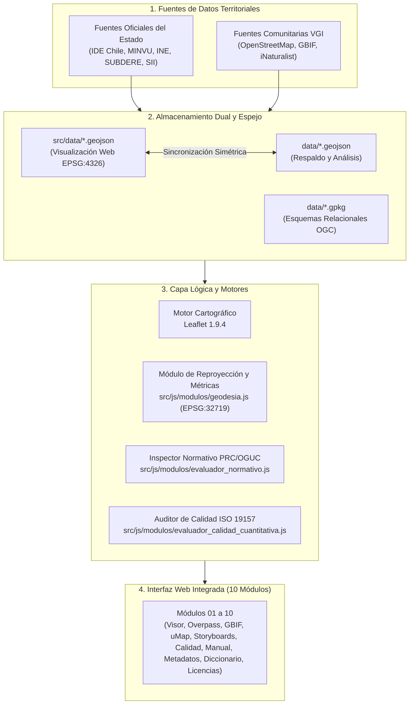

# Manual de Actualización, Arquitectura, Integridad y Contribución Técnica — Atlas VGI UAH

**Proyecto Fondecyt Regular Nº 1261256 · Departamento de Geografía · Universidad Alberto Hurtado (2026)**  
**Documento Maestro de Operaciones y Mantenimiento Integral:** Manual de Actualización Técnica · Arquitectura del Sistema · Protocolo de Integridad y Despliegue · Guía de Contribución Abierta.  
**Versión Consolidada del Sistema:** 132 Capas Operativas (122 Oficiales + 10 VGI) · 146 Descriptores en Diccionario · 10 Módulos Funcionales (`01` al `10`) · 9 Storyboards Territoriales con Modal Interactivo · 5 Dimensiones Analíticas.

---

## 🧭 Índice de Contenidos

1. [Alcance, Fundamentos y Objetivos del Proyecto](#1-alcance-fundamentos-y-objetivos-del-proyecto)
2. [Vías de Participación y Contribución Territorial](#2-vías-de-participación-y-contribución-territorial)
3. [Arquitectura y Tecnologías del Sistema](#3-arquitectura-y-tecnologías-del-sistema)
4. [Estructura del Repositorio y Anatomía de Archivos](#4-estructura-del-repositorio-y-anatomía-de-archivos)
5. [Diseño Visual, Interfaz Táctica y Accesibilidad](#5-diseño-visual-interfaz-táctica-y-accesibilidad)
6. [Motor Cartográfico, Proyecciones y Reproyección de Datos](#6-motor-cartográfico-proyecciones-y-reproyección-de-datos)
7. [Inventario y Catálogo de Capas Territoriales (131 Coberturas)](#7-inventario-y-catálogo-de-capas-territoriales-131-coberturas)
8. [Módulos Funcionales del Atlas (01 al 10)](#8-módulos-funcionales-del-atlas-01-al-10)
9. [Láminas de Análisis Territorial y Storyboards (09 Casos con Modal Interactivo)](#9-láminas-de-análisis-territorial-y-storyboards-09-casos-con-modal-interactivo)
10. [Procedimientos de Mantención y Actualización (Guía Operativa Universal)](#10-procedimientos-de-mantención-y-actualización-guía-operativa-universal)
    - [Procedimiento 1: Ingesta de una nueva capa oficial del Estado (Etapas 1 a 6)](#procedimiento-1-ingesta-de-una-nueva-capa-oficial-del-estado)
    - [Procedimiento 2: Ingesta o actualización de una categoría colaborativa VGI](#procedimiento-2-ingesta-o-actualización-de-una-categoría-colaborativa-vgi)
    - [Procedimiento 3: Actualización de datos existentes e invalidación de caché](#procedimiento-3-actualización-de-datos-existentes-e-invalidación-de-caché)
    - [Procedimiento 4: Incorporación o edición de un Storyboard territorial](#procedimiento-4-incorporación-o-edición-de-un-storyboard-territorial)
    - [Procedimiento 5: Modificación o actualización del Evaluador Normativo](#procedimiento-5-modificación-o-actualización-del-evaluador-normativo)
    - [Procedimiento 6: Modificación del Sistema de Referencia de Coordenadas (SRC)](#procedimiento-6-modificación-del-sistema-de-referencia-de-coordenadas-src)
    - [Procedimiento 7: Modificación de la interfaz gráfica y estilos CSS](#procedimiento-7-modificación-de-la-interfaz-gráfica-y-estilos-css)
    - [Procedimiento 8: Modificación o adición de fichas de Metadatos ISO 19115](#procedimiento-8-modificación-o-adición-de-fichas-de-metadatos-iso-19115)
    - [Procedimiento 9: Modificación de atributos en el Diccionario de Datos (ISO 19110)](#procedimiento-9-modificación-de-atributos-en-el-diccionario-de-datos-iso-19110)
    - [Procedimiento 10: Modificación de plantillas y consultas Overpass QL](#procedimiento-10-modificación-de-plantillas-y-consultas-overpass-ql)
    - [Procedimiento 11: Modificación de parámetros de biodiversidad GBIF](#procedimiento-11-modificación-de-parámetros-de-biodiversidad-gbif)
    - [Procedimiento 12: Integración de proyectos cartográficos uMap](#procedimiento-12-integración-de-proyectos-cartográficos-umap)
    - [Procedimiento 13: Ajuste de ponderadores de calidad multicriterio (WLC / ISO 19157)](#procedimiento-13-ajuste-de-ponderadores-de-calidad-multicriterio-wlc--iso-19157)
    - [Procedimiento 14: Actualización del marco de licencias y catálogos Excel](#procedimiento-14-actualización-del-marco-de-licencias-y-catálogos-excel)
    - [Procedimiento 15: Verificación automatizada pre-despliegue y publicación](#procedimiento-15-verificación-automatizada-pre-despliegue-y-publicación)
11. [Protocolo de Integridad, Pruebas y Despliegue en Producción](#11-protocolo-de-integridad-pruebas-y-despliegue-en-producción)
12. [Diagnóstico y Solución de Problemas Frecuentes](#12-diagnóstico-y-solución-de-problemas-frecuentes)
13. [Marco Legal, Licencias y Protección de Datos](#13-marco-legal-licencias-y-protección-de-datos)
14. [Referencias Bibliográficas y Normativas](#14-referencias-bibliográficas-y-normativas)

---

## 1. Alcance, Fundamentos y Objetivos del Proyecto

### Propósito del documento
Este documento constituye el **Manual Técnico Maestro y Protocolo Operativo Universal** del *Atlas de Información Geográfica Voluntaria para la Gestión Territorial (Atlas VGI · UAH)*. Ha sido concebido como una guía exhaustiva, autosuficiente y rigurosa para desarrolladores, investigadores, estudiantes tesistas, administradores SIG y gestores municipales que requieran auditar, actualizar o modificar cualquier componente del sistema, desde la ingesta de una nueva cobertura geoespacial hasta la reprogramación de parámetros analíticos o el despliegue en producción.

El Atlas articula la infraestructura de cartografía oficial del Estado chileno (IDE Chile, Ministerios, Servicios y Municipios) con la riqueza granular de la Información Geográfica Voluntaria (*Volunteered Geographic Information*, VGI; Goodchild, 2007; Haklay, 2010), facilitando diagnósticos urbanos participativos, trazabilidad de políticas públicas y análisis espacial avanzado.

### Ámbitos y escalas territoriales de estudio
El sistema opera sobre tres escalas espaciales interconectadas:
1. **Escala Micro / Barrial (Piloto Intensivo)**: Barrio Brasil y entorno del Campus Patrimonial de la Universidad Alberto Hurtado (Comuna de Santiago), con foco en habitabilidad, patrimonio, arbolado y vitalidad económica local.
2. **Escala Intermedia / Comunal**: Comuna de Santiago, integrando la zonificación del Plan Regulador Comunal (PRC), sus 10 modificaciones históricas (1990–2024), catastro predial y equipamientos estratégicos.
3. **Escala Macro / Metropolitana**: Gran Santiago y Región Metropolitana, considerando el Plan Regulador Metropolitano de Santiago (PRMS 100), redes de transporte público (Metro, Red Movilidad, UOCT), amenazas naturales (SERNAGEOMIN) y metabolismo de residuos (SUBDERE).

---

## 2. Vías de Participación y Contribución Territorial

El Atlas VGI UAH contempla cuatro vías formales y auditables de contribución:

### Vía 1: Mapeo colaborativo en OpenStreetMap (OSM)
- La comunidad barrial y académica puede cartografiar directamente en OpenStreetMap elementos urbanos (rebajes de vereda, luminarias, especies arbóreas, ciclovías, comercio local).
- Las capas colaborativas del Atlas se sincronizan periódicamente mediante las consultas Overpass QL encapsuladas en el Módulo 02.
- *Guía de etiquetado estándar:* Consulte las categorías documentadas en [`docs/categorias_tematicas_osm.xlsx`](file:///d:/17082025/2026/Practica%20profesional/atlas_vgi_uah/docs/categorias_tematicas_osm.xlsx).

### Vía 2: Reporte o propuesta de datos vía GitHub Issues
- Solicitud de incorporación de nuevas coberturas oficiales, corrección de inconsistencias atributivas o sugerencia de mejoras metodológicas mediante la apertura de un Issue en el repositorio:  
  `https://github.com/santiagogeografia454-sketch/Visualizador-barrio-brasil/issues`
- Debe adjuntarse: enlace a la fuente oficial, ficha de metadatos según estándar ISO 19115 y descripción de pertinencia territorial.

### Vía 3: Carga local de archivos en el visor (Módulo 01)
- Permite a profesionales y actores comunitarios arrastrar y soltar archivos espaciales directamente sobre el lienzo cartográfico del Módulo 01 (`.geojson`, `.kml`, `.gpx` o Shapefiles comprimidos en `.zip`).
- El procesamiento se ejecuta enteramente en la memoria del navegador del cliente, garantizando la privacidad de datos no públicos o en fase de levantamiento.

### Vía 4: Contribución técnica de código y capas mediante Git
- Modificación de código fuente, incorporación de scripts analíticos o ampliación de esquemas de datos mediante bifurcación (*fork*), ramificación de trabajo (*feature branch*) y apertura de un *Pull Request* que supere el 100% de las pruebas automatizadas del protocolo de integridad.

---

## 3. Arquitectura y Tecnologías del Sistema

### Principios de diseño del software
1. **Arquitectura Estática Autónoma (Jamstack)**: Ejecución 100% en el lado del cliente (navegador web), sin dependencias de motores de bases de datos de pago en el servidor ni capas intermedias complejas. Permite despliegue continuo con coste cero ($0 USD) en Netlify y GitHub Pages.
2. **Modularidad Estricta en Vanilla JavaScript (ES6+)**: Implementación del patrón de módulo revelador (IIFE), aislando el estado de cada componente en espacios de nombres globales (`ModuloMapa`, `ModuloIndicadores`, `ModuloGeodesia`, etc.).
3. **Sincronización Simétrica Espejo**: Las carpetas `src/data/` (directorio de compilación y publicación web) y `data/` (directorio raíz de respaldo e intercambio de geodatos) mantienen una paridad absoluta de archivos y sumas de verificación.
4. **Almacenamiento Cartográfico Dual**:
   - **Formato GeoJSON (`EPSG:4326`)**: Formato principal de consumo web ágil, normalizado bajo la especificación RFC 7946 (Butler et al., 2016).
   - **Formato OGC GeoPackage (`.gpkg`)**: Preserva esquemas relacionales complejos de bases del Estado (por ejemplo, los diccionarios de comentarios SQLite de las columnas de SUBDERE RSD 2024).



---

## 4. Estructura del Repositorio y Anatomía de Archivos

```
atlas_vgi_uah/
├── index.html                           <- Redirección raíz a la aplicación
├── package.json                         <- Metadatos del proyecto y scripts auxiliares
├── README.md                            <- Ficha principal del repositorio
├── MANUAL_ACTUALIZACION_ATLAS.md        <- MANUAL MAESTRO DE OPERACIÓN Y ACTUALIZACIÓN
├── MANUAL_USO.md                        <- Manual de usuario del Atlas
├── CONTRIBUTING.md                      <- Guía de contribución para desarrolladores
├── data/                                <- Respaldo y descarga de capas (131 GeoJSONs + GeoPackages)
│   ├── capa_*.geojson                   <- 10 capas temáticas VGI
│   ├── bbdd_*.geojson                   <- 121 capas oficiales del Estado
│   └── CATASTRO_RSD_SUBDERE_2024.gpkg   <- Geodatabase relacional SUBDERE 2024
├── docs/                                <- Documentación técnica de referencia
│   ├── MANUAL_ACTUALIZACION_ATLAS.md    <- Réplica simétrica de documentación
│   ├── MANUAL_USO.md
│   ├── ARQUITECTURA.md
│   ├── TRAZABILIDAD_ACADEMICA.md
│   ├── PROTOCOL_INTEGRIDAD_Y_DESPLIEGUE.md
│   └── catalogo_fuentes_vgi.xlsx        <- Catálogo en Excel de 4 hojas
├── scripts/                             <- Suite de comprobación, metacalidad y despliegue
│   ├── verificar_conteo_capas.py        <- Comprueba la cuadratura de 131 capas y 140 descriptores
│   ├── verificar_integridad_despliegue.py <- Comprueba sintaxis GeoJSON y simetría entre carpetas
│   ├── analisis_metacalidad.py          <- Recalcula el Índice Global de MetaCalidad (ISO 19115/19157)
│   └── generar_catalogos_excel.py       <- Regenera matrices .xlsx a partir del código activo
└── src/                                 <- Aplicación web completa publicada en producción
    ├── index.html                       <- Estructura HTML5 de los 10 módulos funcionales
    ├── css/
    │   └── estilos.css                  <- Hojas de estilo táctico oscuro, variables y componentes
    ├── data/                            <- Capas operativas de visualización web (131 GeoJSONs)
    ├── docs/                            <- Documentación disponible para descarga web
    └── js/
        ├── app.js                       <- Orquestador central del ciclo de vida y navegación
        └── modulos/
            ├── mapa.js                  <- Inicialización de Leaflet, capas base y overlays
            ├── geodesia.js              <- Encapsulación de reproyección y cálculos métricos (EPSG:32719)
            ├── ide_chile.js             <- Catálogo formal de las 121 capas oficiales del Estado
            ├── osm.js                   <- Constructor y ejecutor de consultas Overpass QL
            ├── gbif.js                  <- Conector con la API de GBIF / Darwin Core
            ├── umap.js                  <- Integración y vinculación de mapas uMap
            ├── indicadores_analisis.js  <- 5 dimensiones analíticas y 9 storyboards interactivos
            ├── evaluador_normativo.js   <- Motor del Plan Regulador Comunal de Santiago y OGUC
            ├── evaluador_calidad_cuantitativa.js <- Evaluación ISO 19157 y combinación lineal AHP
            ├── ohsome.js                <- Conector con la API de series temporales de HeiGIT
            ├── manual.js                <- Manual interactivo en la aplicación web
            ├── metadatos.js             <- Generador de fichas de metadatos ISO 19115 / ISO 19139
            └── diccionario.js           <- Diccionario de 140 descriptores técnicos (ISO 19110)
```

---

## 5. Diseño Visual, Interfaz Táctica y Accesibilidad

### Distribución de la pantalla principal
- **Cabecera de Navegación**: Barra superior compacta con selector de los 10 módulos funcionales (`01` al `10`), indicadores de estado y control de visualización.
- **Área Central de Trabajo**: Lienzo cartográfico interactivo 2D/3D con controles de zoom, capas base, escala gráfica y barra de herramientas contextuales.
- **Panel Lateral Dinámico**: Módulos plegables con formularios de consulta, tablas de atributos, fichas normativas y paneles analíticos.
- **Pie de Estado**: Indicador de coordenadas, escala de visualización, Bbox geodésico y atribución cartográfica obligatoria.

### Paleta de colores y componentes visuales
La interfaz adopta una estética táctica en tonos oscuros (*dark mode*), reduciendo la fatiga visual en sesiones prolongadas:
- Fondo primario: `--fondo-principal: #0b0f19`
- Fondo de tarjetas: `--fondo-tarjeta: #111827`
- Acento de acción: `--acento-azul: #38bdf8`
- Alertas y advertencias: `--alerta-ambar: #fbbf24`
- Éxito y confirmación: `--exito-esmeralda: #34d399`
- Líneas divisorias: `--linea-tarjeta: rgba(255, 255, 255, 0.08)`

### Insignias de geometría estándar
- 🟢 **Punto**: `PUNTUAL` (luminarias, arbolado, equipamientos puntuales).
- 🟠 **Línea**: `LINEAL` (red vial, ciclovías, redes de servicios).
- 🟣 **Polígono**: `POLIGONAL` (manzanas censales, predios, áreas verdes, zonas de zonificación PRC).

---

## 6. Motor Cartográfico, Proyecciones y Reproyección de Datos

### Visualización cartográfica en Leaflet
El visor se inicializa en [`src/js/modulos/mapa.js`](file:///d:/17082025/2026/Practica%20profesional/atlas_vgi_uah/src/js/modulos/mapa.js) con los siguientes parámetros estándar:
- **Centro cartográfico**: Latitud `-33.4410`, Longitud `-70.6660` (Plaza Brasil).
- **Escala de inicio**: Nivel de zoom `15` (escala barrial).
- **Límites de visualización**: Área restringida a la Región Metropolitana (`[[-33.9, -71.2], [-33.0, -70.1]]`).
- **Capas base interoperables**: CartoDB DarkMatter (predeterminada), OpenStreetMap Standard y Satélite ESRI.

### Almacenamiento de datos espaciales
- Las capas vectoriales del sistema se almacenan de manera nativa en coordenadas geográficas WGS84 (`EPSG:4326`) en formato GeoJSON dentro de los directorios `src/data/*.geojson` y `data/*.geojson`.
- Este estándar garantiza plena interoperabilidad con estándares web (RFC 7946), visores OGC y herramientas de escritorio SIG como QGIS o ArcGIS Pro.

### Módulo de reproyección y métricas territoriales
- Para evitar las distorsiones métricas de superficie y distancia que genera la proyección Web Mercator (`EPSG:3857`) en latitudes medias como Santiago ($-33,4^\circ$), el Atlas cuenta con un módulo de reproyección y procesamiento métrico centralizado en [`src/js/modulos/geodesia.js`](file:///d:/17082025/2026/Practica%20profesional/atlas_vgi_uah/src/js/modulos/geodesia.js).
- El cálculo métrico euclidiano de superficies ($m^2$, hectáreas, $km^2$) y distancias lineales para la Región Metropolitana se ejecuta en **WGS 84 / UTM Zona 19 Sur (`EPSG:32719`)**, el sistema oficial de referencia adoptado por el Instituto Geográfico Militar (IGM) y la IDE Chile (ISO 19111).
- Toda la lógica algorítmica de transformación de coordenadas y cálculo geométrico se encuentra encapsulada en dicho archivo. Para modificar el Sistema de Referencia de Coordenadas, el huso UTM o la zona de proyección, consulte el [Procedimiento 6](#procedimiento-6-modificación-del-sistema-de-referencia-de-coordenadas-src) de este manual.

---

## 7. Inventario y Catálogo de Capas Territoriales (131 Coberturas)

### Cuadratura general de capas
El sistema cuenta con un universo cerrado y auditado de **132 capas operativas**:
- **122 Capas Oficiales del Estado de Chile**: Custodiadas por ministerios, servicios públicos y municipios (MINVU, INE, MTT, SUBDERE, SII, MMA, SERNAGEOMIN, CMN, MINSAL, Asesoría Urbana).
- **10 Categorías Colaborativas VGI**: Extraídas desde OpenStreetMap y registros biológicos de GBIF / iNaturalist.

### Clasificación en cinco dimensiones analíticas
1. **01 · Dimensión Sociodemográfica (19 capas)**: Manzanas Censo 2024 (INE), densidad habitacional, jefatura de hogar, distribución etaria, hogares hacinados y migración.
2. **02 · Dimensión Socioeconómica (18 capas)**: Inversión pública comunal (BIP/MDSF), comercio minorista, ferias libres, patentes municipales y avalúo fiscal predial (SII).
3. **03 · Dimensión Socioambiental (36 capas)**: Cobertura arbórea, plazas y parques públicos, islas de calor, biodiversidad biológica (GBIF), mapas de ruido ambiental (MMA) y el **Catastro Nacional de Residuos Sólidos Domiciliarios 2024 (13 capas SUBDERE)**.
4. **04 · Dimensión Sociosanitaria (3 capas)**: Centros de atención primaria y hospitalaria (MINSAL/DEIS), territorios operacionales de salud y vulnerabilidad sociosanitaria (RSH).
5. **05 · Dimensión Sociourbana o Habitabilidad (55 capas)**: Zonificación del Plan Regulador Comunal (PRC Santiago), zonas de conservación histórica (ZCH/ICH), cités, pasajes peatonales, red de transporte público (Metro, Red Movilidad, paraderos DTPM, semáforos UOCT) y redes de ciclovías.

### Diccionario técnico de datos
El Módulo 09 del Atlas contiene la ficha técnica de los **140 descriptores de atributos** normalizados bajo el estándar **ISO 19110:2016**, detallando tipo de dato, nombre canónico, rango de valores admisibles y significado semántico.

---

## 8. Módulos Funcionales del Atlas (01 al 10)

| Módulo | Denominación en Interfaz | Archivos Fuente Principales | Descripción Funcional y Alcance |
| :---: | :--- | :--- | :--- |
| **`01`** | **Visor y Atlas VGI** | `src/js/app.js`<br>`src/js/modulos/mapa.js`<br>`src/js/modulos/evaluador_normativo.js` | Lienzo cartográfico multiescalar con las 132 capas operativas. Incluye cálculo en tiempo real del **Índice de Calidad VGI (ICV)**, delimitación dinámica de Bbox métrico en UTM 19S, importación local de archivos espaciales e **Inspector Normativo PRC/OGUC** que emite el Certificado CIN-VGI e integra el expediente histórico de las 10 modificaciones al PRC de Santiago (1990–2024). |
| **`02`** | **Consultas Overpass** | `src/js/modulos/osm.js` | Constructor visual y consola de ejecución en lenguaje Overpass QL para la extracción en tiempo real de geometrías, nodos y etiquetas desde los servidores globales de OpenStreetMap. |
| **`03`** | **Biodiversidad GBIF** | `src/js/modulos/gbif.js` | Conector directo con la API pública de GBIF y registros de iNaturalist para la consulta y visualización de ocurrencias de flora, fauna y funga urbana bajo el estándar Darwin Core. |
| **`04`** | **Cartografía UMAP** | `src/js/modulos/umap.js` | Espacio de integración e incrustación de visores participativos uMap para talleres comunitarios, mapeos colaborativos barriales y cartografía social. |
| **`05`** | **Indicadores y Storyboards** | `src/js/modulos/indicadores_analisis.js` | Panel analítico que organiza las 131 capas en las **5 Dimensiones Analíticas** y despliega **9 Storyboards territoriales** con indicadores clave (KPIs), tablas comparativas, diagramas vectoriales y **modal interactivo de ampliación de imágenes y gráficos**. |
| **`06`** | **Calidad e ICV** | `src/js/modulos/ohsome.js`<br>`src/js/modulos/evaluador_calidad_cuantitativa.js` | Evaluación cuantitativa de calidad bajo el estándar **ISO 19157:2013** mediante combinación lineal ponderada (WLC / AHP), series temporales históricas con la API ohsome (HeiGIT) y auditoría de conjuntos de cambios con OSMCha. |
| **`07`** | **Manual de uso y Actualización** | `src/js/modulos/manual.js` | Módulo de documentación interactiva embebida en la aplicación web, que articula el Manual de Uso, el Manual de Actualización Técnica y las referencias metodológicas. |
| **`08`** | **Metadatos ISO 19115** | `src/js/modulos/metadatos.js` | Generador y visualizador de registros normalizados de metadatos espaciales bajo las normas **ISO 19115-1:2014** e **ISO 19139:2007** (esquemas XML y JSON exportables). |
| **`09`** | **Diccionario (131 capas)** | `src/js/modulos/diccionario.js` | Catálogo de atributos y catálogo de objetos geográficos bajo la norma **ISO 19110:2016** para los 140 descriptores técnicos del sistema, incluyendo los diccionarios de columnas de las bases GeoPackage de SUBDERE. |
| **`10`** | **Licencias y Catálogos** | `src/index.html`<br>`docs/*.xlsx` | Marco normativo y legal de licenciamiento abierto (ODbL 1.0, CC BY-SA 4.0, GNU AGPLv3, Leyes Nº 20.285 y 19.628) y descarga directa de catálogos y matrices en formato Excel. |

---

## 9. Láminas de Análisis Territorial y Storyboards (09 Casos con Modal Interactivo)

El **Módulo 05** integra 9 láminas de análisis socioterritorial profundo sobre el Barrio Brasil y la Comuna de Santiago. Cada lámina combina fundamentación teórica, análisis cuantitativo multivariado, indicadores clave (KPIs), tablas sintéticas y material visual interactivo:

1. **Lámina 1 · Habitar, Altura y Presión sobre el Tejido Patrimonial**: Analiza la coexistencia entre inmuebles patrimoniales protegidos (ZCH/ICH) y el avance de la densificación habitacional en altura.
2. **Lámina 2 · Movilidad Sustentable y Caminabilidad Peatonal**: Evalúa la accesibilidad hacia estaciones de Metro, ciclovías protegidas y cruces semaforizados UOCT.
3. **Lámina 3 · El Oasis Verde del Barrio Brasil: Cobertura Arbórea y Biodiversidad**: Cuantifica la dotación de áreas verdes públicas y la red de arbolado urbano frente a islas de calor y mapas de ruido.
4. **Lámina 4 · Campus UAH y Vitalidad Económica Cotidiana**: Mapea el ecosistema universitario UAH y su sinergia con el comercio minorista, librerías, cafeterías y servicios de proximidad.
5. **Lámina 5 · Cuidados, Envejecimiento y Salud Comunitaria**: Cruza datos de población adulta mayor, red asistencial primaria (CESFAM) y dependencia funcional del Registro Social de Hogares.
6. **Lámina 6 · Metabolismo Urbano y Gestión de Residuos Sólidos Domiciliarios (SUBDERE RSD 2024)**: Examina las 13 capas de infraestructura de reciclaje, puntos limpios y disposición final de residuos en la Región Metropolitana.
7. **Lámina 7 · Treinta Años de Disputa Normativa: Las 10 Modificaciones al PRC en Barrio Brasil (1990–2024)**: Reconstruye la cronología de enmiendas al Plan Regulador Comunal de Santiago y sus expedientes oficiales de Asesoría Urbana.
8. **Lámina 8 · Dinámicas Demográficas y Censo 2024: Densidad, Hogares y Envejecimiento**: Analiza la nueva estructura poblacional del Censo 2024 a nivel de manzana censal, hogares unipersonales y distribución etaria.
9. **Lámina 9 · Morfología Urbana, Segmentos Viales y Vértices Espaciales**: Modela la geometría urbana, segmentación de ejes viales y densidad de nodos espaciales para el estudio de la conectividad morfológica.

### Visualizador modal interactivo para figuras y gráficos
- **Ampliación con un clic**: Todas las figuras, gráficos comparativos, diagramas vectoriales SVG y mapas dentro de los storyboards cuentan con un visor modal interactivo (*lightbox HD*).
- **Interacción**: Al hacer clic sobre cualquier imagen o diagrama, se abre una ventana modal en primer plano que permite apreciar la figura a máxima resolución, con su epígrafe técnico y controles de cierre (botón dedicado, tecla `Escape` o clic fuera del marco).

---

## 10. Procedimientos de Mantención y Actualización (Guía Operativa Universal)

Esta sección constituye la guía operativa paso a paso para modificar o parametrizar cualquier aspecto del Atlas VGI.

### Procedimiento 1: Ingesta de una nueva capa oficial del Estado
Para incorporar una nueva capa cartográfica (ej. `bbdd_122.geojson`):

#### Paso 1. Preparación y reproyección del archivo
1. Compruebe que los datos de origen provengan de un repositorio institucional del Estado (IDE Chile, GeoNodo, ministerios o municipios).
2. Asegúrese de que el archivo vectorial esté exportado estrictamente en formato **GeoJSON (RFC 7946)** con codificación **UTF-8** y coordenadas geográficas elipsoidales **WGS84 (`EPSG:4326`)**.
3. Verifique que no contenga geometrías corruptas ni claves atributivas vacías.

#### Paso 2. Almacenamiento simétrico en las carpetas
Copie el archivo exactamente con el mismo nombre en ambos directorios:
- En el directorio de publicación web: `src/data/bbdd_122.geojson`
- En el directorio de respaldo y descarga: `data/bbdd_122.geojson`

#### Paso 3. Registro en el catálogo oficial (`src/js/modulos/ide_chile.js`)
Agregue la definición de la cobertura en el objeto `CAPAS_OFICIALES`:
```javascript
bbdd_122: {
  id: "bbdd_122",
  nombre: "Nombre Oficial de la Capa",
  archivo: "bbdd_122.geojson",
  num_bbdd: 122,
  institucion: "Institución Custodia",
  tipo_geometria: "POLIGONAL", // "PUNTUAL" | "LINEAL" | "POLIGONAL"
  color_borde: "#38bdf8",
  color_relleno: "#0284c7",
  opacidad: 0.7,
  descripcion: "Descripción sintética y alcance territorial de la capa.",
  fuente_url: "https://www.ide.cl/...",
  licencia: "Open Data / Creative Commons Atribución 4.0"
}
```

#### Paso 4. Incorporación del botón selector en la interfaz (`src/index.html`)
Localice la sección de botones de capas oficiales en `src/index.html` y agregue el elemento interactivo:
```html
<button type="button" class="chip-oficial" id="btn-oficial-bbdd_122" data-capa="bbdd_122" title="Institución Custodia">
  <span class="punto-color" style="background:#38bdf8;"></span>
  <span class="nombre-capa">122. Nombre Oficial de la Capa</span>
  <span class="insignia-geo pol">POL</span>
</button>
```

#### Paso 5. Asociación a dimensión analítica y diccionario de datos
1. En [`src/js/modulos/indicadores_analisis.js`](file:///d:/17082025/2026/Practica%20profesional/atlas_vgi_uah/src/js/modulos/indicadores_analisis.js), agregue el ID de la capa (`bbdd_122`) en la dimensión temática correspondiente (`dim-01` a `dim-05`).
2. En [`src/js/modulos/diccionario.js`](file:///d:/17082025/2026/Practica%20profesional/atlas_vgi_uah/src/js/modulos/diccionario.js), documente los atributos de la capa bajo el estándar ISO 19110.

#### Paso 6. Actualización de umbrales en scripts de auditoría
Actualice el número total de capas esperadas (de 131 a 132) en:
- `scripts/verificar_conteo_capas.py`
- `scripts/verificar_integridad_despliegue.py`
- `scripts/analisis_metacalidad.py`

---

### Procedimiento 2: Ingesta o actualización de una categoría colaborativa VGI
1. Las 10 categorías VGI (`cat01_educacion` a `cat10_coberturas`) se configuran en el archivo [`src/config/config.json`](file:///d:/17082025/2026/Practica%20profesional/atlas_vgi_uah/src/config/config.json) bajo el arreglo `categorias_osm`.
2. Para actualizar los datos de una categoría, ejecute una consulta en el Módulo 02 (Overpass QL) o exporte el resultado mediante el script `scripts/extractor_vgi.py`.
3. Guarde el archivo resultante de manera simétrica en `src/data/capa_catXX_nombre.geojson` y `data/capa_catXX_nombre.geojson`.
4. Si modifica etiquetas o filtros, documente los cambios en [`docs/categorias_tematicas_osm.xlsx`](file:///d:/17082025/2026/Practica%20profesional/atlas_vgi_uah/docs/categorias_tematicas_osm.xlsx).

---

### Procedimiento 3: Actualización de datos existentes e invalidación de caché
Cuando se actualizan datos geométricos o atributos en un archivo GeoJSON existente sin cambiar su nombre:
1. Reemplace el archivo tanto en `src/data/` como en `data/`.
2. En [`src/js/modulos/mapa.js`](file:///d:/17082025/2026/Practica%20profesional/atlas_vgi_uah/src/js/modulos/mapa.js), actualice la constante de versión de caché:
   ```javascript
   const VERSION_DATOS = '20261020_01'; // Formato YYYYMMDD_XX
   ```
3. Esta cadena se adjunta a todas las peticiones `fetch('src/data/' + archivo + '?v=' + VERSION_DATOS)`, forzando al navegador del cliente a descargar la versión fresca e ignorar la memoria caché previa.

---

### Procedimiento 4: Incorporación o edición de un Storyboard territorial
Para editar o agregar una lámina de análisis en el **Módulo 05**:
1. Abra [`src/js/modulos/indicadores_analisis.js`](file:///d:/17082025/2026/Practica%20profesional/atlas_vgi_uah/src/js/modulos/indicadores_analisis.js).
2. Localice el arreglo `STORYBOARDS_DATA`.
3. Para cada lámina, defina la estructura canónica:
   - `id`: Identificador único (ej. `storyboard-mi-tema`).
   - `titulo` y `subtitulo`: Encabezado descriptivo y marco temporal.
   - `dimension`: Código de la dimensión vinculada (`dim-01` a `dim-05`).
   - `capas_relacionadas`: Lista de IDs de capas a activar en el mapa (`['bbdd_01', 'cat08_espaciopublico']`).
   - `kpis`: Tarjetas con métricas cuantitativas clave (`valor`, `etiqueta`, `tendencia`).
   - `analisis_html`: Texto estructurado con diagnósticos espaciales, tablas comparativas y referencias APA.
   - `grafico_svg` o `imagenes`: Diagramas vectoriales o imágenes asociadas.
4. Para habilitar el zoom interactivo en una figura, asigne la clase CSS `figura-ampliable` o el atributo `onclick="ModuloIndicadores.abrirModalFigura(this)"`.

---

### Procedimiento 5: Modificación o actualización del Evaluador Normativo
El **Inspector Normativo PRC/OGUC** se encuentra implementado en [`src/js/modulos/evaluador_normativo.js`](file:///d:/17082025/2026/Practica%20profesional/atlas_vgi_uah/src/js/modulos/evaluador_normativo.js):
1. **Actualización de Zonas Normativas**: Si se promulga una nueva ordenanza comunal, actualice la matriz `ZONIFICACION_PRC_SANTIAGO` con las zonas vigentes (ej. `ZCH B1`, `Zona A`, `Zona B`), coeficientes de constructibilidad, ocupación de suelo y usos permitidos/prohibidos según el Artículo 2.1.24 de la OGUC.
2. **Incorporación de Enmiendas y Modificaciones**: El expediente histórico de las 10 modificaciones al PRC de Santiago (1990–2024) se mantiene en el arreglo `MODIFICACIONES_HISTORICAS_PRC`. Para incorporar una nueva modificación (ej. Modificación N° 11), agregue el objeto correspondiente con: número, decreto de promulgación, fecha de publicación en el Diario Oficial, materia regulada y enlace al expediente oficial de Asesoría Urbana.

---

### Procedimiento 6: Modificación del Sistema de Referencia de Coordenadas (SRC)
Si el Atlas requiere ser adaptado a otra región de Chile o a otro país con un huso cartográfico distinto:
1. **Configuración del Huso y Parámetros Métricos**: Abra [`src/js/modulos/geodesia.js`](file:///d:/17082025/2026/Practica%20profesional/atlas_vgi_uah/src/js/modulos/geodesia.js). Modifique las constantes de proyección asignadas para UTM:
   - Huso UTM correspondiente (por ejemplo, Zona 18S para el norte de Chile, o Zona 19S actual para Santiago).
   - Meridiano central correspondiente.
2. **Ajuste del Centro y Bbox del Visor**: En [`src/js/modulos/mapa.js`](file:///d:/17082025/2026/Practica%20profesional/atlas_vgi_uah/src/js/modulos/mapa.js), ajuste las variables `CENTRO_INICIAL`, `ZOOM_INICIAL` y `LIMITES_MAXIMOS` (`maxBounds`) con las coordenadas geográficas de la nueva área de estudio.
3. **Parámetros del Bbox Territorial**: En [`src/config/config.json`](file:///d:/17082025/2026/Practica%20profesional/atlas_vgi_uah/src/config/config.json), modifique el polígono de encuadre por defecto (`bbox_estudio`).

---

### Procedimiento 7: Modificación de la interfaz gráfica y estilos CSS
1. Todos los estilos visuales, paleta cromática, diseño responsivo y efectos se encuentran centralizados en [`src/css/estilos.css`](file:///d:/17082025/2026/Practica%20profesional/atlas_vgi_uah/src/css/estilos.css).
2. Para cambiar los colores de la aplicación, edite las variables del bloque `:root` al inicio del archivo CSS.
3. Conserve siempre un ratio de contraste mínimo de `4.5:1` para texto estándar y `3:1` para elementos de interfaz gráfica, cumpliendo la pauta WCAG 2.1 nivel AA.

---

### Procedimiento 8: Modificación o adición de fichas de Metadatos ISO 19115
1. Abra [`src/js/modulos/metadatos.js`](file:///d:/17082025/2026/Practica%20profesional/atlas_vgi_uah/src/js/modulos/metadatos.js).
2. Localice la función `obtenerMetadatosCapa(idCapa)`.
3. Defina los campos estándar según ISO 19115-1:2014: título, resumen temático, propósito, linaje o procedencia de los datos, fecha de última actualización, frecuencia de mantenimiento, restricciones legales de uso y punto de contacto institucional.

---

### Procedimiento 9: Modificación de atributos en el Diccionario de Datos (ISO 19110)
1. Abra [`src/js/modulos/diccionario.js`](file:///d:/17082025/2026/Practica%20profesional/atlas_vgi_uah/src/js/modulos/diccionario.js).
2. Localice el catálogo `DESCRIPTORES_ATRIBUTOS`.
3. Para cada campo o descriptor técnico, consigne:
   - `codigo_atributo`: Nombre del campo en la tabla de atributos (ej. `COMUNA`, `ZONA_PRC`, `SUPERFICIE_M2`).
   - `etiqueta_legible`: Nombre descriptivo en lenguaje natural.
   - `tipo_dato`: `Texto`, `Entero`, `Flotante`, `Fecha` o `Booleano`.
   - `definicion`: Explicación conceptual rigurosa.
   - `origen_fuente`: Institución que genera y custodia la variable.

---

### Procedimiento 10: Modificación de plantillas y consultas Overpass QL
1. Abra [`src/js/modulos/osm.js`](file:///d:/17082025/2026/Practica%20profesional/atlas_vgi_uah/src/js/modulos/osm.js).
2. Localice el arreglo `PLANTILLAS_CONSULTAS_OSM`.
3. Defina o modifique las consultas Overpass QL especificando etiquetas (`key=value`), tipos de entidades (`node`, `way`, `relation`), encuadre espacial y salida en formato JSON `[out:json]`.

---

### Procedimiento 11: Modificación de parámetros de biodiversidad GBIF
1. Abra [`src/js/modulos/gbif.js`](file:///d:/17082025/2026/Practica%20profesional/atlas_vgi_uah/src/js/modulos/gbif.js).
2. Ajuste los endpoints de consulta a la API de GBIF (`https://api.gbif.org/v1/occurrence/search`), los códigos de taxones prioritarios (Aves, Plantae, Insecta, Fungi) y los filtros de validez temporal y coordenadas geográficas.

---

### Procedimiento 12: Integración de proyectos cartográficos uMap
1. Abra [`src/js/modulos/umap.js`](file:///d:/17082025/2026/Practica%20profesional/atlas_vgi_uah/src/js/modulos/umap.js).
2. Modifique o incorpore enlaces a proyectos colaborativos uMap en el arreglo `MAPAS_UMAP_CONFIG`, proveyendo título del taller o proyecto, URL de inserción (*iframe*) y descripción metodológica de la sesión de mapeo social.

---

### Procedimiento 13: Ajuste de ponderadores de calidad multicriterio (WLC / ISO 19157)
1. Abra [`src/js/modulos/evaluador_calidad_cuantitativa.js`](file:///d:/17082025/2026/Practica%20profesional/atlas_vgi_uah/src/js/modulos/evaluador_calidad_cuantitativa.js).
2. Ajuste las ponderaciones asignadas a las dimensiones de calidad bajo la norma ISO 19157:2013 (Completitud, Consistencia Lógica, Exactitud Posicional, Exactitud Temática y Calidad Temporal).
3. Asegúrese de que la suma de los ponderadores sea exactamente igual a `1.0` (100%).

---

### Procedimiento 14: Actualización del marco de licencias y catálogos Excel
1. Si se actualiza una licencia de datos o un marco legal, modifique la sección correspondiente en `src/index.html` (Módulo 10).
2. Para regenerar los catálogos en formato Excel (`docs/*.xlsx` y `src/docs/*.xlsx`), ejecute desde la raíz del proyecto:
   ```bash
   python scripts/generar_catalogos_excel.py
   ```

---

### Procedimiento 15: Verificación automatizada pre-despliegue y publicación
Antes de realizar cualquier confirmación (*commit*) en Git o publicar a producción, ejecute estrictamente el protocolo de pruebas:
```bash
# 1. Comprueba la cuadratura de 131 capas y 140 descriptores
python scripts/verificar_conteo_capas.py

# 2. Comprueba la integridad física, sintaxis GeoJSON y simetría entre data/ y src/data/
python scripts/verificar_integridad_despliegue.py

# 3. Recalcula el Índice Global de MetaCalidad bajo normas ISO
python scripts/analisis_metacalidad.py
```
Si todas las pruebas concluyen con éxito (`100% OK`), proceda a la confirmación y publicación en producción:
```bash
git add -A
git commit -m "actualizacion: descripcion detallada del cambio realizado"
git push origin main
```
El repositorio de GitHub activará automáticamente el despliegue continuo hacia los servidores de producción en Netlify.

---

## 11. Protocolo de Integridad, Pruebas y Despliegue en Producción

### Reglas de integridad estructural obligatorias
1. **Paridad Simétrica**: Ningún archivo `.geojson` puede existir en `src/data/` sin existir de manera idéntica en `data/`, y viceversa.
2. **Sintaxis Estricta GeoJSON**: Los archivos deben ser parseables por `json.loads()` de Python y por `JSON.parse()` del navegador, cumpliendo la especificación RFC 7946.
3. **Ausencia de Punteros LFS Rotos**: Los archivos GeoJSON deben ser texto plano JSON real y no punteros residuales de Git LFS (`oid sha256:...`).
4. **Validación Sintáctica de JavaScript**: Todos los módulos en `src/js/` y `src/js/modulos/` deben superar la comprobación de sintaxis de Node.js (`node -c archivo.js`).

---

## 12. Diagnóstico y Solución de Problemas Frecuentes

| Síntoma o Error Detectado | Causa Técnica Probable | Procedimiento de Solución |
| :--- | :--- | :--- |
| **Error 404 al cargar una capa** | El archivo GeoJSON no se encuentra en `src/data/` o el nombre difiere en `ide_chile.js`. | Verifique que el archivo exista en `src/data/` y que la propiedad `archivo` en `ide_chile.js` coincida exactamente. |
| **La capa se visualiza desplazada en el mapa** | Coordenadas invertidas (latitud/longitud) o sistema de coordenadas distinto de WGS84. | Abra el archivo en QGIS y expórtelo en `EPSG:4326` con coordenadas en orden `[longitud, latitud]`. |
| **El navegador muestra datos antiguos tras actualizar** | La memoria caché local del navegador retiene la versión anterior del archivo. | Incremente la variable `VERSION_DATOS` en `src/js/modulos/mapa.js` según el [Procedimiento 3](#procedimiento-3-actualización-de-datos-existentes-e-invalidación-de-caché). |
| **Fallo en scripts de verificación pre-despliegue** | Discrepancia en el conteo de capas o falta de descriptor en el diccionario de datos. | Ejecute `python scripts/verificar_conteo_capas.py` para identificar la capa no catalogada y agréguela a `diccionario.js`. |

---

## 13. Marco Legal, Licencias y Protección de Datos

### Régimen de licenciamiento abierto
El sistema opera bajo un marco armónico de licencias libres que protege la autoría académica y fomenta la reutilización ciudadana:
- **Datos de OpenStreetMap**: Licencia Abierta de Bases de Datos (**ODbL 1.0**) de la Fundación OpenStreetMap.
- **Cartografía Oficial del Estado de Chile**: Términos de libre acceso y reutilización según la Política Nacional de Información Geoespacial (PNIG) e IDE Chile.
- **Código Fuente del Visualizador y Scripts**: Licencia **GNU AGPLv3** (Affero General Public License), garantizando que las modificaciones derivadas se mantengan abiertas y con código disponible.
- **Contenidos Educativos, Manuales y Storyboards**: Licencia **Creative Commons Atribución-CompartirIgual 4.0 Internacional (CC BY-SA 4.0)**.

### Transparencia pública y protección de la vida privada
- Toda la información oficial incorporada se fundamenta en la **Ley N° 20.285 sobre Acceso a la Información Pública**.
- Ninguna capa contiene datos personales sensibles no agregados, en estricto cumplimiento de la **Ley N° 19.628 sobre Protección de la Vida Privada**.

---

## 14. Referencias Bibliográficas y Normativas

- Butler, H., Daly, M., Doyle, A., Gillies, S., Hagen, S., & Schaub, T. (2016). *The GeoJSON Format* (RFC 7807/7946). Internet Engineering Task Force (IETF). https://doi.org/10.17487/RFC7946
- Goodchild, M. F. (2007). Citizens as sensors: The world of volunteered geography. *GeoJournal*, 69(4), 211–221. https://doi.org/10.1007/s10708-007-9111-y
- Haklay, M. (2010). How good is volunteered geographical information? A case study of OpenStreetMap data. *Environment and Planning B: Planning and Design*, 37(4), 682–703. https://doi.org/10.1068/b35097
- Instituto Geográfico Militar de Chile [IGM]. (2020). *Normas y especificaciones técnicas para levantamientos cartográficos*. IGM Chile.
- International Organization for Standardization. (2014). *Geographic information — Metadata* (ISO Standard No. 19115-1:2014). ISO. https://www.iso.org/standard/53798.html
- International Organization for Standardization. (2013). *Geographic information — Data quality* (ISO Standard No. 19157:2013). ISO. https://www.iso.org/standard/32575.html
- International Organization for Standardization. (2016). *Geographic information — Methodology for feature cataloguing* (ISO Standard No. 19110:2016). ISO. https://www.iso.org/standard/57303.html
- International Organization for Standardization. (2019). *Geographic information — Referencing by coordinates* (ISO Standard No. 19111:2019). ISO. https://www.iso.org/standard/74033.html
