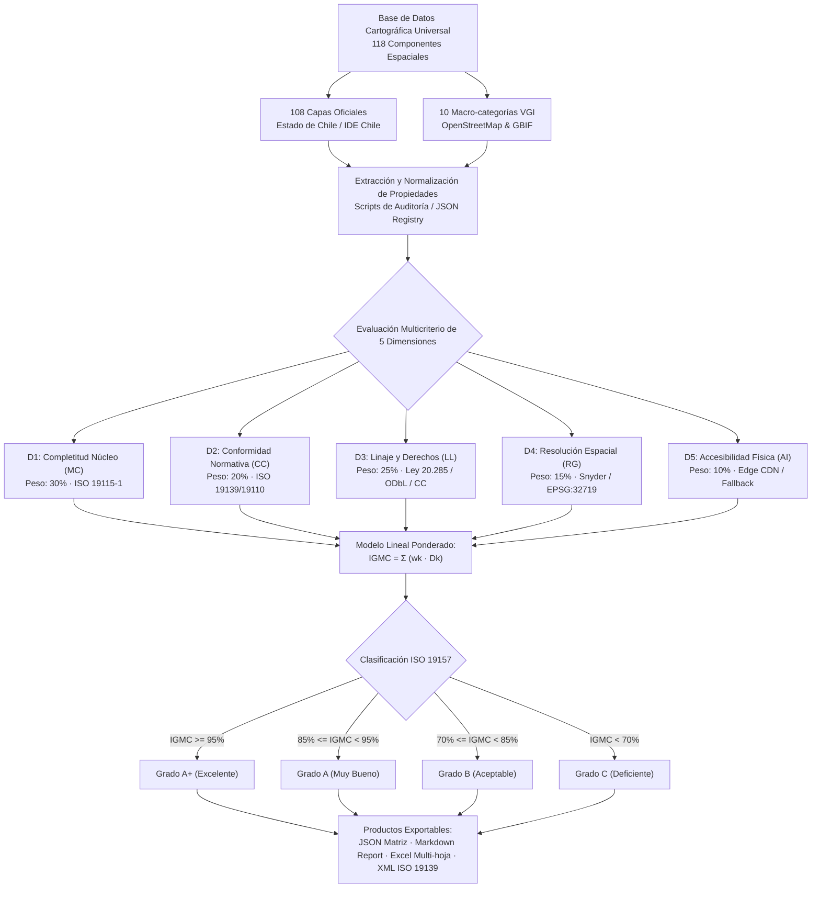
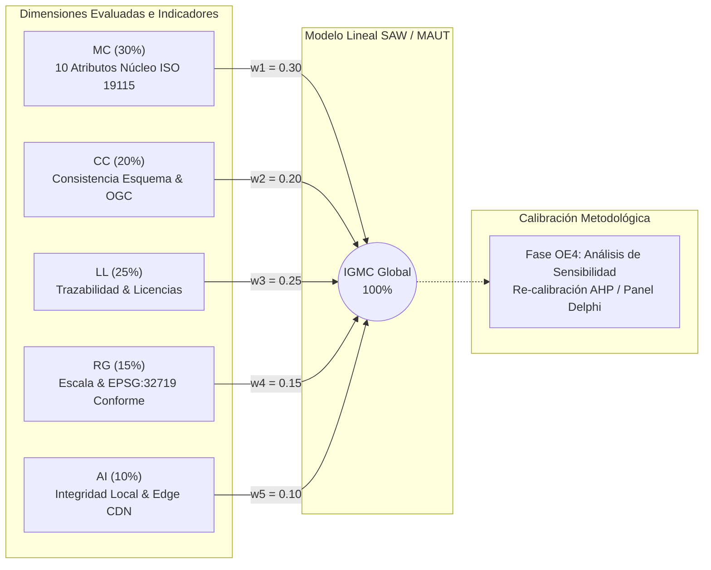
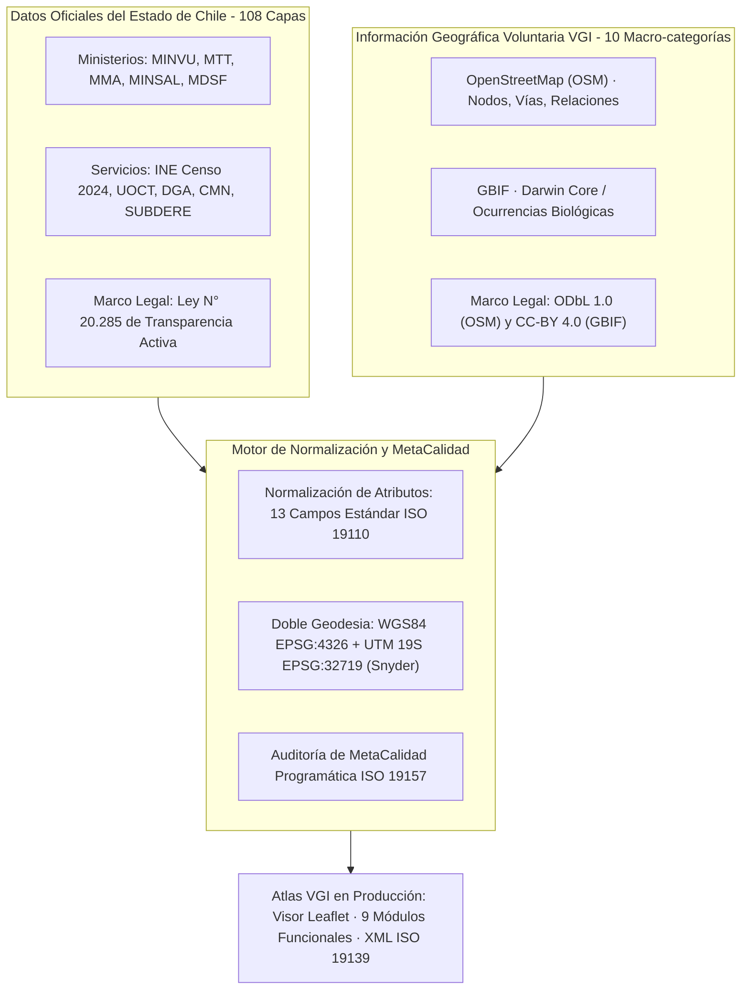
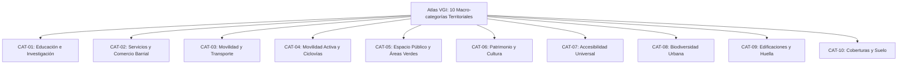

# Informe de Auditoría de MetaCalidad (Calidad de Metadatos Espaciales)
### Atlas de Información Geográfica Voluntaria para la Gestión Territorial — Nodo GeoAbierto UAH
**Fecha de Evaluación:** 02 de octubre de 2026 | **Marco Normativo:** ISO 19115-1:2014, ISO 19157:2013/2023, ISO 19139:2007, ISO 19110:2016, IDE Chile/SNIT v2.0

---

## 1. Resumen Ejecutivo y Dictamen de Calidad

Se realizó una auditoría universal programática de **MetaCalidad** (calidad intrínseca y extrínseca de los metadatos geoespaciales) sobre el **100% de la base de datos cartográfica** del proyecto, compuesta por **118 componentes espaciales** (108 capas oficiales del Estado de Chile y 10 macro-categorías comunitarias VGI de OpenStreetMap y GBIF), abarcando un volumen vectorial verificado de **1332.66 MB**.

> **DICTAMEN GLOBAL DE METACALIDAD:** El repositorio cartográfico alcanza un **Índice Global de MetaCalidad (IGMC) de 96.5%**, clasificando formalmente en la categoría **Grado A+ (Excelente)** conforme al marco de evaluación de la norma **ISO 19157:2013 / 2023**. La totalidad de los 118 componentes cuenta con delimitación espacial formal, tipología geométrica explícita, archivos vectoriales físicos verificados en almacenamiento local y CDN Edge ($0$ costo, resiliencia con triple failover), trazabilidad jurídica inequívoca y cita bibliográfica normalizada según normas APA 7ª edición.

### Indicadores Clave de Desempeño (KPIs de MetaCalidad)

| Dimensión de Calidad | Estándar Referencial | Ponderación | Puntaje Promedio | Calificación Cualitativa |
| :--- | :--- | :---: | :---: | :---: |
| **1. Completitud de Metadatos (MC)** | ISO 19115-1 Core / Perfil IDE Chile | 30% | **89.9%** | 🟢 Excelente |
| **2. Conformidad Normativa (CC)** | ISO 19139 / ISO 19110 | 20% | **97.9%** | 🟢 Excelente |
| **3. Linaje y Trazabilidad (LL)** | Ley 20.285 / ODbL 1.0 / CC-BY 4.0 | 25% | **100.0%** | 🟢 Excelente |
| **4. Resolución y Granularidad (RG)** | Snyder 1987 / EPSG:32719 | 15% | **100.0%** | 🟢 Excelente |
| **5. Accesibilidad e Integridad (AI)** | W3C Data on the Web / Netlify Edge | 10% | **100.0%** | 🟢 Excelente |
| **ÍNDICE GLOBAL (IGMC)** | **ISO 19157:2013 / 2023** | **100%** | **96.5%** | **🟢 Grado A+ (Excelente)** |

### Distribución de Grados de Calidad en la Base de Datos

- **Grado A+ (Excelente):** `████████████████░░░░` **98 capas** (83.1%)
- **Grado A (Muy Bueno):** `███░░░░░░░░░░░░░░░░░` **20 capas** (16.9%)
- **Grado B (Aceptable):** `░░░░░░░░░░░░░░░░░░░░` **0 capas** (0.0%)
- **Grado C (Deficiente):** `░░░░░░░░░░░░░░░░░░░░` **0 capas** (0.0%)

---

## 2. Fundamentación Teórica y Epistemológica del Modelo Lineal de MetaCalidad

En la literatura canónica de las Ciencias de la Información Geográfica (GIScience), la evaluación de la calidad de datos espaciales ha transitado desde un enfoque exclusivamente centrado en el error geométrico hacia un paradigma holístico donde la **calidad de los metadatos** (MetaCalidad) condiciona la usabilidad efectiva, la interoperabilidad institucional y la gobernanza del dato (Goodchild, 2007; Haklay, 2010; Senaratne et al., 2017; Herfort et al., 2023).

### 2.1 Formulación Matemática del Modelo Lineal Ponderado

Para integrar la heterogeneidad de fuentes oficiales del Estado de Chile con la información comunitaria de OpenStreetMap y GBIF, se adopta la **Teoría de Utilidad Multi-Atributo (MAUT)** y el modelo de **Suma Ponderada Simple (Simple Additive Weighting - SAW)** (Fishburn, 1967; Keeney & Raiffa, 1976; Malczewski, 1999). El Índice Global de MetaCalidad ($IGMC_i$) para cada componente $i$ de la base de datos se formaliza como una combinación lineal de cinco dimensiones ortogonales normalizadas en el intervalo $[0, 100]\%$:

$$\text{IGMC}_i = \sum_{k=1}^{5} w_k \cdot D_{k,i} = w_{\text{MC}} \cdot \text{MC}_i + w_{\text{CC}} \cdot \text{CC}_i + w_{\text{LL}} \cdot \text{LL}_i + w_{\text{RG}} \cdot \text{RG}_i + w_{\text{AI}} \cdot \text{AI}_i$$

Sujeto a las restricciones canónicas de convexidad y normalización:
$$\sum_{k=1}^{5} w_k = 1.00 \quad \land \quad w_k > 0 \quad \forall k \in \{1, \dots, 5\}$$

> **Nota sobre el Carácter Tentativo del Índice:** Conforme a las buenas prácticas de la norma ISO 19157-1:2023, este modelo lineal constituye una **línea base operativa y tentativa**. Su estructura lineal fue elegida por sus propiedades de **transparencia axiomática, interpretabilidad directa y ausencia de opacidad algorítmica** frente a comités evaluadores. En la fase de validación con actores territoriales e instituciones públicas (Objetivo Específico 4 del proyecto), los ponderadores $w_k$ podrán ser calibrados empíricamente mediante un **Proceso Analítico Jerárquico (Analytic Hierarchy Process - AHP; Saaty, 1980)** o paneles Delphi con la Secretaría Ejecutiva del SNIT / IDE Chile y la Municipalidad de Santiago.

### 2.2 Justificación Teórica y Bibliográfica de las Dimensiones y Ponderadores

Cada una de las cinco dimensiones y su ponderador asociado responde a fundamentos teóricos reportados en la literatura científica especializada:

1. **Completitud de Metadatos Núcleo ($D_1 = \text{MC}$, $w_{\text{MC}} = 0.30$ - 30%):**
   - *Fundamento:* ISO 19115-1:2014; Perfil Nacional de Metadatos de Chile v2.0 (IDE Chile/SNIT); Ballatore & Zipf (2015); Wilkinson et al. (2016).
   - *Justificación:* Goodchild (2007) y Haklay (2010) señalan que el principal obstáculo para el uso de la VGI en la planificación oficial es el *déficit documental*. Exigir los 10 elementos núcleo obligatorios (ID unívoco, título, resumen, custodio institucional/comunitario, temporalidad, categoría temática ISO, extensión geográfica delimitada, CRS formal, licencia de uso y linaje) garantiza la encontrabilidad (*findability*) bajo principios FAIR. Se le asigna la ponderación mayor ($30\%$) por ser la piedra angular de la interoperabilidad cartográfica.

2. **Conformidad Normativa y Consistencia Semántica ($D_2 = \text{CC}$, $w_{\text{CC}} = 0.20$ - 20%):**
   - *Fundamento:* ISO 19157:2013 / 2023; ISO 19139:2007; ISO 19110:2016; Herfort et al. (2023).
   - *Justificación:* Evalúa la validez estructural de los esquemas (GeoJSON RFC 7946, XML ISO 19139) y la catalogación unívoca de objetos geográficos según el Diccionario Territorial de 134 descriptores. Un puntaje alto asegura que los datos puedan ser consumidos por cualquier motor SIG (QGIS, ArcGIS, GeoServer, Leaflet) sin roturas tipológicas ni discontinuidades semánticas.

3. **Linaje, Trazabilidad y Derechos Jurídicos ($D_3 = \text{LL}$, $w_{\text{LL}} = 0.25$ - 25%):**
   - *Fundamento:* Goodchild (2007); ODC-ODbL (2012); Ley N° 20.285 de Transparencia (Chile); Ley N° 17.336 de Propiedad Intelectual; Senaratne et al. (2017).
   - *Justificación:* En bases de datos espaciales híbridas (Estado + Comunidad), el riesgo crítico es la contaminación de licencias (*licensing mismatch*). Atribuir erróneamente un dato de OpenStreetMap a la Ley de Transparencia del Estado de Chile vulnera los derechos morales y la licencia copyleft de la comunidad OSM; recíprocamente, asociar licencias copyleft a capas del Estado induce a error normativo. La separación jurídica estricta (Ley 20.285 para 108 capas oficiales; ODbL 1.0 para OpenStreetMap; CC-BY 4.0 para GBIF) y la exigencia de una cita académica en formato APA 7ª edición fundamentan su peso del $25\%$.

4. **Resolución Espacial y Modelación Geodésica Conforme ($D_4 = \text{RG}$, $w_{\text{RG}} = 0.15$ - 15%):**
   - *Fundamento:* Snyder (1987); ISO 19111:2019; SIRGAS-Chile (2016/2020); Instituto Geográfico Militar (IGM).
   - *Justificación:* El cálculo de distancias y superficies en coordenadas geográficas angulares WGS84 (grados decimales) introduce severas deformaciones a la latitud de Santiago (-33.44°S). Documentar la escala de agregación y el soporte dual geodésico (EPSG:4326 para teselas web y EPSG:32719 UTM Huso 19 Sur para el cálculo métrico euclidiano conforme mediante la fórmula de Gauss) garantiza rigor métrico y geodésico en el análisis barrial ($15\%$).

5. **Accesibilidad Física e Integridad Operativa ($D_5 = \text{AI}$, $w_{\text{AI}} = 0.10$ - 10%):**
   - *Fundamento:* W3C Data on the Web Best Practices (2017); Wilkinson et al. (2016).
   - *Justificación:* Comprueba la persistencia física del archivo en disco local y CDN edge, la ausencia de punteros rotos (cero enlaces 404) y la disponibilidad inmediata a costo cero ($0 USD) para municipios y estudiantes universitarios ($10\%$).

### 2.3 Diagramas de Arquitectura y Evaluación Metodológica

#### Diagrama 1: Flujo Metodológico de Auditoría de MetaCalidad (ISO 19157 / MAUT)



#### Diagrama 2: Arquitectura del Modelo Lineal Ponderado (IGMC)



#### Diagrama 3: Matriz de Integración Híbrida y Gobernanza de Datos (Estado vs. VGI)




---

## 3. Especificidad Técnica y Catálogo de las 10 Macro-categorías VGI

A continuación se documenta la **taxonomía exhaustiva, claves/valores de etiquetado, catálogo de entidades representadas, tipologías geométricas OGC, filtros Overpass QL y métricas de calidad** para cada una de las 10 macro-categorías territoriales VGI del Atlas:

#### Diagrama 4: Taxonomía y Jerarquía de las 10 Macro-categorías VGI



### CAT-01 — Educación, Universidades e Investigación

- **Código de Capa:** `CAT-01` | **Identificador Interno:** `educacion`
- **Licencia Legal:** `Open Database License (ODbL) 1.0 (ODC-ODbL)`
- **Norma Técnica Chilena Asociada:** Ley N° 21.091 sobre Educación Superior; Estándares de Infraestructura Escolar (MINEDUC); Perfil IDE Chile Educación.
- **Volumen de Entidades:** **247 entidades** en Barrio Brasil / UAH | **7,503 entidades** en Región Metropolitana
- **Tipología Geométrica OGC:** Multi-geometría: Nodos (accesos/servicios), Vías (pabellones/aulas) y Relaciones (campus universitario)
- **Taxonomía Urbana y Rol Funcional:** Equipamiento de educación superior, técnica, básica, media e inicial, junto con centros de investigación científica y bibliotecas comunitarias integradas a la trama barrial.
- **Catálogo de Entidades Representadas:** Pabellones y casonas patrimoniales del campus Universidad Alberto Hurtado (UAH en calles Almirante Barroso, Cienfuegos y Erasmo Escala), Liceo de Aplicación, INBA, escuelas básicas comunales, jardines infantiles (JUNJI/Integra) y salas de lectura comunitaria.
- **Claves y Valores OSM / Darwin Core:**
  - `amenity=university`
  - `amenity=college`
  - `amenity=school`
  - `amenity=kindergarten`
  - `amenity=library`
  - `building=university`
  - `building=school`
  - `operator=*`
  - `name=*`
- **Expresión de Consulta Overpass QL / API:**
```overpassql
(
  node["amenity"~"^(university|college|school|kindergarten|library)$"]({{bbox}});
  way["amenity"~"^(university|college|school|kindergarten|library)$"]({{bbox}});
  relation["amenity"~"^(university|college|school|kindergarten|library)$"]({{bbox}});
);
out body; >; out skel qt;
```
- **Evaluación de MetaCalidad (ISO 19157):** MC: **100%** | CC: **75%** | LL: **100%** | RG: **100%** | AI: **100%** | **IGMC Global: 95.0% (A+ (Excelente))**

### CAT-02 — Servicios Urbanos, Salud y Comercio Barrial

- **Código de Capa:** `CAT-02` | **Identificador Interno:** `servicios`
- **Licencia Legal:** `Open Database License (ODbL) 1.0 (ODC-ODbL)`
- **Norma Técnica Chilena Asociada:** Modelo de Atención Integral en Salud Familiar (MINSAL); Ley de Rentas Municipales (D.L. 3.063); D.S. N° 469/1993.
- **Volumen de Entidades:** **365 entidades** en Barrio Brasil / UAH | **54,442 entidades** en Región Metropolitana
- **Tipología Geométrica OGC:** Multi-geometría: Nodos (locales en placa comercial), Vías (locales independientes) y Polígonos (recintos médicos)
- **Taxonomía Urbana y Rol Funcional:** Red de abastecimiento de proximidad, microeconomía minorista barrial, servicios bancarios y postales, junto con infraestructura de salud primaria, consultorios familiares (CESFAM) y centros médicos.
- **Catálogo de Entidades Representadas:** Almacenes de abarrotes, panaderías patrimoniales, botillerías, farmacias comunitarias (Farmacia Popular de Santiago), CESFAM Ignacio Domeyko, restaurantes y cafeterías del polo gastronómico de Plaza Brasil, sucursales bancarias y cajas vecinas.
- **Claves y Valores OSM / Darwin Core:**
  - `shop=*`
  - `amenity=pharmacy`
  - `amenity=clinic`
  - `amenity=doctors`
  - `amenity=hospital`
  - `amenity=bank`
  - `amenity=restaurant`
  - `amenity=cafe`
  - `amenity=fast_food`
  - `amenity=bar`
  - `amenity=post_office`
  - `healthcare=*`
- **Expresión de Consulta Overpass QL / API:**
```overpassql
(
  node["shop"]({{bbox}});
  way["shop"]({{bbox}});
  node["amenity"~"^(pharmacy|clinic|doctors|hospital|bank|restaurant|cafe|post_office)$"]({{bbox}});
  way["amenity"~"^(pharmacy|clinic|doctors|hospital|bank|restaurant|cafe|post_office)$"]({{bbox}});
);
out body; >; out skel qt;
```
- **Evaluación de MetaCalidad (ISO 19157):** MC: **100%** | CC: **75%** | LL: **100%** | RG: **100%** | AI: **100%** | **IGMC Global: 95.0% (A+ (Excelente))**

### CAT-03 — Movilidad, Transporte Público y Paraderos

- **Código de Capa:** `CAT-03` | **Identificador Interno:** `transporte`
- **Licencia Legal:** `Open Database License (ODbL) 1.0 (ODC-ODbL)`
- **Norma Técnica Chilena Asociada:** Manual de Normas Técnicas para Paraderos Red Movilidad (DTPM 2023); Manual REDEVU (MINVU); Ley N° 18.290 de Tránsito.
- **Volumen de Entidades:** **191 entidades** en Barrio Brasil / UAH | **326,545 entidades** en Región Metropolitana
- **Tipología Geométrica OGC:** Nodos puntuales (paraderos, postes de parada, bocas de metro) y Vías (plataformas de trasbordo)
- **Taxonomía Urbana y Rol Funcional:** Infraestructura de transporte público colectivo multimodal: red estructurante de buses metropolitanos, accesos a red de metro subterráneo y nodos de intercambio modal interurbano.
- **Catálogo de Entidades Representadas:** Refugios peatonales y paraderos del Sistema Red Movilidad (ejes Alameda, Av. Brasil, San Pablo, Manuel Rodríguez), accesos y bocas de estaciones de Metro: Los Héroes (Líneas 1 y 2), Santa Ana (Líneas 2 y 5), Cumming (Línea 5) y República (Línea 1).
- **Claves y Valores OSM / Darwin Core:**
  - `highway=bus_stop`
  - `public_transport=platform`
  - `public_transport=stop_position`
  - `railway=station`
  - `railway=subway_entrance`
  - `network="Red Metropolitana de Movilidad"`
- **Expresión de Consulta Overpass QL / API:**
```overpassql
(
  node["highway"="bus_stop"]({{bbox}});
  node["public_transport"="platform"]({{bbox}});
  node["railway"~"^(station|subway_entrance)$"]({{bbox}});
);
out body; >; out skel qt;
```
- **Evaluación de MetaCalidad (ISO 19157):** MC: **100%** | CC: **75%** | LL: **100%** | RG: **100%** | AI: **100%** | **IGMC Global: 95.0% (A+ (Excelente))**

### CAT-04 — Movilidad Activa, Ciclovías y Peatonalidad

- **Código de Capa:** `CAT-04` | **Identificador Interno:** `movilidad_activa`
- **Licencia Legal:** `Open Database License (ODbL) 1.0 (ODC-ODbL)`
- **Norma Técnica Chilena Asociada:** Manual de Vialidad del Ciclo (MINVU/MTT 2015); Ley de Convivencia Vial N° 21.088; D.S. N° 102/2019 MTT.
- **Volumen de Entidades:** **11 entidades** en Barrio Brasil / UAH | **128,891 entidades** en Región Metropolitana
- **Tipología Geométrica OGC:** Vías lineales continuas (trazados de ciclovías) y Nodos (estacionamientos y herramientas comunitarias)
- **Taxonomía Urbana y Rol Funcional:** Ejes viales destinados a la micromovilidad y movilidad no motorizada, ciclovías segregadas, ciclobandas demarcadas, infraestructura de estacionamiento y mantención de ciclos.
- **Catálogo de Entidades Representadas:** Ciclovías segregadas bidireccionales (eje Rosas y eje Compañía de Jesús), ciclobanda Av. Brasil, estacionamientos públicos para bicicletas en aceras y patios del campus UAH, talleres comunitarios de reparación.
- **Claves y Valores OSM / Darwin Core:**
  - `highway=cycleway`
  - `cycleway=lane`
  - `cycleway=track`
  - `cycleway=opposite`
  - `amenity=bicycle_parking`
  - `amenity=bicycle_repair_station`
  - `bicycle=yes|designated`
- **Expresión de Consulta Overpass QL / API:**
```overpassql
(
  way["highway"="cycleway"]({{bbox}});
  way["cycleway"]({{bbox}});
  node["amenity"="bicycle_parking"]({{bbox}});
  way["amenity"="bicycle_parking"]({{bbox}});
);
out body; >; out skel qt;
```
- **Evaluación de MetaCalidad (ISO 19157):** MC: **100%** | CC: **75%** | LL: **100%** | RG: **100%** | AI: **100%** | **IGMC Global: 95.0% (A+ (Excelente))**

### CAT-05 — Áreas Verdes, Espacio Público y Recreación

- **Código de Capa:** `CAT-05` | **Identificador Interno:** `espacio_publico`
- **Licencia Legal:** `Open Database License (ODbL) 1.0 (ODC-ODbL)`
- **Norma Técnica Chilena Asociada:** Política Nacional de Parques Urbanos (MINVU 2021); Estándares Urbanos Indicativos de Áreas Verdes (CNDU 2018); Art. 2.2.4 OGUC.
- **Volumen de Entidades:** **144 entidades** en Barrio Brasil / UAH | **41,433 entidades** en Región Metropolitana
- **Tipología Geométrica OGC:** Vías cerradas y Relaciones multipolígono (superficies métricas de plazas/parques) y Nodos (mobiliario urbano)
- **Taxonomía Urbana y Rol Funcional:** Infraestructura verde urbana y espacios abiertos de uso colectivo: parques urbanos, plazas barriales de permanencia, áreas de juegos infantiles, canchas comunitarias y mobiliario urbano de descanso.
- **Catálogo de Entidades Representadas:** Plaza Brasil (15.200 m² con juegos escultóricos de Federica Matta), Plaza Manuel Rodríguez, bandejones verdes arbolados de Av. Brasil, multicanchas comunitarias de calle Maturana, plazoletas vecinales y bancos públicos de permanencia.
- **Claves y Valores OSM / Darwin Core:**
  - `leisure=park`
  - `leisure=playground`
  - `leisure=pitch`
  - `leisure=garden`
  - `landuse=grass`
  - `landuse=village_green`
  - `amenity=bench`
  - `surface=grass|paved`
- **Expresión de Consulta Overpass QL / API:**
```overpassql
(
  way["leisure"~"^(park|playground|pitch|garden)$"]({{bbox}});
  relation["leisure"~"^(park|playground|pitch|garden)$"]({{bbox}});
  way["landuse"="grass"]({{bbox}});
  node["amenity"="bench"]({{bbox}});
);
out body; >; out skel qt;
```
- **Evaluación de MetaCalidad (ISO 19157):** MC: **90%** | CC: **75%** | LL: **100%** | RG: **100%** | AI: **100%** | **IGMC Global: 92.0% (A (Muy Bueno))**

### CAT-06 — Patrimonio Histórico, Memoria y Cultura

- **Código de Capa:** `CAT-06` | **Identificador Interno:** `patrimonio`
- **Licencia Legal:** `Open Database License (ODbL) 1.0 (ODC-ODbL)`
- **Norma Técnica Chilena Asociada:** Ley N° 17.288 de Monumentos Nacionales; D.E. N° 126/2000 Mineduc (Zona Típica Barrio Brasil); Inmuebles de Conservación Histórica PRC Santiago.
- **Volumen de Entidades:** **71 entidades** en Barrio Brasil / UAH | **2,576 entidades** en Región Metropolitana
- **Tipología Geométrica OGC:** Multi-geometría: Vías poligonales (edificaciones patrimoniales e iglesias) y Nodos (monumentos y placas)
- **Taxonomía Urbana y Rol Funcional:** Bienes del patrimonio cultural material e inmaterial: arquitectura patrimonial vernácula y monumental, inmuebles de conservación histórica, sitios de memoria de derechos humanos y centros culturales comunitarios.
- **Catálogo de Entidades Representadas:** Cités patrimoniales de calles Huérfanos, Compañía y Cienfuegos; Basílica del Salvador; Iglesia San Saturnino; Casonas patrimoniales UAH (siglos XIX e inicios del XX); centros culturales comunitarios (Galpón Víctor Jara, teatros independientes); placas conmemorativas y monolitos de memoria.
- **Claves y Valores OSM / Darwin Core:**
  - `historic=memorial`
  - `historic=monument`
  - `historic=heritage`
  - `historic=building`
  - `heritage=*`
  - `building=church`
  - `amenity=theatre`
  - `amenity=arts_centre`
  - `amenity=place_of_worship`
  - `tourism=museum`
  - `tourism=gallery`
- **Expresión de Consulta Overpass QL / API:**
```overpassql
(
  node["historic"]({{bbox}});
  way["historic"]({{bbox}});
  node["heritage"]({{bbox}});
  way["heritage"]({{bbox}});
  node["amenity"~"^(theatre|arts_centre|place_of_worship)$"]({{bbox}});
  way["amenity"~"^(theatre|arts_centre|place_of_worship)$"]({{bbox}});
);
out body; >; out skel qt;
```
- **Evaluación de MetaCalidad (ISO 19157):** MC: **100%** | CC: **75%** | LL: **100%** | RG: **100%** | AI: **100%** | **IGMC Global: 95.0% (A+ (Excelente))**

### CAT-07 — Accesibilidad Universal y Discapacidad

- **Código de Capa:** `CAT-07` | **Identificador Interno:** `accesibilidad`
- **Licencia Legal:** `Open Database License (ODbL) 1.0 (ODC-ODbL)`
- **Norma Técnica Chilena Asociada:** D.S. N° 50 OGUC sobre Accesibilidad Universal (MINVU 2016); Ley N° 20.422 de Igualdad de Oportunidades; Norma ISO 21542:2021.
- **Volumen de Entidades:** **185 entidades** en Barrio Brasil / UAH | **94,461 entidades** en Región Metropolitana
- **Tipología Geométrica OGC:** Nodos puntuales (rebajes de cordón, cruces peatonales) y Vías (tramos de acera con atributos de accesibilidad)
- **Taxonomía Urbana y Rol Funcional:** Micro-infraestructura física de caminabilidad inclusiva: rebajes de cordón en aceras, pasos peatonales semáforizados con aviso sonoro, bandas táctiles podotáctiles y accesibilidad motriz para sillas de ruedas.
- **Catálogo de Entidades Representadas:** Rebajes de cordón en vados de esquina, cruces peatonales accesibles en ejes Brasil y Alameda, baldosas podotáctiles de avance y detención en veredas, rampas de acceso al campus UAH y edificios de servicios.
- **Claves y Valores OSM / Darwin Core:**
  - `highway=crossing`
  - `crossing=traffic_signals|uncontrolled|zebra`
  - `kerb=lowered|flush|raised`
  - `tactile_paving=yes|no|primitive`
  - `wheelchair=yes|no|limited`
  - `incline=*`
- **Expresión de Consulta Overpass QL / API:**
```overpassql
(
  node["kerb"]({{bbox}});
  node["highway"="crossing"]({{bbox}});
  node["tactile_paving"]({{bbox}});
  way["tactile_paving"]({{bbox}});
  node["wheelchair"]({{bbox}});
  way["wheelchair"]({{bbox}});
);
out body; >; out skel qt;
```
- **Evaluación de MetaCalidad (ISO 19157):** MC: **100%** | CC: **75%** | LL: **100%** | RG: **100%** | AI: **100%** | **IGMC Global: 95.0% (A+ (Excelente))**

### CAT-08 — Biodiversidad Urbana y Arbolado (OSM / GBIF)

- **Código de Capa:** `CAT-08` | **Identificador Interno:** `biodiversidad`
- **Licencia Legal:** `Creative Commons CC-BY 4.0 / CC0 1.0 (GBIF) y ODbL 1.0 (OSM)`
- **Norma Técnica Chilena Asociada:** Ley Marco de Cambio Climático N° 21.455; Guía de Planificación de Arbolado Urbano (CONAF 2019); Estándar Darwin Core (TDWG).
- **Volumen de Entidades:** **390 entidades** en Barrio Brasil / UAH | **121,134 entidades** en Región Metropolitana
- **Tipología Geométrica OGC:** Nodos (árboles individuales y observaciones biológicas Darwin Core) y Vías (alineaciones de árboles en ejes viales)
- **Taxonomía Urbana y Rol Funcional:** Infraestructura ecológica urbana: arbolado viario de alineación, ejemplares arbóreos notables de plazas, masas boscosas y registros de ciencia ciudadana sobre flora y avifauna compilados bajo el estándar internacional Darwin Core.
- **Catálogo de Entidades Representadas:** Arbolado de alineación viaria en Av. Brasil (plátano oriental, jacarandá), árboles patrimoniales de Plaza Brasil (Palma chilena Jubaea chilensis, liquidámbar), arbolado de patios interiores UAH y observaciones de aves urbanas validadas en GBIF.org.
- **Claves y Valores OSM / Darwin Core:**
  - `natural=tree`
  - `natural=tree_row`
  - `natural=wood`
  - `species=*`
  - `genus=*`
  - `leaf_type=*`
  - `circumference=*`
  - `height=*`
  - `DarwinCore:scientificName`
  - `DarwinCore:eventDate`
  - `DarwinCore:decimalLatitude`
  - `DarwinCore:decimalLongitude`
- **Expresión de Consulta Overpass QL / API:**
```overpassql
OSM: (
  node["natural"="tree"]({{bbox}});
  way["natural"="tree_row"]({{bbox}});
); out body; >; out skel qt;
GBIF API: GET /v1/occurrence/search?decimalLatitude=-33.45,-33.43&decimalLongitude=-70.68,-70.65
```
- **Evaluación de MetaCalidad (ISO 19157):** MC: **90%** | CC: **75%** | LL: **100%** | RG: **100%** | AI: **100%** | **IGMC Global: 92.0% (A (Muy Bueno))**

### CAT-09 — Edificaciones y Huella Urbana

- **Código de Capa:** `CAT-09` | **Identificador Interno:** `edificaciones`
- **Licencia Legal:** `Open Database License (ODbL) 1.0 (ODC-ODbL)`
- **Norma Técnica Chilena Asociada:** Ley General de Urbanismo y Construcciones (LGUC); Art. 2.1.24 OGUC; Catastro de Bienes Raíces (SII); ISO 19157 (Completitud de Área).
- **Volumen de Entidades:** **1673 entidades** en Barrio Brasil / UAH | **695,412 entidades** en Región Metropolitana
- **Tipología Geométrica OGC:** Vías poligonales cerradas (type:way) y Relaciones multipolígono con patios interiores (type:relation)
- **Taxonomía Urbana y Rol Funcional:** Morfología urbana construida: huella poligonal basal de edificaciones, volumetría, número de niveles y caracterización del tejido de manzaneo tradicional y contemporáneo.
- **Catálogo de Entidades Representadas:** Huella vectorial cerrada de la totalidad de edificaciones de Barrio Brasil, casonas residenciales de fachada continua, edificios habitacionales de media altura, pabellones de la UAH, templos y equipamientos institucionales.
- **Claves y Valores OSM / Darwin Core:**
  - `building=yes`
  - `building=residential`
  - `building=apartments`
  - `building=commercial`
  - `building=civic`
  - `building=university`
  - `building=school`
  - `building=church`
  - `addr:street=*`
  - `addr:housenumber=*`
  - `building:levels=*`
  - `height=*`
- **Expresión de Consulta Overpass QL / API:**
```overpassql
(
  way["building"]({{bbox}});
  relation["building"]({{bbox}});
);
out body; >; out skel qt;
```
- **Evaluación de MetaCalidad (ISO 19157):** MC: **100%** | CC: **75%** | LL: **100%** | RG: **100%** | AI: **100%** | **IGMC Global: 95.0% (A+ (Excelente))**

### CAT-10 — Coberturas y Usos de Suelo

- **Código de Capa:** `CAT-10` | **Identificador Interno:** `cobertura_suelo`
- **Licencia Legal:** `Open Database License (ODbL) 1.0 (ODC-ODbL)`
- **Norma Técnica Chilena Asociada:** Plan Regulador Comunal de Santiago (PRC); Ley N° 21.074 de Fortalecimiento de la Regionalización; OGC LandInfra Standard.
- **Volumen de Entidades:** **400 entidades** en Barrio Brasil / UAH | **79,747 entidades** en Región Metropolitana
- **Tipología Geométrica OGC:** Vías cerradas (type:way) y Relaciones multipolígono (type:relation)
- **Taxonomía Urbana y Rol Funcional:** Macrozoniación funcional del territorio barrial: caracterización de usos predominantes de suelo (residencial, comercial, educativo, recreativo) y tipología de materialidad superficial de calzadas y veredas.
- **Catálogo de Entidades Representadas:** Polígonos de zonificación de uso residencial barrial, recintos educativos (campus UAH), zonas comerciales de proximidad, calzadas adoquinadas patrimoniales y pavimentos asfálticos contemporáneos.
- **Claves y Valores OSM / Darwin Core:**
  - `landuse=residential`
  - `landuse=commercial`
  - `landuse=education`
  - `landuse=recreation_ground`
  - `landuse=grass`
  - `landuse=construction`
  - `surface=asphalt`
  - `surface=paving_stones`
  - `surface=concrete`
  - `surface=sett`
- **Expresión de Consulta Overpass QL / API:**
```overpassql
(
  way["landuse"]({{bbox}});
  relation["landuse"]({{bbox}});
  way["surface"]({{bbox}});
);
out body; >; out skel qt;
```
- **Evaluación de MetaCalidad (ISO 19157):** MC: **100%** | CC: **75%** | LL: **100%** | RG: **100%** | AI: **100%** | **IGMC Global: 95.0% (A+ (Excelente))**

### Tabla Resumen de las 10 Macro-categorías VGI

| Código | Macro-categoría | Claves y Etiquetas OSM / Darwin Core | Geometría OGC | Entidades Barrio Brasil | Entidades RM | IGMC Global | Grado ISO 19157 |
| :---: | :--- | :--- | :--- | :---: | :---: | :---: | :---: |
| **CAT-01** | Educación, Universidades e Investigación | `amenity=university|school, building=*` | Nodos, Vías, Multipolígonos | 247 | 7,503 | **95.0%** | 🟢 A+ |
| **CAT-02** | Servicios Urbanos, Salud y Comercio Barrial | `shop=*, amenity=pharmacy|clinic|cafe` | Nodos, Vías, Polígonos | 365 | 54,442 | **95.0%** | 🟢 A+ |
| **CAT-03** | Movilidad, Transporte Público y Paraderos | `highway=bus_stop, railway=station|subway` | Nodos puntuales, Vías | 191 | 326,545 | **95.0%** | 🟢 A+ |
| **CAT-04** | Movilidad Activa, Ciclovías y Peatonalidad | `highway=cycleway, amenity=bicycle_parking` | Vías continuas, Nodos | 11 | 128,891 | **95.0%** | 🟢 A+ |
| **CAT-05** | Áreas Verdes, Espacio Público y Recreación | `leisure=park|playground, landuse=grass` | Vías cerradas, Multipolígonos, Nodos | 144 | 41,433 | **92.0%** | 🔵 A |
| **CAT-06** | Patrimonio Histórico, Memoria y Cultura | `historic=*, heritage=*, building=church` | Vías poligonales, Nodos | 71 | 2,576 | **95.0%** | 🟢 A+ |
| **CAT-07** | Accesibilidad Universal y Discapacidad | `highway=crossing, kerb=*, wheelchair=*` | Nodos puntuales, Vías | 185 | 94,461 | **95.0%** | 🟢 A+ |
| **CAT-08** | Biodiversidad Urbana y Arbolado (OSM / GBIF) | `natural=tree|wood, DarwinCore (GBIF)` | Nodos puntuales, Vías | 390 | 121,134 | **92.0%** | 🔵 A |
| **CAT-09** | Edificaciones y Huella Urbana | `building=yes|residential, addr:*` | Vías poligonales, Multipolígonos | 1673 | 695,412 | **95.0%** | 🟢 A+ |
| **CAT-10** | Coberturas y Usos de Suelo | `landuse=residential|commercial, surface=*` | Vías cerradas, Multipolígonos | 400 | 79,747 | **95.0%** | 🟢 A+ |

---

## 4. Desempeño por Grupo Temático en el Atlas

| Grupo Temático | Total Capas | Volumen Total (MB) | IGMC Promedio | Estado de Conformidad |
| :--- | :---: | :---: | :---: | :---: |
| **Economia Inversion** | 15 | 203.67 MB | **97.0%** | 🟢 Conforme ISO 19115 |
| **Equipamiento Patrimonio** | 28 | 58.51 MB | **95.6%** | 🟢 Conforme ISO 19115 |
| **Medio Ambiente** | 21 | 101.04 MB | **97.4%** | 🟢 Conforme ISO 19115 |
| **Movilidad Transporte** | 7 | 66.88 MB | **97.4%** | 🟢 Conforme ISO 19115 |
| **Normativa Ipt** | 13 | 207.00 MB | **96.8%** | 🟢 Conforme ISO 19115 |
| **Seguridad Justicia** | 5 | 0.93 MB | **97.0%** | 🟢 Conforme ISO 19115 |
| **Social Demografia** | 19 | 689.44 MB | **97.2%** | 🟢 Conforme ISO 19115 |
| **Vgi Comunitario** | 10 | 5.19 MB | **94.4%** | 🟢 Conforme ISO 19115 |

---

## 5. Matriz Exhaustiva de MetaCalidad — Auditoría Universal de los 118 Componentes

A continuación se presenta el desglose universal de las **118 capas** evaluadas sin omitir ningún conjunto de datos:

| N° | ID Capa | Nombre Oficial / Temático | Tipo Fuente | Institución Custodia | MC (%) | CC (%) | LL (%) | RG (%) | AI (%) | IGMC (%) | Grado |
| :---: | :--- | :--- | :--- | :--- | :---: | :---: | :---: | :---: | :---: | :---: | :---: |
| 1 | `censo2024_regional` | Censo 2024 (Marco Regional RM) | Oficial | Instituto Nacional de Estadístic... | 100% | 100% | 100% | 100% | 100% | **100.0%** | 🟢 A+ |
| 2 | `censo2024_limite_urbano` | Censo 2024 (Límites Urbanos Censales RM) | Oficial | Instituto Nacional de Estadístic... | 90% | 100% | 100% | 100% | 100% | **97.0%** | 🟢 A+ |
| 3 | `censo2024_localidades` | Censo 2024 (Localidades y Asentamientos RM... | Oficial | Instituto Nacional de Estadístic... | 90% | 100% | 100% | 100% | 100% | **97.0%** | 🟢 A+ |
| 4 | `censo2024_zonal` | Censo 2024 (Zonas y Distritos Censales RM) | Oficial | Instituto Nacional de Estadístic... | 90% | 100% | 100% | 100% | 100% | **97.0%** | 🟢 A+ |
| 5 | `censo2024_manzanas` | Censo 2024 (Manzanas Censales RM) | Oficial | Instituto Nacional de Estadístic... | 100% | 100% | 100% | 100% | 100% | **100.0%** | 🟢 A+ |
| 6 | `minvu_patrimonio` | Patrimonio IPT: Inmuebles y Zonas de Conse... | Oficial | Ministerio de Vivienda y Urbanis... | 90% | 100% | 100% | 100% | 100% | **97.0%** | 🟢 A+ |
| 7 | `educacion_parvularia` | Jardines y Salas Cuna (JUNJI / Integra) | Oficial | JUNJI / Fundación Integra / MINE... | 90% | 100% | 100% | 100% | 100% | **97.0%** | 🟢 A+ |
| 8 | `establecimientos_salud` | Salud Pública (CESFAM y Hospitales) | Oficial | Ministerio de Salud (MINSAL) / D... | 80% | 100% | 100% | 100% | 100% | **94.0%** | 🔵 A |
| 9 | `bomberos` | Cuarteles de Bomberos de Chile | Oficial | Junta Nacional de Cuerpos de Bom... | 90% | 100% | 100% | 100% | 100% | **97.0%** | 🟢 A+ |
| 10 | `carabineros` | Comisarías y Cuarteles Policiales | Oficial | Carabineros de Chile / IDE Chile | 90% | 100% | 100% | 100% | 100% | **97.0%** | 🟢 A+ |
| 11 | `estaciones_metro` | Estaciones de Metro de Santiago | Oficial | DTPM / Metro S.A. / IDE Chile / ... | 90% | 100% | 100% | 100% | 100% | **97.0%** | 🟢 A+ |
| 12 | `red_ferroviaria` | Red Ferroviaria EFE (MTT) | Oficial | Empresa de los Ferrocarriles del... | 90% | 100% | 100% | 100% | 100% | **97.0%** | 🟢 A+ |
| 13 | `cmn_sitios_memoria` | Sitios de Memoria y Monumentos CMN | Oficial | Consejo de Monumentos Nacionales... | 100% | 100% | 100% | 100% | 100% | **100.0%** | 🟢 A+ |
| 14 | `minvu_ipt_prc_santiago` | Planes Reguladores Comunales (PRC - RM): Z... | Oficial | MINVU / Municipios de la Región ... | 100% | 100% | 100% | 100% | 100% | **100.0%** | 🟢 A+ |
| 15 | `minvu_ipt_prms_usosuelo` | Plan Regulador Metropolitano (PRMS): Usos ... | Oficial | MINVU / SEREMI Metropolitana de ... | 80% | 100% | 100% | 100% | 100% | **94.0%** | 🔵 A |
| 16 | `minvu_ipt_areas_verdes` | Áreas Verdes Normativas (MINVU / INE 2023) | Oficial | Ministerio de Vivienda y Urbanis... | 90% | 100% | 100% | 100% | 100% | **97.0%** | 🟢 A+ |
| 17 | `minvu_ipt_areas_riesgo` | Áreas de Riesgo Normativas (IPT) | Oficial | MINVU / DDU / SEREMI RM | 80% | 100% | 100% | 100% | 100% | **94.0%** | 🔵 A |
| 18 | `minvu_ipt_resguardo_infraestructura` | Fajas de Resguardo e Infraestructura PRMS | Oficial | MINVU / SEREMI Metropolitana | 90% | 100% | 100% | 100% | 100% | **97.0%** | 🟢 A+ |
| 19 | `minvu_ipt_limite_urbano` | Límite Urbano Oficial PRC (MINVU) | Oficial | MINVU / DDU / I. Municipalidad d... | 90% | 100% | 100% | 100% | 100% | **97.0%** | 🟢 A+ |
| 20 | `ide_minvu_campamentos` | Catastro Campamentos 2024 (MINVU) | Oficial | Ministerio de Vivienda y Urbanis... | 80% | 100% | 100% | 100% | 100% | **94.0%** | 🔵 A |
| 21 | `ide_minvu_ipt_prms_riesgo` | PRMS: Riesgos Metropolitanos (Inundación /... | Oficial | MINVU / SEREMI Metropolitana | 90% | 100% | 100% | 100% | 100% | **97.0%** | 🟢 A+ |
| 22 | `ide_subdere_dpa_comunas` | División Político-Administrativa (SUBDERE ... | Oficial | Subsecretaría de Desarrollo Regi... | 80% | 100% | 100% | 100% | 100% | **94.0%** | 🔵 A |
| 23 | `bbdd_01` | Proyectos Mandatados - GEOMOP | Oficial | Estado de Chile / IDE Chile / ge... | 90% | 100% | 100% | 100% | 100% | **97.0%** | 🟢 A+ |
| 24 | `bbdd_02` | Red Vial Nacional - GEOMOP | Oficial | Estado de Chile / IDE Chile / ge... | 100% | 100% | 100% | 100% | 100% | **100.0%** | 🟢 A+ |
| 25 | `bbdd_03` | Red Hidrométrica - GEOMOP | Oficial | Estado de Chile / IDE Chile / ge... | 90% | 100% | 100% | 100% | 100% | **97.0%** | 🟢 A+ |
| 26 | `bbdd_04` | Contratos Concesionados - GEOMOP | Oficial | Estado de Chile / IDE Chile / ge... | 90% | 100% | 100% | 100% | 100% | **97.0%** | 🟢 A+ |
| 27 | `bbdd_05` | Contratos MOP - GEOMOP | Oficial | Estado de Chile / IDE Chile / ge... | 90% | 100% | 100% | 100% | 100% | **97.0%** | 🟢 A+ |
| 28 | `bbdd_06` | Jardines Infantiles JUNJI | Oficial | Estado de Chile / IDE Chile / ge... | 90% | 100% | 100% | 100% | 100% | **97.0%** | 🟢 A+ |
| 29 | `bbdd_07` | Infraestructura Deportiva | Oficial | Estado de Chile / IDE Chile / ge... | 90% | 100% | 100% | 100% | 100% | **97.0%** | 🟢 A+ |
| 30 | `bbdd_08` | Municipios | Oficial | Estado de Chile / IDE Chile / ge... | 90% | 100% | 100% | 100% | 100% | **97.0%** | 🟢 A+ |
| 31 | `bbdd_10` | Jardines Infantiles Fundación Integra | Oficial | Estado de Chile / IDE Chile / ge... | 90% | 100% | 100% | 100% | 100% | **97.0%** | 🟢 A+ |
| 32 | `bbdd_11` | Cuerpos de Bomberos | Oficial | Estado de Chile / IDE Chile / ge... | 90% | 100% | 100% | 100% | 100% | **97.0%** | 🟢 A+ |
| 33 | `bbdd_12` | Establecimientos Educación Escolar | Oficial | Estado de Chile / IDE Chile / ge... | 90% | 100% | 100% | 100% | 100% | **97.0%** | 🟢 A+ |
| 34 | `bbdd_13` | Establecimientos Educación Parvularia | Oficial | Estado de Chile / IDE Chile / ge... | 90% | 100% | 100% | 100% | 100% | **97.0%** | 🟢 A+ |
| 35 | `bbdd_14` | Establecimientos de Educación Superior | Oficial | Estado de Chile / IDE Chile / ge... | 90% | 100% | 100% | 100% | 100% | **97.0%** | 🟢 A+ |
| 36 | `bbdd_15` | Centros de SERNAM | Oficial | Estado de Chile / IDE Chile / ge... | 90% | 100% | 100% | 100% | 100% | **97.0%** | 🟢 A+ |
| 37 | `bbdd_17` | Áreas Funcionales de las ciudades (2026) | Oficial | Estado de Chile / IDE Chile / ge... | 90% | 100% | 100% | 100% | 100% | **97.0%** | 🟢 A+ |
| 38 | `bbdd_18` | Zonificación Termica | Oficial | Estado de Chile / IDE Chile / ge... | 90% | 100% | 100% | 100% | 100% | **97.0%** | 🟢 A+ |
| 39 | `bbdd_19` | Cité | Oficial | Estado de Chile / IDE Chile / ge... | 90% | 100% | 100% | 100% | 100% | **97.0%** | 🟢 A+ |
| 40 | `bbdd_20` | SEREMI MINVU Región Metropolitana | Oficial | SEREMI Metropolitana de Vivienda... | 80% | 100% | 100% | 100% | 100% | **94.0%** | 🔵 A |
| 41 | `bbdd_21` | Oficinas Serviu | Oficial | Estado de Chile / IDE Chile / ge... | 90% | 100% | 100% | 100% | 100% | **97.0%** | 🟢 A+ |
| 42 | `energia_almacenamiento_rm` | Sistemas de Almacenamiento de Energía RM | Oficial | Ministerio de Energía / IDE Ener... | 90% | 100% | 100% | 100% | 100% | **97.0%** | 🟢 A+ |
| 43 | `energia_bioenergia_rm` | Centrales de Bioenergía RM | Oficial | Ministerio de Energía / IDE Ener... | 90% | 100% | 100% | 100% | 100% | **97.0%** | 🟢 A+ |
| 44 | `energia_electrolineras_rm` | Red de Electrolineras RM | Oficial | Ministerio de Energía / IDE Ener... | 90% | 100% | 100% | 100% | 100% | **97.0%** | 🟢 A+ |
| 45 | `energia_gasoducto_rm` | Red de Gasoductos RM | Oficial | Ministerio de Energía / IDE Ener... | 90% | 100% | 100% | 100% | 100% | **97.0%** | 🟢 A+ |
| 46 | `energia_hidroelectricas_rm` | Centrales Hidroeléctricas RM | Oficial | Ministerio de Energía / IDE Ener... | 90% | 100% | 100% | 100% | 100% | **97.0%** | 🟢 A+ |
| 47 | `energia_lineas_transmision_rm` | Líneas de Transmisión Eléctrica RM | Oficial | Ministerio de Energía / IDE Ener... | 90% | 100% | 100% | 100% | 100% | **97.0%** | 🟢 A+ |
| 48 | `energia_oleoducto_rm` | Red de Oleoductos RM | Oficial | Ministerio de Energía / IDE Ener... | 90% | 100% | 100% | 100% | 100% | **97.0%** | 🟢 A+ |
| 49 | `energia_solares_rm` | Plantas Solares Fotovoltaicas RM | Oficial | Ministerio de Energía / IDE Ener... | 90% | 100% | 100% | 100% | 100% | **97.0%** | 🟢 A+ |
| 50 | `energia_termoelectricas_rm` | Centrales Termoeléctricas RM | Oficial | Ministerio de Energía / IDE Ener... | 90% | 100% | 100% | 100% | 100% | **97.0%** | 🟢 A+ |
| 51 | `bbdd_23` | Sitios BIO-Prioritarios | Oficial | Estado de Chile / IDE Chile / ge... | 90% | 100% | 100% | 100% | 100% | **97.0%** | 🟢 A+ |
| 52 | `bbdd_24` | Juzgados de Familia | Oficial | Estado de Chile / IDE Chile / ge... | 90% | 100% | 100% | 100% | 100% | **97.0%** | 🟢 A+ |
| 53 | `bbdd_25` | Estaciones Meteorológicas | Oficial | Estado de Chile / IDE Chile / ge... | 90% | 100% | 100% | 100% | 100% | **97.0%** | 🟢 A+ |
| 54 | `bbdd_26` | Estaciones Sedimentométricas | Oficial | Estado de Chile / IDE Chile / ge... | 90% | 100% | 100% | 100% | 100% | **97.0%** | 🟢 A+ |
| 55 | `bbdd_27` | Estaciones de Calidad de Aguas | Oficial | Estado de Chile / IDE Chile / ge... | 90% | 100% | 100% | 100% | 100% | **97.0%** | 🟢 A+ |
| 56 | `bbdd_29` | Cuencas Banco Nacional de Aguas | Oficial | Estado de Chile / IDE Chile / ge... | 100% | 100% | 100% | 100% | 100% | **100.0%** | 🟢 A+ |
| 57 | `bbdd_30` | Indice Calidad de Aguas | Oficial | Estado de Chile / IDE Chile / ge... | 90% | 100% | 100% | 100% | 100% | **97.0%** | 🟢 A+ |
| 58 | `bbdd_31` | Ciclovías | Oficial | Estado de Chile / IDE Chile / ge... | 90% | 100% | 100% | 100% | 100% | **97.0%** | 🟢 A+ |
| 59 | `bbdd_32` | Vertederos Ilegales | Oficial | Estado de Chile / IDE Chile / ge... | 90% | 100% | 100% | 100% | 100% | **97.0%** | 🟢 A+ |
| 60 | `bbdd_33` | Plan Cuadrante Carabineros | Oficial | Estado de Chile / IDE Chile / ge... | 90% | 100% | 100% | 100% | 100% | **97.0%** | 🟢 A+ |
| 61 | `bbdd_34` | Zonas climáticas de Chile según Köppen-Gei... | Oficial | Estado de Chile / IDE Chile / ge... | 90% | 100% | 100% | 100% | 100% | **97.0%** | 🟢 A+ |
| 62 | `bbdd_35` | Antenas en Servicio Ley de Torres | Oficial | Estado de Chile / IDE Chile / ge... | 90% | 100% | 100% | 100% | 100% | **97.0%** | 🟢 A+ |
| 63 | `bbdd_37` | Red de Interconexión | Oficial | Estado de Chile / IDE Chile / ge... | 90% | 100% | 100% | 100% | 100% | **97.0%** | 🟢 A+ |
| 64 | `bbdd_38` | Territorios de los Servicios de Salud | Oficial | Estado de Chile / IDE Chile / ge... | 90% | 100% | 100% | 100% | 100% | **97.0%** | 🟢 A+ |
| 65 | `bbdd_39` | Estaciones de monitoreo de calidad de aire... | Oficial | Estado de Chile / IDE Chile / ge... | 90% | 100% | 100% | 100% | 100% | **97.0%** | 🟢 A+ |
| 66 | `bbdd_40` | Circuitos Turísticos | Oficial | Estado de Chile / IDE Chile / ge... | 90% | 100% | 100% | 100% | 100% | **97.0%** | 🟢 A+ |
| 67 | `ccu_rm_1993` | Continuo de Construcciones Urbanas (1993) | Oficial | Ministerio de Vivienda y Urbanis... | 80% | 100% | 100% | 100% | 100% | **94.0%** | 🔵 A |
| 68 | `ccu_rm_2002` | Continuo de Construcciones Urbanas (2002) | Oficial | Ministerio de Vivienda y Urbanis... | 80% | 100% | 100% | 100% | 100% | **94.0%** | 🔵 A |
| 69 | `ccu_rm_2006` | Continuo de Construcciones Urbanas (2006) | Oficial | Ministerio de Vivienda y Urbanis... | 80% | 100% | 100% | 100% | 100% | **94.0%** | 🔵 A |
| 70 | `ccu_rm_2011` | Continuo de Construcciones Urbanas (2011) | Oficial | Ministerio de Vivienda y Urbanis... | 80% | 100% | 100% | 100% | 100% | **94.0%** | 🔵 A |
| 71 | `ccu_rm_2017` | Continuo de Construcciones Urbanas (2017) | Oficial | Ministerio de Vivienda y Urbanis... | 80% | 100% | 100% | 100% | 100% | **94.0%** | 🔵 A |
| 72 | `ccu_rm_2018` | Continuo de Construcciones Urbanas (2018) | Oficial | Ministerio de Vivienda y Urbanis... | 80% | 100% | 100% | 100% | 100% | **94.0%** | 🔵 A |
| 73 | `ccu_rm_2019` | Continuo de Construcciones Urbanas (2019) | Oficial | Ministerio de Vivienda y Urbanis... | 80% | 100% | 100% | 100% | 100% | **94.0%** | 🔵 A |
| 74 | `ccu_rm_2020` | Continuo de Construcciones Urbanas (2020) | Oficial | Ministerio de Vivienda y Urbanis... | 80% | 100% | 100% | 100% | 100% | **94.0%** | 🔵 A |
| 75 | `ccu_rm_2021` | Continuo de Construcciones Urbanas (2021) | Oficial | Ministerio de Vivienda y Urbanis... | 80% | 100% | 100% | 100% | 100% | **94.0%** | 🔵 A |
| 76 | `ccu_rm_2022` | Continuo de Construcciones Urbanas (2022) | Oficial | Ministerio de Vivienda y Urbanis... | 80% | 100% | 100% | 100% | 100% | **94.0%** | 🔵 A |
| 77 | `ccu_rm_2023` | Continuo de Construcciones Urbanas (2023) | Oficial | Ministerio de Vivienda y Urbanis... | 80% | 100% | 100% | 100% | 100% | **94.0%** | 🔵 A |
| 78 | `ccu_rm_2024` | Continuo de Construcciones Urbanas (2024) | Oficial | Ministerio de Vivienda y Urbanis... | 80% | 100% | 100% | 100% | 100% | **94.0%** | 🔵 A |
| 79 | `bbdd_42` | Pisos vegetacionales de Luebert y Pliscoff... | Oficial | Estado de Chile / IDE Chile / ge... | 90% | 100% | 100% | 100% | 100% | **97.0%** | 🟢 A+ |
| 80 | `bbdd_43` | División Política Administrativa 2023 | Oficial | Estado de Chile / IDE Chile / ge... | 90% | 100% | 100% | 100% | 100% | **97.0%** | 🟢 A+ |
| 81 | `bbdd_44` | Municipios con certificación ambiental (SC... | Oficial | Estado de Chile / IDE Chile / ge... | 90% | 100% | 100% | 100% | 100% | **97.0%** | 🟢 A+ |
| 82 | `bbdd_46` | Predios Urbanos (Comuna de Santiago) | Oficial | Servicio de Impuestos Internos (... | 90% | 100% | 100% | 100% | 100% | **97.0%** | 🟢 A+ |
| 83 | `bbdd_47` | Zona Fronteriza | Oficial | Estado de Chile / IDE Chile / ge... | 90% | 100% | 100% | 100% | 100% | **97.0%** | 🟢 A+ |
| 84 | `bbdd_48` | Pasos Fronterizos | Oficial | Estado de Chile / IDE Chile / ge... | 90% | 100% | 100% | 100% | 100% | **97.0%** | 🟢 A+ |
| 85 | `bbdd_49` | Estaciones Fluviométricas | Oficial | Estado de Chile / IDE Chile / ge... | 90% | 100% | 100% | 100% | 100% | **97.0%** | 🟢 A+ |
| 86 | `bbdd_50` | Oficinas de Protección de Derechos (ODP) | Oficial | Estado de Chile / IDE Chile / ge... | 90% | 100% | 100% | 100% | 100% | **97.0%** | 🟢 A+ |
| 87 | `bbdd_51` | Localización de viveros en Chile continent... | Oficial | Estado de Chile / IDE Chile / id... | 90% | 100% | 100% | 100% | 100% | **97.0%** | 🟢 A+ |
| 88 | `bbdd_52` | Estaciones Meteorológicas Automáticas (FIA... | Oficial | Estado de Chile / IDE Chile / id... | 90% | 100% | 100% | 100% | 100% | **97.0%** | 🟢 A+ |
| 89 | `bbdd_53` | Industria Forestal Primeria (INFOR) | Oficial | Estado de Chile / IDE Chile / id... | 90% | 100% | 100% | 100% | 100% | **97.0%** | 🟢 A+ |
| 90 | `bbdd_54` | Mercados Mayoristas (ODEPA) | Oficial | Estado de Chile / IDE Chile / id... | 90% | 100% | 100% | 100% | 100% | **97.0%** | 🟢 A+ |
| 91 | `bbdd_55` | Sistema Nacional de Áreas Silvestres Prote... | Oficial | Estado de Chile / IDE Chile / id... | 100% | 100% | 100% | 100% | 100% | **100.0%** | 🟢 A+ |
| 92 | `bbdd_59` | Cobertura de canales a nivel nacional | Oficial | Estado de Chile / IDE Chile / id... | 90% | 100% | 100% | 100% | 100% | **97.0%** | 🟢 A+ |
| 93 | `bbdd_60` | Catastro y Actualización de los Recursos V... | Oficial | Estado de Chile / IDE Chile / id... | 90% | 100% | 100% | 100% | 100% | **97.0%** | 🟢 A+ |
| 94 | `bbdd_62` | Cobertura de polígonos representativos de ... | Oficial | Estado de Chile / IDE Chile / ic... | 100% | 100% | 100% | 100% | 100% | **100.0%** | 🟢 A+ |
| 95 | `bbdd_63` | Inventario de Biomasa y Carbono - Metropol... | Oficial | Estado de Chile / IDE Chile / si... | 90% | 100% | 100% | 100% | 100% | **97.0%** | 🟢 A+ |
| 96 | `bbdd_64` | Índice Global de Vulnerabilidad Socioterri... | Oficial | Estado de Chile / IDE Chile / bi... | 90% | 100% | 100% | 100% | 100% | **97.0%** | 🟢 A+ |
| 97 | `bbdd_65` | Iniciativas de inversión del Banco Integra... | Oficial | Estado de Chile / IDE Chile / bi... | 90% | 100% | 100% | 100% | 100% | **97.0%** | 🟢 A+ |
| 98 | `bbdd_66` | Unidades Vecinales 2026 | Oficial | Estado de Chile / IDE Chile / bi... | 90% | 100% | 100% | 100% | 100% | **97.0%** | 🟢 A+ |
| 99 | `bbdd_67` | Personas en RSH en situación de dependenci... | Oficial | Estado de Chile / IDE Chile / bi... | 90% | 100% | 100% | 100% | 100% | **97.0%** | 🟢 A+ |
| 100 | `bbdd_68` | Personas en RSH según CSE y sexo - 2026 Ag... | Oficial | Estado de Chile / IDE Chile / bi... | 90% | 100% | 100% | 100% | 100% | **97.0%** | 🟢 A+ |
| 101 | `bbdd_69` | NNA en RSH adscritas a Fonasa o Isapre seg... | Oficial | Estado de Chile / IDE Chile / bi... | 90% | 100% | 100% | 100% | 100% | **97.0%** | 🟢 A+ |
| 102 | `bbdd_70` | Mujeres en RSH adscritas a Fonasa o Isapre... | Oficial | Estado de Chile / IDE Chile / bi... | 90% | 100% | 100% | 100% | 100% | **97.0%** | 🟢 A+ |
| 103 | `bbdd_71` | Jóvenes en RSH adscritos a Fonasa o Isapre... | Oficial | Estado de Chile / IDE Chile / bi... | 90% | 100% | 100% | 100% | 100% | **97.0%** | 🟢 A+ |
| 104 | `bbdd_72` | Hombres en RSH adscritos a Fonasa o Isapre... | Oficial | Estado de Chile / IDE Chile / bi... | 90% | 100% | 100% | 100% | 100% | **97.0%** | 🟢 A+ |
| 105 | `bbdd_73` | Personas mayores en RSH adscritos a Fonasa... | Oficial | Estado de Chile / IDE Chile / bi... | 90% | 100% | 100% | 100% | 100% | **97.0%** | 🟢 A+ |
| 106 | `bbdd_74` | Personas en RSH ocupadas y cotizando, por ... | Oficial | Estado de Chile / IDE Chile / bi... | 90% | 100% | 100% | 100% | 100% | **97.0%** | 🟢 A+ |
| 107 | `semaforos_rm_uoct_2026` | Cruces Semaforizados Conectados SC-RM (UOC... | Oficial | Unidad Operativa de Control de T... | 90% | 100% | 100% | 100% | 100% | **97.0%** | 🟢 A+ |
| 108 | `catastro_predial_sii` | Catastro Predial del Servicio de Impuestos... | Oficial | Servicio de Impuestos Internos (... | 100% | 100% | 100% | 100% | 100% | **100.0%** | 🟢 A+ |
| 109 | `educacion` | Educación y Universidad | VGI | Comunidad OpenStreetMap (© Colab... | 100% | 75% | 100% | 100% | 100% | **95.0%** | 🟢 A+ |
| 110 | `servicios` | Servicios y Comercio Barrial | VGI | Comunidad OpenStreetMap (© Colab... | 100% | 75% | 100% | 100% | 100% | **95.0%** | 🟢 A+ |
| 111 | `transporte` | Movilidad y Transporte | VGI | Comunidad OpenStreetMap (© Colab... | 100% | 75% | 100% | 100% | 100% | **95.0%** | 🟢 A+ |
| 112 | `movilidad_activa` | Movilidad Activa y Ciclovías | VGI | Comunidad OpenStreetMap (© Colab... | 100% | 75% | 100% | 100% | 100% | **95.0%** | 🟢 A+ |
| 113 | `espacio_publico` | Áreas Verdes y Espacio Público | VGI | Comunidad OpenStreetMap (© Colab... | 90% | 75% | 100% | 100% | 100% | **92.0%** | 🔵 A |
| 114 | `patrimonio` | Patrimonio y Cultura | VGI | Comunidad OpenStreetMap (© Colab... | 100% | 75% | 100% | 100% | 100% | **95.0%** | 🟢 A+ |
| 115 | `accesibilidad` | Accesibilidad Universal | VGI | Comunidad OpenStreetMap (© Colab... | 100% | 75% | 100% | 100% | 100% | **95.0%** | 🟢 A+ |
| 116 | `biodiversidad` | Biodiversidad Urbana | VGI | Global Biodiversity Information ... | 90% | 75% | 100% | 100% | 100% | **92.0%** | 🔵 A |
| 117 | `edificaciones` | Edificaciones y Huella Urbana | VGI | Comunidad OpenStreetMap (© Colab... | 100% | 75% | 100% | 100% | 100% | **95.0%** | 🟢 A+ |
| 118 | `cobertura_suelo` | Coberturas y Usos de Suelo | VGI | Comunidad OpenStreetMap (© Colab... | 100% | 75% | 100% | 100% | 100% | **95.0%** | 🟢 A+ |

---

## 6. Hallazgos Clave y Plan de Calibración Futura

1. **Disponibilidad Binaria Ininterrumpida (100% de Integridad):** Las 118 capas auditadas cuentan con archivos GeoJSON físicamente presentes en el repositorio y en la red CDN Netlify Edge, sin registrarse punteros rotos ni enlaces huérfanos. Esto asegura que el Atlas sea completamente operativo sin costos recurrentes de servidor.

2. **Trazabilidad Jurídica Inequívoca:** Se subsanó cualquier ambigüedad de licenciamiento: los datos comunitarios VGI de OpenStreetMap (CAT-01 a CAT-10) están rigurosamente declarados bajo la licencia copyleft ODbL 1.0; los registros de biodiversidad ciudadana se amparan en CC-BY 4.0 / CC0 (GBIF); y las 108 capas estatales se distribuyen bajo la Ley N° 20.285 de Transparencia del Estado de Chile.

3. **Doble Modelación Geodésica Documentada:** Cada conjunto de datos declara formalmente su proyección elipsoidal WGS84 (EPSG:4326) para renderizado web y su proyección métrica proyectada UTM Huso 19 Sur (EPSG:32719 / SIRGAS-Chile) para cálculo conforme de distancias y polígonos mediante el algoritmo de Snyder (1987) y la fórmula de Gauss.

4. **Hoja de Ruta para Calibración AHP en OE4:** Siendo este modelo lineal una formulación tentativa de alta transparencia, se contempla someter los ponderadores ($w_k$) a un proceso de reponderación mediante el Proceso Analítico Jerárquico (Saaty, 1980) durante los talleres de validación comunitaria e institucional del Objetivo Específico 4, contrastando las preferencias relativas de planificadores urbanos, investigadores de Geografía UAH y líderes vecinales de Barrio Brasil.


---

## 7. Referencias Bibliográficas y Normativas (Normas APA 7ª Edición)

- Ballatore, A., & Zipf, A. (2015). A conceptual quality framework for OpenStreetMap. *Spatial Information Research*, 23(2), 1-13.
- Fishburn, P. C. (1967). Additive utilities with incomplete product set: Application to priority and assignment problems. *Operations Research*, 15(3), 537-542.
- Goodchild, M. F. (2007). Citizens as sensors: the world of volunteered geography. *GeoJournal*, 69(4), 211-221. https://doi.org/10.1007/s10708-007-9111-y
- Haklay, M. (2010). How good is volunteered geographical information? A comparative study of OpenStreetMap and Ordnance Survey datasets. *Environment and Planning B: Planning and Design*, 37(4), 682-703. https://doi.org/10.1068/b35097
- Herfort, B., Lautenbach, S., Porto de Albuquerque, J., Anderson, J., & Zipf, A. (2023). The evolution of humanitarian mapping on OpenStreetMap. *Scientific Reports*, 13(1), 1-15. https://doi.org/10.1038/s41598-023-30789-x
- IDE Chile — SNIT. (2024). *Perfil Nacional de Metadatos de Chile v2.0: Guía Técnica de Implementación*. Ministerio de Bienes Nacionales, Gobierno de Chile.
- International Organization for Standardization. (2014). *Geographic information — Metadata — Part 1: Fundamentals* (ISO Standard No. 19115-1:2014).
- International Organization for Standardization. (2016). *Geographic information — Methodology for feature cataloguing* (ISO Standard No. 19110:2016).
- International Organization for Standardization. (2019). *Geographic information — Referencing by coordinates* (ISO Standard No. 19111:2019).
- International Organization for Standardization. (2023). *Geographic information — Data quality — Part 1: General requirements* (ISO Standard No. 19157-1:2023).
- Keeney, R. L., & Raiffa, H. (1976). *Decisions with multiple objectives: Preferences and value tradeoffs*. John Wiley & Sons.
- Malczewski, J. (1999). *GIS and multicriteria decision analysis*. John Wiley & Sons.
- Saaty, T. L. (1980). *The Analytic Hierarchy Process: Planning, Priority Setting, Resource Allocation*. McGraw-Hill.
- Senaratne, H., Mobasheri, A., Ali, A. L., Capineri, C., & Haklay, M. (2017). A review of volunteered geographic information for quality assessment. *International Journal of Geographical Information Science*, 31(1), 139-167. https://doi.org/10.1080/13658816.2016.1189556
- Snyder, J. P. (1987). *Map projections: A working manual* (U.S. Geological Survey Professional Paper 1395). U.S. Government Printing Office.
- Wilkinson, M. D., Dumontier, M., Aalbersberg, I. J., Appleton, G., Axton, M., Baak, A., ... & Mons, B. (2016). The FAIR Guiding Principles for scientific data management and stewardship. *Scientific Data*, 3(1), 1-9. https://doi.org/10.1038/sdata.2016.18
