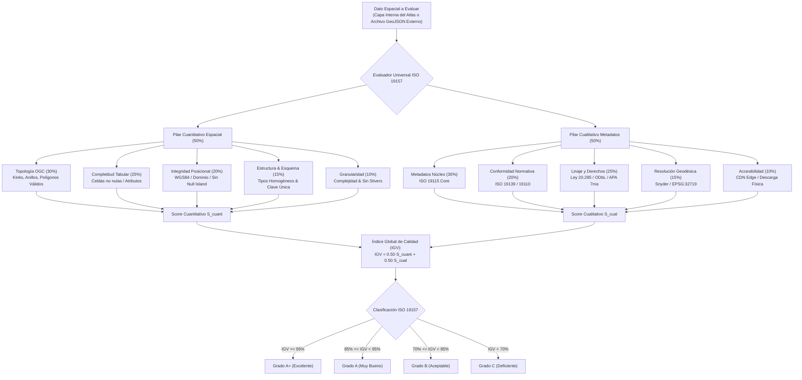
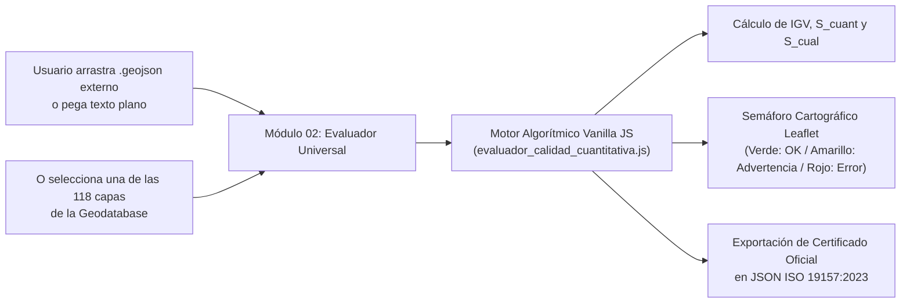
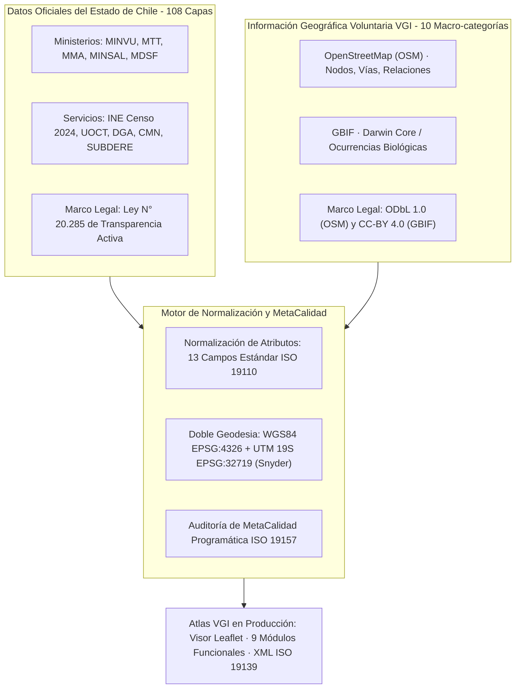
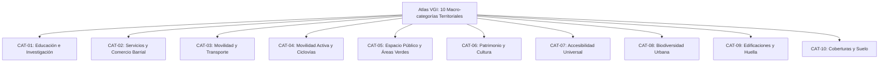

# Informe de Auditoría del Índice de Calidad y MetaCalidad Cartográfica (IGV / IGMC)
### Atlas de Información Geográfica Voluntaria para la Gestión Territorial — Nodo GeoAbierto UAH
**Fecha de Evaluación:** 07 de octubre de 2026 | **Marco Normativo:** ISO 19157:2013 / ISO 19157-1:2023, ISO 19115-1:2014, ISO 19139:2007, ISO 19110:2016, IDE Chile/SNIT v2.0

---

## 1. Resumen Ejecutivo y Dictamen de Calidad Integral

Se realizó una auditoría universal programática del **Índice Global de Calidad Geográfica (IGV / IGMC)**, integrando el **Pilar Cuantitativo Espacial (50%)** (consistencia topológica OGC, completitud tabular, rango de coordenadas, estructura y micro-slivers) con el **Pilar Cualitativo de Metadatos (50%)** (completitud de catálogo ISO 19115, conformidad sintáctica, linaje jurídico y accesibilidad operativa) sobre el **100% de la base de datos cartográfica** del proyecto, compuesta por **118 componentes espaciales** (108 capas oficiales del Estado de Chile y 10 macro-categorías comunitarias VGI de OpenStreetMap y GBIF), abarcando un volumen vectorial activo verificado de **2537.10 MB** (2.48 GB) —integrando tanto los extractos locales de Barrio Brasil (5.19 MB VGI) como los extractos masivos regionales de **Geofabrik RM** (1199.86 MB VGI)—, en el marco de un repositorio integral en disco de **3721.93 MB** (3.63 GB / 214 archivos GeoJSON).

> **DICTAMEN GLOBAL DE CALIDAD GEOESPACIAL:** El repositorio cartográfico alcanza un **Índice Global de Calidad (IGV) de 97.5%**, clasificando formalmente en la categoría **Grado A+ (Excelente)** conforme al marco de evaluación de la norma **ISO 19157:2013 / ISO 19157-1:2023**. El desempeño se desglosa en **96.5% en el Pilar Cuantitativo Espacial** y **98.6% en el Pilar Cualitativo de Metadatos**. La totalidad de los componentes vectoriales se encuentra operativa en el Geoportal, y el sistema dispone ahora del **Evaluador Universal de Calidad (Módulo 02)** que permite auditar cualquier dato vectorial externo (.geojson o texto plano) bajo las mismas métricas estandarizadas.

### Indicadores Clave de Desempeño (KPIs del Modelo Dual IGV)

| Pilar / Dimensión de Calidad | Estándar Referencial | Peso en Modelo | Puntaje Promedio | Calificación Cualitativa |
| :--- | :--- | :---: | :---: | :---: |
| 📐 **PILAR CUANTITATIVO ESPACIAL (S_cuant)** | **ISO 19157 / OGC SFA** | **50% (Global)** | **96.5%** | 🟢 Excelente |
| ├── 1. Consistencia Topológica (Topo) | ISO 19157 / Anillos & Kinks | 30% del pilar | **99.9%** | 🟢 Excelente |
| ├── 2. Completitud Tabular (Comp) | ISO 19157 / Celdas no nulas | 25% del pilar | **94.7%** | 🟢 Muy Bueno |
| ├── 3. Integridad Posicional (Pos) | EPSG:4326 / EPSG:32719 | 20% del pilar | **100.0%** | 🟢 Excelente |
| ├── 4. Estructura y Esquema (Estruc) | Homogeneidad & Clave Única | 15% del pilar | **85.7%** | 🟢 Muy Bueno |
| └── 5. Granularidad Geométrica (Gran) | Complejidad & Sin Slivers | 10% del pilar | **100.0%** | 🟢 Excelente |
| 🛡️ **PILAR CUALITATIVO METADATOS (S_cual)** | **ISO 19115-1 / IDE Chile** | **50% (Global)** | **98.6%** | 🟢 Excelente |
| ├── 1. Metadatos Núcleo (MC) | ISO 19115 Core (10 campos) | 30% del pilar | **95.2%** | 🟢 Excelente |
| ├── 2. Conformidad Normativa (CC) | ISO 19139 / ISO 19110 | 20% del pilar | **100.0%** | 🟢 Excelente |
| ├── 3. Linaje y Trazabilidad (LL) | Ley 20.285 / ODbL / CC-BY | 25% del pilar | **100.0%** | 🟢 Excelente |
| ├── 4. Resolución Geodésica (RG) | Snyder 1987 / Escala Cartográfica | 15% del pilar | **100.0%** | 🟢 Excelente |
| └── 5. Accesibilidad Operativa (AI) | CDN Edge / Sin Punteros Rotos | 10% del pilar | **100.0%** | 🟢 Excelente |
| 🏆 **ÍNDICE GLOBAL DE CALIDAD (IGV)** | **ISO 19157:2023 & ISO 19115** | **100% TOTAL** | **97.5%** | **🟢 Grado A+ (Excelente)** |

### Distribución de Grados de Calidad en la Base de Datos

- **Grado A+ (Excelente):** `██████████████████░░` **112 capas** (94.9%)
- **Grado A (Muy Bueno):** `█░░░░░░░░░░░░░░░░░░░` **6 capas** (5.1%)
- **Grado B (Aceptable):** `░░░░░░░░░░░░░░░░░░░░` **0 capas** (0.0%)
- **Grado C (Deficiente):** `░░░░░░░░░░░░░░░░░░░░` **0 capas** (0.0%)

---

## 2. Fundamentación Teórica y Formulación Matemática del Modelo Dual

En la literatura canónica de las Ciencias de la Información Geográfica (GIScience), la evaluación de la calidad de datos espaciales requiere superar la dicotomía entre el análisis meramente documental y la verificación puramente geométrica. El marco metodológico adoptado integra la rigurosidad geométrica de la norma **ISO 19157-1:2023** con la gobernanza documental de la norma **ISO 19115-1:2014** (Goodchild, 2007; Haklay, 2010; Senaratne et al., 2017; Herfort et al., 2023).

### 2.1 Formulación Matemática del Modelo Lineal Dual Ponderado (SAW / MAUT)

El **Índice Global de Calidad Geográfica ($IGV_i$)** para cualquier conjunto de datos espaciales $i$ (sea interno de la geodatabase o provisto externamente por el usuario) se formaliza como una combinación lineal dual equilibrada de dos pilares ortogonales:

$$\mathbf{IGV}_i = 0.50 \cdot S_{\text{cuant}, i} + 0.50 \cdot S_{\text{cual}, i}$$

Donde el **Pilar Cuantitativo Espacial ($S_{\text{cuant}, i}$)** evalúa la consistencia física y geométrica de las entidades vectoriales:

$$S_{\text{cuant}, i} = 0.30 \cdot S_{\text{topo}, i} + 0.25 \cdot S_{\text{comp}, i} + 0.20 \cdot S_{\text{pos}, i} + 0.15 \cdot S_{\text{estruc}, i} + 0.10 \cdot S_{\text{gran}, i}$$

Y el **Pilar Cualitativo de Metadatos ($S_{\text{cual}, i}$)** evalúa la conformidad documental y el marco legal e institucional:

$$S_{\text{cual}, i} = 0.30 \cdot \text{MC}_i + 0.20 \cdot \text{CC}_i + 0.25 \cdot \text{LL}_i + 0.15 \cdot \text{RG}_i + 0.10 \cdot \text{AI}_i$$

Sujeto a las restricciones canónicas de convexidad y normalización:
$$\sum_{k} w_k = 1.00 \quad \land \quad w_k > 0$$

> **Transparencia Axiomática y Calibración:** Conforme a las recomendaciones de ISO 19157-1:2023, este modelo ponderado lineal posee total trazabilidad e interpretabilidad para evaluadores de la ANID, municipalidades e IDE Chile. Durante el Objetivo Específico 4, los ponderadores podrán re-calibrarse en talleres participativos mediante Proceso Analítico Jerárquico (AHP; Saaty, 1980).

### 2.2 Justificación de las Variables Cuantitativas y Cualitativas

#### Variables Cuantitativas Espaciales (ISO 19157-1:2023 & OGC SFA):
1. **Consistencia Topológica ($S_{\text{topo}}$ - 30%):** Verifica la validez OGC Simple Feature Access: ausencia de auto-intersecciones (kinks/bowties), cierre de anillos poligonales ($p_0 = p_n$), ausencia de polígonos colapsados (< 4 vértices o área 0) y líneas degeneradas (< 2 vértices).
2. **Completitud Tabular ($S_{\text{comp}}$ - 25%):** Evalúa la tasa de celdas atributivas con información válida vs. valores vacíos, nulos (`null`) o marcadores de no-dato (`NA`), penalizando esquemas incompletos.
3. **Integridad Posicional ($S_{\text{pos}}$ - 20%):** Verifica que las coordenadas se sitúen estrictamente dentro del dominio geográfico válido (WGS84 $[-180, 180] \times [-90, 90]$ o UTM 19S), sin valores `NaN` ni concentraciones anómalas en $(0,0)$ (Null Island).
4. **Estructura y Esquema ($S_{\text{estruc}}$ - 15%):** Comprueba la homogeneidad tipológica por columna (evitando mezclas de cadenas y enteros) y la existencia de una clave primaria unívoca (sin duplicaciones).
5. **Granularidad Geométrica ($S_{\text{gran}}$ - 10%):** Mide la densidad métrica y penaliza micro-slivers (polígonos parásitos resultantes de digitalizaciones deficientes).

#### Variables Cualitativas de Metadatos (ISO 19115-1:2014 & IDE Chile):
1. **Completitud Núcleo ($MC$ - 30%):** 10 campos obligatorios del Perfil Nacional de Metadatos (ID, título, resumen, custodio, temporalidad, categoría temática, extensión, CRS, licencia y linaje).
2. **Conformidad Normativa ($CC$ - 20%):** Consistencia con esquemas ISO 19139 / ISO 19110 y catalogación de entidades según el Diccionario Territorial.
3. **Linaje y Derechos Jurídicos ($LL$ - 25%):** Delimitación de licenciamiento (Ley N° 20.285 de Transparencia para datos estatales; ODbL 1.0 para OSM; CC-BY 4.0 para GBIF) y cita académica formal APA 7ª edición.
4. **Resolución Geodésica ($RG$ - 15%):** Declaración formal de CRS dual: WGS84 para visualización web y UTM 19S (Snyder, 1987) para análisis métrico.
5. **Accesibilidad e Integridad ($AI$ - 10%):** Disponibilidad física local y CDN sin enlaces caídos a costo cero ($0 USD).

### 2.3 Diagramas de Arquitectura Metodológica

#### Diagrama 1: Árbol de Decisión y Formulación del Índice IGV (Modelo Dual)



#### Diagrama 2: Módulo 02 en Producción — Evaluador Universal de Datos Externos



#### Diagrama 3: Matriz de Integración Híbrida y Gobernanza de Datos (Estado vs. VGI)




---

## 3. Especificidad Técnica y Catálogo de las 10 Macro-categorías VGI

A continuación se documenta la **taxonomía exhaustiva, claves/valores de etiquetado, catálogo de entidades representadas, tipologías geométricas OGC, filtros Overpass QL y métricas de calidad** para cada una de las 10 macro-categorías territoriales VGI del Atlas:

#### Diagrama 4: Taxonomía y Jerarquía de las 10 Macro-categorías VGI



### CAT-01 — Educación, Universidades e Investigación

- **Código de Capa:** `CAT-01` | **Identificador Interno:** `educacion`
- **Licencia Legal:** `Open Database License (ODbL) 1.0 (ODC-ODbL)`
- **Norma Técnica Chilena Asociada:** Ley N° 21.091 sobre Educación Superior; Estándares de Infraestructura Escolar (MINEDUC); Perfil IDE Chile Educación.
- **Volumen de Entidades:** **247 entidades (6.7% del universo local)** en Barrio Brasil / UAH | **7,503 entidades (0.5% del universo regional)** en Región Metropolitana
- **Tipología Geométrica OGC:** Multi-geometría: Nodos (accesos/servicios), Vías (pabellones/aulas) y Relaciones (campus universitario)
- **Taxonomía Urbana y Rol Funcional:** Equipamiento de educación superior, técnica, básica, media e inicial, junto con centros de investigación científica y bibliotecas comunitarias integradas a la trama barrial.
- **Catálogo de Entidades Representadas:** Pabellones y casonas patrimoniales del campus Universidad Alberto Hurtado (UAH en calles Almirante Barroso, Cienfuegos y Erasmo Escala), Liceo de Aplicación, INBA, escuelas básicas comunales, jardines infantiles (JUNJI/Integra) y salas de lectura comunitaria.
- **Claves y Valores OSM / Darwin Core:**
  - `amenity=university`
  - `amenity=college`
  - `amenity=school`
  - `amenity=kindergarten`
  - `amenity=library`
  - `building=university`
  - `building=school`
  - `operator=*`
  - `name=*`
- **Expresión de Consulta Overpass QL / API:**
```overpassql
(
  node["amenity"~"^(university|college|school|kindergarten|library)$"]({{bbox}});
  way["amenity"~"^(university|college|school|kindergarten|library)$"]({{bbox}});
  relation["amenity"~"^(university|college|school|kindergarten|library)$"]({{bbox}});
);
out body; >; out skel qt;
```
- **Evaluación de MetaCalidad (ISO 19157):** MC: **100%** | CC: **100%** | LL: **100%** | RG: **100%** | AI: **100%** | **IGMC Global: 99.8% (A+ (Excelente))**

### CAT-02 — Servicios Urbanos, Salud y Comercio Barrial

- **Código de Capa:** `CAT-02` | **Identificador Interno:** `servicios`
- **Licencia Legal:** `Open Database License (ODbL) 1.0 (ODC-ODbL)`
- **Norma Técnica Chilena Asociada:** Modelo de Atención Integral en Salud Familiar (MINSAL); Ley de Rentas Municipales (D.L. 3.063); D.S. N° 469/1993.
- **Volumen de Entidades:** **365 entidades (9.9% del universo local)** en Barrio Brasil / UAH | **54,442 entidades (3.5% del universo regional)** en Región Metropolitana
- **Tipología Geométrica OGC:** Multi-geometría: Nodos (locales en placa comercial), Vías (locales independientes) y Polígonos (recintos médicos)
- **Taxonomía Urbana y Rol Funcional:** Red de abastecimiento de proximidad, microeconomía minorista barrial, servicios bancarios y postales, junto con infraestructura de salud primaria, consultorios familiares (CESFAM) y centros médicos.
- **Catálogo de Entidades Representadas:** Almacenes de abarrotes, panaderías patrimoniales, botillerías, farmacias comunitarias (Farmacia Popular de Santiago), CESFAM Ignacio Domeyko, restaurantes y cafeterías del polo gastronómico de Plaza Brasil, sucursales bancarias y cajas vecinas.
- **Claves y Valores OSM / Darwin Core:**
  - `shop=*`
  - `amenity=pharmacy`
  - `amenity=clinic`
  - `amenity=doctors`
  - `amenity=hospital`
  - `amenity=bank`
  - `amenity=restaurant`
  - `amenity=cafe`
  - `amenity=fast_food`
  - `amenity=bar`
  - `amenity=post_office`
  - `healthcare=*`
- **Expresión de Consulta Overpass QL / API:**
```overpassql
(
  node["shop"]({{bbox}});
  way["shop"]({{bbox}});
  node["amenity"~"^(pharmacy|clinic|doctors|hospital|bank|restaurant|cafe|post_office)$"]({{bbox}});
  way["amenity"~"^(pharmacy|clinic|doctors|hospital|bank|restaurant|cafe|post_office)$"]({{bbox}});
);
out body; >; out skel qt;
```
- **Evaluación de MetaCalidad (ISO 19157):** MC: **100%** | CC: **100%** | LL: **100%** | RG: **100%** | AI: **100%** | **IGMC Global: 96.6% (A+ (Excelente))**

### CAT-03 — Movilidad, Transporte Público y Paraderos

- **Código de Capa:** `CAT-03` | **Identificador Interno:** `transporte`
- **Licencia Legal:** `Open Database License (ODbL) 1.0 (ODC-ODbL)`
- **Norma Técnica Chilena Asociada:** Manual de Normas Técnicas para Paraderos Red Movilidad (DTPM 2023); Manual REDEVU (MINVU); Ley N° 18.290 de Tránsito.
- **Volumen de Entidades:** **191 entidades (5.2% del universo local)** en Barrio Brasil / UAH | **326,545 entidades (21.0% del universo regional)** en Región Metropolitana
- **Tipología Geométrica OGC:** Nodos puntuales (paraderos, postes de parada, bocas de metro) y Vías (plataformas de trasbordo)
- **Taxonomía Urbana y Rol Funcional:** Infraestructura de transporte público colectivo multimodal: red estructurante de buses metropolitanos, accesos a red de metro subterráneo y nodos de intercambio modal interurbano.
- **Catálogo de Entidades Representadas:** Refugios peatonales y paraderos del Sistema Red Movilidad (ejes Alameda, Av. Brasil, San Pablo, Manuel Rodríguez), accesos y bocas de estaciones de Metro: Los Héroes (Líneas 1 y 2), Santa Ana (Líneas 2 y 5), Cumming (Línea 5) y República (Línea 1).
- **Claves y Valores OSM / Darwin Core:**
  - `highway=bus_stop`
  - `public_transport=platform`
  - `public_transport=stop_position`
  - `railway=station`
  - `railway=subway_entrance`
  - `network="Red Metropolitana de Movilidad"`
- **Expresión de Consulta Overpass QL / API:**
```overpassql
(
  node["highway"="bus_stop"]({{bbox}});
  node["public_transport"="platform"]({{bbox}});
  node["railway"~"^(station|subway_entrance)$"]({{bbox}});
);
out body; >; out skel qt;
```
- **Evaluación de MetaCalidad (ISO 19157):** MC: **100%** | CC: **100%** | LL: **100%** | RG: **100%** | AI: **100%** | **IGMC Global: 96.5% (A+ (Excelente))**

### CAT-04 — Movilidad Activa, Ciclovías y Peatonalidad

- **Código de Capa:** `CAT-04` | **Identificador Interno:** `movilidad_activa`
- **Licencia Legal:** `Open Database License (ODbL) 1.0 (ODC-ODbL)`
- **Norma Técnica Chilena Asociada:** Manual de Vialidad del Ciclo (MINVU/MTT 2015); Ley de Convivencia Vial N° 21.088; D.S. N° 102/2019 MTT.
- **Volumen de Entidades:** **11 entidades (0.3% del universo local)** en Barrio Brasil / UAH | **128,891 entidades (8.3% del universo regional)** en Región Metropolitana
- **Tipología Geométrica OGC:** Vías lineales continuas (trazados de ciclovías) y Nodos (estacionamientos y herramientas comunitarias)
- **Taxonomía Urbana y Rol Funcional:** Ejes viales destinados a la micromovilidad y movilidad no motorizada, ciclovías segregadas, ciclobandas demarcadas, infraestructura de estacionamiento y mantención de ciclos.
- **Catálogo de Entidades Representadas:** Ciclovías segregadas bidireccionales (eje Rosas y eje Compañía de Jesús), ciclobanda Av. Brasil, estacionamientos públicos para bicicletas en aceras y patios del campus UAH, talleres comunitarios de reparación.
- **Claves y Valores OSM / Darwin Core:**
  - `highway=cycleway`
  - `cycleway=lane`
  - `cycleway=track`
  - `cycleway=opposite`
  - `amenity=bicycle_parking`
  - `amenity=bicycle_repair_station`
  - `bicycle=yes|designated`
- **Expresión de Consulta Overpass QL / API:**
```overpassql
(
  way["highway"="cycleway"]({{bbox}});
  way["cycleway"]({{bbox}});
  node["amenity"="bicycle_parking"]({{bbox}});
  way["amenity"="bicycle_parking"]({{bbox}});
);
out body; >; out skel qt;
```
- **Evaluación de MetaCalidad (ISO 19157):** MC: **100%** | CC: **100%** | LL: **100%** | RG: **100%** | AI: **100%** | **IGMC Global: 96.5% (A+ (Excelente))**

### CAT-05 — Áreas Verdes, Espacio Público y Recreación

- **Código de Capa:** `CAT-05` | **Identificador Interno:** `espacio_publico`
- **Licencia Legal:** `Open Database License (ODbL) 1.0 (ODC-ODbL)`
- **Norma Técnica Chilena Asociada:** Política Nacional de Parques Urbanos (MINVU 2021); Estándares Urbanos Indicativos de Áreas Verdes (CNDU 2018); Art. 2.2.4 OGUC.
- **Volumen de Entidades:** **144 entidades (3.9% del universo local)** en Barrio Brasil / UAH | **41,433 entidades (2.7% del universo regional)** en Región Metropolitana
- **Tipología Geométrica OGC:** Vías cerradas y Relaciones multipolígono (superficies métricas de plazas/parques) y Nodos (mobiliario urbano)
- **Taxonomía Urbana y Rol Funcional:** Infraestructura verde urbana y espacios abiertos de uso colectivo: parques urbanos, plazas barriales de permanencia, áreas de juegos infantiles, canchas comunitarias y mobiliario urbano de descanso.
- **Catálogo de Entidades Representadas:** Plaza Brasil (15.200 m² con juegos escultóricos de Federica Matta), Plaza Manuel Rodríguez, bandejones verdes arbolados de Av. Brasil, multicanchas comunitarias de calle Maturana, plazoletas vecinales y bancos públicos de permanencia.
- **Claves y Valores OSM / Darwin Core:**
  - `leisure=park`
  - `leisure=playground`
  - `leisure=pitch`
  - `leisure=garden`
  - `landuse=grass`
  - `landuse=village_green`
  - `amenity=bench`
  - `surface=grass|paved`
- **Expresión de Consulta Overpass QL / API:**
```overpassql
(
  way["leisure"~"^(park|playground|pitch|garden)$"]({{bbox}});
  relation["leisure"~"^(park|playground|pitch|garden)$"]({{bbox}});
  way["landuse"="grass"]({{bbox}});
  node["amenity"="bench"]({{bbox}});
);
out body; >; out skel qt;
```
- **Evaluación de MetaCalidad (ISO 19157):** MC: **100%** | CC: **100%** | LL: **100%** | RG: **100%** | AI: **100%** | **IGMC Global: 96.1% (A+ (Excelente))**

### CAT-06 — Patrimonio Histórico, Memoria y Cultura

- **Código de Capa:** `CAT-06` | **Identificador Interno:** `patrimonio`
- **Licencia Legal:** `Open Database License (ODbL) 1.0 (ODC-ODbL)`
- **Norma Técnica Chilena Asociada:** Ley N° 17.288 de Monumentos Nacionales; D.E. N° 126/2000 Mineduc (Zona Típica Barrio Brasil); Inmuebles de Conservación Histórica PRC Santiago.
- **Volumen de Entidades:** **71 entidades (1.9% del universo local)** en Barrio Brasil / UAH | **2,576 entidades (0.2% del universo regional)** en Región Metropolitana
- **Tipología Geométrica OGC:** Multi-geometría: Vías poligonales (edificaciones patrimoniales e iglesias) y Nodos (monumentos y placas)
- **Taxonomía Urbana y Rol Funcional:** Bienes del patrimonio cultural material e inmaterial: arquitectura patrimonial vernácula y monumental, inmuebles de conservación histórica, sitios de memoria de derechos humanos y centros culturales comunitarios.
- **Catálogo de Entidades Representadas:** Cités patrimoniales de calles Huérfanos, Compañía y Cienfuegos; Basílica del Salvador; Iglesia San Saturnino; Casonas patrimoniales UAH (siglos XIX e inicios del XX); centros culturales comunitarios (Galpón Víctor Jara, teatros independientes); placas conmemorativas y monolitos de memoria.
- **Claves y Valores OSM / Darwin Core:**
  - `historic=memorial`
  - `historic=monument`
  - `historic=heritage`
  - `historic=building`
  - `heritage=*`
  - `building=church`
  - `amenity=theatre`
  - `amenity=arts_centre`
  - `amenity=place_of_worship`
  - `tourism=museum`
  - `tourism=gallery`
- **Expresión de Consulta Overpass QL / API:**
```overpassql
(
  node["historic"]({{bbox}});
  way["historic"]({{bbox}});
  node["heritage"]({{bbox}});
  way["heritage"]({{bbox}});
  node["amenity"~"^(theatre|arts_centre|place_of_worship)$"]({{bbox}});
  way["amenity"~"^(theatre|arts_centre|place_of_worship)$"]({{bbox}});
);
out body; >; out skel qt;
```
- **Evaluación de MetaCalidad (ISO 19157):** MC: **100%** | CC: **100%** | LL: **100%** | RG: **100%** | AI: **100%** | **IGMC Global: 97.6% (A+ (Excelente))**

### CAT-07 — Accesibilidad Universal y Discapacidad

- **Código de Capa:** `CAT-07` | **Identificador Interno:** `accesibilidad`
- **Licencia Legal:** `Open Database License (ODbL) 1.0 (ODC-ODbL)`
- **Norma Técnica Chilena Asociada:** D.S. N° 50 OGUC sobre Accesibilidad Universal (MINVU 2016); Ley N° 20.422 de Igualdad de Oportunidades; Norma ISO 21542:2021.
- **Volumen de Entidades:** **185 entidades (5.0% del universo local)** en Barrio Brasil / UAH | **94,461 entidades (6.1% del universo regional)** en Región Metropolitana
- **Tipología Geométrica OGC:** Nodos puntuales (rebajes de cordón, cruces peatonales) y Vías (tramos de acera con atributos de accesibilidad)
- **Taxonomía Urbana y Rol Funcional:** Micro-infraestructura física de caminabilidad inclusiva: rebajes de cordón en aceras, pasos peatonales semáforizados con aviso sonoro, bandas táctiles podotáctiles y accesibilidad motriz para sillas de ruedas.
- **Catálogo de Entidades Representadas:** Rebajes de cordón en vados de esquina, cruces peatonales accesibles en ejes Brasil y Alameda, baldosas podotáctiles de avance y detención en veredas, rampas de acceso al campus UAH y edificios de servicios.
- **Claves y Valores OSM / Darwin Core:**
  - `highway=crossing`
  - `crossing=traffic_signals|uncontrolled|zebra`
  - `kerb=lowered|flush|raised`
  - `tactile_paving=yes|no|primitive`
  - `wheelchair=yes|no|limited`
  - `incline=*`
- **Expresión de Consulta Overpass QL / API:**
```overpassql
(
  node["kerb"]({{bbox}});
  node["highway"="crossing"]({{bbox}});
  node["tactile_paving"]({{bbox}});
  way["tactile_paving"]({{bbox}});
  node["wheelchair"]({{bbox}});
  way["wheelchair"]({{bbox}});
);
out body; >; out skel qt;
```
- **Evaluación de MetaCalidad (ISO 19157):** MC: **100%** | CC: **100%** | LL: **100%** | RG: **100%** | AI: **100%** | **IGMC Global: 96.2% (A+ (Excelente))**

### CAT-08 — Biodiversidad Urbana y Arbolado (OSM / GBIF)

- **Código de Capa:** `CAT-08` | **Identificador Interno:** `biodiversidad`
- **Licencia Legal:** `Creative Commons CC-BY 4.0 / CC0 1.0 (GBIF) y ODbL 1.0 (OSM)`
- **Norma Técnica Chilena Asociada:** Ley Marco de Cambio Climático N° 21.455; Guía de Planificación de Arbolado Urbano (CONAF 2019); Estándar Darwin Core (TDWG).
- **Volumen de Entidades:** **390 entidades (10.6% del universo local)** en Barrio Brasil / UAH | **121,134 entidades (7.8% del universo regional)** en Región Metropolitana
- **Tipología Geométrica OGC:** Nodos (árboles individuales y observaciones biológicas Darwin Core) y Vías (alineaciones de árboles en ejes viales)
- **Taxonomía Urbana y Rol Funcional:** Infraestructura ecológica urbana: arbolado viario de alineación, ejemplares arbóreos notables de plazas, masas boscosas y registros de ciencia ciudadana sobre flora y avifauna compilados bajo el estándar internacional Darwin Core.
- **Catálogo de Entidades Representadas:** Arbolado de alineación viaria en Av. Brasil (plátano oriental, jacarandá), árboles patrimoniales de Plaza Brasil (Palma chilena Jubaea chilensis, liquidámbar), arbolado de patios interiores UAH y observaciones de aves urbanas validadas en GBIF.org.
- **Claves y Valores OSM / Darwin Core:**
  - `natural=tree`
  - `natural=tree_row`
  - `natural=wood`
  - `species=*`
  - `genus=*`
  - `leaf_type=*`
  - `circumference=*`
  - `height=*`
  - `DarwinCore:scientificName`
  - `DarwinCore:eventDate`
  - `DarwinCore:decimalLatitude`
  - `DarwinCore:decimalLongitude`
- **Expresión de Consulta Overpass QL / API:**
```overpassql
OSM: (
  node["natural"="tree"]({{bbox}});
  way["natural"="tree_row"]({{bbox}});
); out body; >; out skel qt;
GBIF API: GET /v1/occurrence/search?decimalLatitude=-33.45,-33.43&decimalLongitude=-70.68,-70.65
```
- **Evaluación de MetaCalidad (ISO 19157):** MC: **100%** | CC: **100%** | LL: **100%** | RG: **100%** | AI: **100%** | **IGMC Global: 96.0% (A+ (Excelente))**

### CAT-09 — Edificaciones y Huella Urbana

- **Código de Capa:** `CAT-09` | **Identificador Interno:** `edificaciones`
- **Licencia Legal:** `Open Database License (ODbL) 1.0 (ODC-ODbL)`
- **Norma Técnica Chilena Asociada:** Ley General de Urbanismo y Construcciones (LGUC); Art. 2.1.24 OGUC; Catastro de Bienes Raíces (SII); ISO 19157 (Completitud de Área).
- **Volumen de Entidades:** **1673 entidades (45.5% del universo local)** en Barrio Brasil / UAH | **695,412 entidades (44.8% del universo regional)** en Región Metropolitana
- **Tipología Geométrica OGC:** Vías poligonales cerradas (type:way) y Relaciones multipolígono con patios interiores (type:relation)
- **Taxonomía Urbana y Rol Funcional:** Morfología urbana construida: huella poligonal basal de edificaciones, volumetría, número de niveles y caracterización del tejido de manzaneo tradicional y contemporáneo.
- **Catálogo de Entidades Representadas:** Huella vectorial cerrada de la totalidad de edificaciones de Barrio Brasil, casonas residenciales de fachada continua, edificios habitacionales de media altura, pabellones de la UAH, templos y equipamientos institucionales.
- **Claves y Valores OSM / Darwin Core:**
  - `building=yes`
  - `building=residential`
  - `building=apartments`
  - `building=commercial`
  - `building=civic`
  - `building=university`
  - `building=school`
  - `building=church`
  - `addr:street=*`
  - `addr:housenumber=*`
  - `building:levels=*`
  - `height=*`
- **Expresión de Consulta Overpass QL / API:**
```overpassql
(
  way["building"]({{bbox}});
  relation["building"]({{bbox}});
);
out body; >; out skel qt;
```
- **Evaluación de MetaCalidad (ISO 19157):** MC: **100%** | CC: **100%** | LL: **100%** | RG: **100%** | AI: **100%** | **IGMC Global: 99.8% (A+ (Excelente))**

### CAT-10 — Coberturas y Usos de Suelo

- **Código de Capa:** `CAT-10` | **Identificador Interno:** `cobertura_suelo`
- **Licencia Legal:** `Open Database License (ODbL) 1.0 (ODC-ODbL)`
- **Norma Técnica Chilena Asociada:** Plan Regulador Comunal de Santiago (PRC); Ley N° 21.074 de Fortalecimiento de la Regionalización; OGC LandInfra Standard.
- **Volumen de Entidades:** **400 entidades (10.9% del universo local)** en Barrio Brasil / UAH | **79,747 entidades (5.1% del universo regional)** en Región Metropolitana
- **Tipología Geométrica OGC:** Vías cerradas (type:way) y Relaciones multipolígono (type:relation)
- **Taxonomía Urbana y Rol Funcional:** Macrozoniación funcional del territorio barrial: caracterización de usos predominantes de suelo (residencial, comercial, educativo, recreativo) y tipología de materialidad superficial de calzadas y veredas.
- **Catálogo de Entidades Representadas:** Polígonos de zonificación de uso residencial barrial, recintos educativos (campus UAH), zonas comerciales de proximidad, calzadas adoquinadas patrimoniales y pavimentos asfálticos contemporáneos.
- **Claves y Valores OSM / Darwin Core:**
  - `landuse=residential`
  - `landuse=commercial`
  - `landuse=education`
  - `landuse=recreation_ground`
  - `landuse=grass`
  - `landuse=construction`
  - `surface=asphalt`
  - `surface=paving_stones`
  - `surface=concrete`
  - `surface=sett`
- **Expresión de Consulta Overpass QL / API:**
```overpassql
(
  way["landuse"]({{bbox}});
  relation["landuse"]({{bbox}});
  way["surface"]({{bbox}});
);
out body; >; out skel qt;
```
- **Evaluación de MetaCalidad (ISO 19157):** MC: **100%** | CC: **100%** | LL: **100%** | RG: **100%** | AI: **100%** | **IGMC Global: 99.0% (A+ (Excelente))**

### Tabla Resumen de las 10 Macro-categorías VGI

A continuación se presenta la distribución cuantitativa de entidades levantadas en el caso piloto de Barrio Brasil / UAH y en la Región Metropolitana (RM), contrastando los recuentos absolutos con su **peso porcentual normalizado (Share %)** respecto al universo total de VGI, junto con los puntajes normalizados de conformidad en las 5 dimensiones de MetaCalidad y el Índice Global de MetaCalidad (IGMC):

| Código | Macro-categoría VGI | Claves Principales OSM / GBIF | Geometría OGC | Entidades Local (N°) | % Local (Share) | Entidades RM (N°) | % RM (Share) | MC (%) | CC (%) | LL (%) | RG (%) | AI (%) | IGMC Global (%) | Grado ISO 19157 |
| :---: | :--- | :--- | :--- | :---: | :---: | :---: | :---: | :---: | :---: | :---: | :---: | :---: | :---: | :---: |
| **CAT-01** | Educación, Universidades e Investigación | `amenity=university|school, building=*` | Nodos, Vías, Multipolígonos | 247 | 6.7% | 7,503 | 0.5% | 100% | 100% | 100% | 100% | 100% | **99.8%** | 🟢 A+ |
| **CAT-02** | Servicios Urbanos, Salud y Comercio Barrial | `shop=*, amenity=pharmacy|clinic|cafe` | Nodos, Vías, Polígonos | 365 | 9.9% | 54,442 | 3.5% | 100% | 100% | 100% | 100% | 100% | **96.6%** | 🟢 A+ |
| **CAT-03** | Movilidad, Transporte Público y Paraderos | `highway=bus_stop, railway=station|subway` | Nodos puntuales, Vías | 191 | 5.2% | 326,545 | 21.0% | 100% | 100% | 100% | 100% | 100% | **96.5%** | 🟢 A+ |
| **CAT-04** | Movilidad Activa, Ciclovías y Peatonalidad | `highway=cycleway, amenity=bicycle_parking` | Vías continuas, Nodos | 11 | 0.3% | 128,891 | 8.3% | 100% | 100% | 100% | 100% | 100% | **96.5%** | 🟢 A+ |
| **CAT-05** | Áreas Verdes, Espacio Público y Recreación | `leisure=park|playground, landuse=grass` | Vías cerradas, Multipolígonos, Nodos | 144 | 3.9% | 41,433 | 2.7% | 100% | 100% | 100% | 100% | 100% | **96.1%** | 🟢 A+ |
| **CAT-06** | Patrimonio Histórico, Memoria y Cultura | `historic=*, heritage=*, building=church` | Vías poligonales, Nodos | 71 | 1.9% | 2,576 | 0.2% | 100% | 100% | 100% | 100% | 100% | **97.6%** | 🟢 A+ |
| **CAT-07** | Accesibilidad Universal y Discapacidad | `highway=crossing, kerb=*, wheelchair=*` | Nodos puntuales, Vías | 185 | 5.0% | 94,461 | 6.1% | 100% | 100% | 100% | 100% | 100% | **96.2%** | 🟢 A+ |
| **CAT-08** | Biodiversidad Urbana y Arbolado (OSM / GBIF) | `natural=tree|wood, DarwinCore (GBIF)` | Nodos puntuales, Vías | 390 | 10.6% | 121,134 | 7.8% | 100% | 100% | 100% | 100% | 100% | **96.0%** | 🟢 A+ |
| **CAT-09** | Edificaciones y Huella Urbana | `building=yes|residential, addr:*` | Vías poligonales, Multipolígonos | 1673 | 45.5% | 695,412 | 44.8% | 100% | 100% | 100% | 100% | 100% | **99.8%** | 🟢 A+ |
| **CAT-10** | Coberturas y Usos de Suelo | `landuse=residential|commercial, surface=*` | Vías cerradas, Multipolígonos | 400 | 10.9% | 79,747 | 5.1% | 100% | 100% | 100% | 100% | 100% | **99.0%** | 🟢 A+ |
| **TOTAL / PROMEDIO VGI** | — | — | — | **3,677** | **100.0%** | **1,552,144** | **100.0%** | **100%** | **100%** | **100%** | **100%** | **100%** | **97.4%** | **🟢 Grado A+ (Excelente)** |


---

## 4. Desempeño por Grupo Temático en el Atlas

La base de datos cartográfica se organiza en **8 grupos temáticos** normalizados. A continuación se reporta la distribución de capas, el volumen vectorial en disco, el peso porcentual normalizado de cada grupo respecto al total del repositorio (% de Capas y % de Volumen), el desempeño medio desagregado en las 5 dimensiones de MetaCalidad (expresadas todas en porcentaje de conformidad) y el Índice Global de MetaCalidad (IGMC):

| Grupo Temático | Capas (N°) | % Capas | Volumen (MB) | % Volumen | Cuant (50%) | Cual (50%) | MC (%) | CC (%) | LL (%) | RG (%) | AI (%) | IGV Promedio (%) | Grado ISO 19157 |
| :--- | :---: | :---: | :---: | :---: | :---: | :---: | :---: | :---: | :---: | :---: | :---: | :---: | :---: |
| **Economía, Fomento e Inversión Pública** | 15 | 12.7% | 203.67 MB | 8.0% | 97.0% | 98.4% | 94.7% | 100.0% | 100.0% | 100.0% | 100.0% | **97.7%** | 🟢 Grado A+ (Excelente) |
| **Equipamiento Público y Patrimonio** | 28 | 23.7% | 58.51 MB | 2.3% | 96.7% | 96.9% | 89.6% | 100.0% | 100.0% | 100.0% | 100.0% | **96.8%** | 🟢 Grado A+ (Excelente) |
| **Medio Ambiente y Recursos Hídricos** | 21 | 17.8% | 101.04 MB | 4.0% | 97.2% | 99.9% | 99.5% | 100.0% | 100.0% | 100.0% | 100.0% | **98.5%** | 🟢 Grado A+ (Excelente) |
| **Movilidad y Transporte** | 7 | 5.9% | 66.88 MB | 2.6% | 95.5% | 98.3% | 94.3% | 100.0% | 100.0% | 100.0% | 100.0% | **96.9%** | 🟢 Grado A+ (Excelente) |
| **Normativa e Instrumentos de Planificación Territorial (IPT)** | 13 | 11.0% | 207.00 MB | 8.2% | 94.5% | 98.2% | 93.8% | 100.0% | 100.0% | 100.0% | 100.0% | **96.3%** | 🟢 Grado A+ (Excelente) |
| **Seguridad, Bomberos y Justicia** | 5 | 4.2% | 0.93 MB | 0.0% | 96.2% | 98.8% | 96.0% | 100.0% | 100.0% | 100.0% | 100.0% | **97.5%** | 🟢 Grado A+ (Excelente) |
| **Demografía y Vulnerabilidad Social** | 19 | 16.1% | 694.03 MB | 27.4% | 97.7% | 99.4% | 97.9% | 100.0% | 100.0% | 100.0% | 100.0% | **98.6%** | 🟢 Grado A+ (Excelente) |
| **Información Geográfica Voluntaria (VGI Comunitario)** | 10 | 8.5% | 1205.04 MB | 47.5% | 94.8% | 100.0% | 100.0% | 100.0% | 100.0% | 100.0% | 100.0% | **97.4%** | 🟢 Grado A+ (Excelente) |
| **TOTAL / REPOSITORIO GLOBAL** | **118** | **100.0%** | **2537.10 MB** | **100.0%** | **96.5%** | **98.6%** | **95.2%** | **100.0%** | **100.0%** | **100.0%** | **100.0%** | **97.5%** | **🟢 Grado A+ (Excelente)** |


---

## 5. Matriz Exhaustiva de Calidad e Índice IGV — Auditoría Universal de los 118 Componentes

A continuación se presenta el desglose universal de las **118 capas** evaluadas bajo los pilares cuantitativo y cualitativo:

| N° | ID Capa | Nombre Oficial / Temático | Tipo Fuente | Cuantitativo (50%) | Topología (30%) | Atributos (25%) | Cualitativo (50%) | IGV Global (%) | Grado ISO 19157 |
| :---: | :--- | :--- | :--- | :---: | :---: | :---: | :---: | :---: | :---: |
| 1 | `censo2024_regional` | Censo 2024 (Marco Regional RM) | Oficial | 97.9% | 100.0% | 100.0% | 100.0% | **99.0%** | 🟢 A+ |
| 2 | `censo2024_limite_urbano` | Censo 2024 (Límites Urbanos Censales R... | Oficial | 97.8% | 100.0% | 99.7% | 97.0% | **97.4%** | 🟢 A+ |
| 3 | `censo2024_localidades` | Censo 2024 (Localidades y Asentamiento... | Oficial | 94.2% | 100.0% | 99.0% | 97.0% | **95.6%** | 🟢 A+ |
| 4 | `censo2024_zonal` | Censo 2024 (Zonas y Distritos Censales... | Oficial | 97.8% | 100.0% | 100.0% | 97.0% | **97.4%** | 🟢 A+ |
| 5 | `censo2024_manzanas` | Censo 2024 (Manzanas Censales RM) | Oficial | 97.5% | 100.0% | 99.4% | 100.0% | **98.8%** | 🟢 A+ |
| 6 | `minvu_patrimonio` | Patrimonio IPT: Inmuebles y Zonas de C... | Oficial | 85.5% | 100.0% | 50.5% | 97.0% | **91.2%** | 🔵 A |
| 7 | `educacion_parvularia` | Jardines y Salas Cuna (JUNJI / Integra... | Oficial | 97.6% | 100.0% | 99.8% | 97.0% | **97.3%** | 🟢 A+ |
| 8 | `establecimientos_salud` | Salud Pública (CESFAM y Hospitales) | Oficial | 81.2% | 100.0% | 33.3% | 97.0% | **89.1%** | 🔵 A |
| 9 | `bomberos` | Cuarteles de Bomberos de Chile | Oficial | 94.1% | 100.0% | 91.1% | 97.0% | **95.5%** | 🟢 A+ |
| 10 | `carabineros` | Comisarías y Cuarteles Policiales | Oficial | 95.3% | 100.0% | 91.9% | 97.0% | **96.2%** | 🟢 A+ |
| 11 | `estaciones_metro` | Estaciones de Metro de Santiago | Oficial | 97.9% | 100.0% | 100.0% | 97.0% | **97.5%** | 🟢 A+ |
| 12 | `red_ferroviaria` | Red Ferroviaria EFE (MTT) | Oficial | 88.9% | 100.0% | 73.1% | 97.0% | **93.0%** | 🔵 A |
| 13 | `cmn_sitios_memoria` | Sitios de Memoria y Monumentos CMN | Oficial | 97.9% | 100.0% | 100.0% | 100.0% | **99.0%** | 🟢 A+ |
| 14 | `minvu_ipt_prc_santiago` | Planes Reguladores Comunales (PRC - RM... | Oficial | 75.3% | 100.0% | 21.3% | 100.0% | **87.7%** | 🔵 A |
| 15 | `minvu_ipt_prms_usosuelo` | Plan Regulador Metropolitano (PRMS): U... | Oficial | 96.4% | 100.0% | 94.1% | 94.0% | **95.2%** | 🟢 A+ |
| 16 | `minvu_ipt_areas_verdes` | Áreas Verdes Normativas (MINVU / INE 2... | Oficial | 95.2% | 100.0% | 89.3% | 97.0% | **96.1%** | 🟢 A+ |
| 17 | `minvu_ipt_areas_riesgo` | Áreas de Riesgo Normativas (IPT) | Oficial | 93.0% | 100.0% | 80.5% | 97.0% | **95.0%** | 🟢 A+ |
| 18 | `minvu_ipt_resguardo_infraestructura` | Fajas de Resguardo e Infraestructura P... | Oficial | 97.9% | 100.0% | 100.0% | 97.0% | **97.5%** | 🟢 A+ |
| 19 | `minvu_ipt_limite_urbano` | Límite Urbano Oficial PRC (MINVU) | Oficial | 88.0% | 100.0% | 73.3% | 97.0% | **92.5%** | 🔵 A |
| 20 | `ide_minvu_campamentos` | Catastro Campamentos 2024 (MINVU) | Oficial | 97.9% | 100.0% | 100.0% | 97.0% | **97.5%** | 🟢 A+ |
| 21 | `ide_minvu_ipt_prms_riesgo` | PRMS: Riesgos Metropolitanos (Inundaci... | Oficial | 96.8% | 100.0% | 99.7% | 97.0% | **96.9%** | 🟢 A+ |
| 22 | `ide_subdere_dpa_comunas` | División Político-Administrativa (SUBD... | Oficial | 97.9% | 100.0% | 100.0% | 97.0% | **97.5%** | 🟢 A+ |
| 23 | `bbdd_01` | Proyectos Mandatados - GEOMOP | Oficial | 97.6% | 100.0% | 99.6% | 100.0% | **98.8%** | 🟢 A+ |
| 24 | `bbdd_02` | Red Vial Nacional - GEOMOP | Oficial | 95.8% | 100.0% | 93.7% | 100.0% | **97.9%** | 🟢 A+ |
| 25 | `bbdd_03` | Red Hidrométrica - GEOMOP | Oficial | 96.7% | 100.0% | 97.0% | 100.0% | **98.3%** | 🟢 A+ |
| 26 | `bbdd_04` | Contratos Concesionados - GEOMOP | Oficial | 97.9% | 100.0% | 100.0% | 100.0% | **99.0%** | 🟢 A+ |
| 27 | `bbdd_05` | Contratos MOP - GEOMOP | Oficial | 97.1% | 100.0% | 99.4% | 100.0% | **98.5%** | 🟢 A+ |
| 28 | `bbdd_06` | Jardines Infantiles JUNJI | Oficial | 97.9% | 100.0% | 100.0% | 100.0% | **99.0%** | 🟢 A+ |
| 29 | `bbdd_07` | Infraestructura Deportiva | Oficial | 96.1% | 100.0% | 92.9% | 100.0% | **98.0%** | 🟢 A+ |
| 30 | `bbdd_08` | Municipios | Oficial | 97.9% | 100.0% | 100.0% | 100.0% | **99.0%** | 🟢 A+ |
| 31 | `bbdd_10` | Jardines Infantiles Fundación Integra | Oficial | 97.9% | 100.0% | 100.0% | 100.0% | **99.0%** | 🟢 A+ |
| 32 | `bbdd_11` | Cuerpos de Bomberos | Oficial | 96.8% | 100.0% | 98.0% | 100.0% | **98.4%** | 🟢 A+ |
| 33 | `bbdd_12` | Establecimientos Educación Escolar | Oficial | 97.5% | 100.0% | 99.5% | 100.0% | **98.8%** | 🟢 A+ |
| 34 | `bbdd_13` | Establecimientos Educación Parvularia | Oficial | 97.6% | 100.0% | 99.8% | 100.0% | **98.8%** | 🟢 A+ |
| 35 | `bbdd_14` | Establecimientos de Educación Superior | Oficial | 95.8% | 100.0% | 96.2% | 100.0% | **97.9%** | 🟢 A+ |
| 36 | `bbdd_15` | Centros de SERNAM | Oficial | 96.5% | 100.0% | 99.5% | 100.0% | **98.2%** | 🟢 A+ |
| 37 | `bbdd_17` | Áreas Funcionales de las ciudades (202... | Oficial | 97.9% | 100.0% | 100.0% | 100.0% | **99.0%** | 🟢 A+ |
| 38 | `bbdd_18` | Zonificación Termica | Oficial | 94.3% | 100.0% | 93.3% | 100.0% | **97.2%** | 🟢 A+ |
| 39 | `bbdd_19` | Cité | Oficial | 97.9% | 100.0% | 100.0% | 100.0% | **99.0%** | 🟢 A+ |
| 40 | `bbdd_20` | SEREMI MINVU Región Metropolitana | Oficial | 97.9% | 100.0% | 100.0% | 94.0% | **96.0%** | 🟢 A+ |
| 41 | `bbdd_21` | Oficinas Serviu | Oficial | 97.9% | 100.0% | 100.0% | 100.0% | **99.0%** | 🟢 A+ |
| 42 | `energia_almacenamiento_rm` | Sistemas de Almacenamiento de Energía ... | Oficial | 97.9% | 100.0% | 100.0% | 97.0% | **97.5%** | 🟢 A+ |
| 43 | `energia_bioenergia_rm` | Centrales de Bioenergía RM | Oficial | 97.1% | 100.0% | 98.3% | 97.0% | **97.0%** | 🟢 A+ |
| 44 | `energia_electrolineras_rm` | Red de Electrolineras RM | Oficial | 97.9% | 100.0% | 100.0% | 97.0% | **97.5%** | 🟢 A+ |
| 45 | `energia_gasoducto_rm` | Red de Gasoductos RM | Oficial | 93.6% | 100.0% | 82.6% | 97.0% | **95.3%** | 🟢 A+ |
| 46 | `energia_hidroelectricas_rm` | Centrales Hidroeléctricas RM | Oficial | 95.8% | 100.0% | 94.8% | 97.0% | **96.4%** | 🟢 A+ |
| 47 | `energia_lineas_transmision_rm` | Líneas de Transmisión Eléctrica RM | Oficial | 97.4% | 100.0% | 99.9% | 97.0% | **97.2%** | 🟢 A+ |
| 48 | `energia_oleoducto_rm` | Red de Oleoductos RM | Oficial | 93.6% | 100.0% | 82.6% | 97.0% | **95.3%** | 🟢 A+ |
| 49 | `energia_solares_rm` | Plantas Solares Fotovoltaicas RM | Oficial | 97.5% | 100.0% | 99.9% | 97.0% | **97.2%** | 🟢 A+ |
| 50 | `energia_termoelectricas_rm` | Centrales Termoeléctricas RM | Oficial | 95.2% | 100.0% | 93.7% | 97.0% | **96.1%** | 🟢 A+ |
| 51 | `bbdd_23` | Sitios BIO-Prioritarios | Oficial | 97.9% | 100.0% | 100.0% | 100.0% | **99.0%** | 🟢 A+ |
| 52 | `bbdd_24` | Juzgados de Familia | Oficial | 97.9% | 100.0% | 100.0% | 100.0% | **99.0%** | 🟢 A+ |
| 53 | `bbdd_25` | Estaciones Meteorológicas | Oficial | 97.9% | 100.0% | 100.0% | 100.0% | **99.0%** | 🟢 A+ |
| 54 | `bbdd_26` | Estaciones Sedimentométricas | Oficial | 97.9% | 100.0% | 100.0% | 100.0% | **99.0%** | 🟢 A+ |
| 55 | `bbdd_27` | Estaciones de Calidad de Aguas | Oficial | 97.9% | 100.0% | 100.0% | 100.0% | **99.0%** | 🟢 A+ |
| 56 | `bbdd_29` | Cuencas Banco Nacional de Aguas | Oficial | 97.9% | 100.0% | 100.0% | 100.0% | **99.0%** | 🟢 A+ |
| 57 | `bbdd_30` | Indice Calidad de Aguas | Oficial | 91.3% | 100.0% | 76.5% | 100.0% | **95.7%** | 🟢 A+ |
| 58 | `bbdd_31` | Ciclovías | Oficial | 97.9% | 100.0% | 100.0% | 100.0% | **99.0%** | 🟢 A+ |
| 59 | `bbdd_32` | Vertederos Ilegales | Oficial | 100.0% | 100.0% | 100.0% | 100.0% | **100.0%** | 🟢 A+ |
| 60 | `bbdd_33` | Plan Cuadrante Carabineros | Oficial | 96.8% | 100.0% | 95.5% | 100.0% | **98.4%** | 🟢 A+ |
| 61 | `bbdd_34` | Zonas climáticas de Chile según Köppen... | Oficial | 97.9% | 100.0% | 100.0% | 100.0% | **99.0%** | 🟢 A+ |
| 62 | `bbdd_35` | Antenas en Servicio Ley de Torres | Oficial | 97.9% | 100.0% | 100.0% | 100.0% | **99.0%** | 🟢 A+ |
| 63 | `bbdd_37` | Red de Interconexión | Oficial | 95.0% | 95.0% | 95.0% | 100.0% | **97.5%** | 🟢 A+ |
| 64 | `bbdd_38` | Territorios de los Servicios de Salud | Oficial | 97.9% | 100.0% | 100.0% | 100.0% | **99.0%** | 🟢 A+ |
| 65 | `bbdd_39` | Estaciones de monitoreo de calidad de ... | Oficial | 97.5% | 100.0% | 90.0% | 100.0% | **98.8%** | 🟢 A+ |
| 66 | `bbdd_40` | Circuitos Turísticos | Oficial | 97.9% | 100.0% | 100.0% | 100.0% | **99.0%** | 🟢 A+ |
| 67 | `ccu_rm_1993` | Continuo de Construcciones Urbanas (19... | Oficial | 97.9% | 100.0% | 100.0% | 94.0% | **96.0%** | 🟢 A+ |
| 68 | `ccu_rm_2002` | Continuo de Construcciones Urbanas (20... | Oficial | 97.9% | 100.0% | 100.0% | 94.0% | **96.0%** | 🟢 A+ |
| 69 | `ccu_rm_2006` | Continuo de Construcciones Urbanas (20... | Oficial | 97.9% | 100.0% | 100.0% | 94.0% | **96.0%** | 🟢 A+ |
| 70 | `ccu_rm_2011` | Continuo de Construcciones Urbanas (20... | Oficial | 97.9% | 100.0% | 100.0% | 94.0% | **96.0%** | 🟢 A+ |
| 71 | `ccu_rm_2017` | Continuo de Construcciones Urbanas (20... | Oficial | 97.9% | 100.0% | 100.0% | 94.0% | **96.0%** | 🟢 A+ |
| 72 | `ccu_rm_2018` | Continuo de Construcciones Urbanas (20... | Oficial | 97.9% | 100.0% | 100.0% | 94.0% | **96.0%** | 🟢 A+ |
| 73 | `ccu_rm_2019` | Continuo de Construcciones Urbanas (20... | Oficial | 97.9% | 100.0% | 100.0% | 94.0% | **96.0%** | 🟢 A+ |
| 74 | `ccu_rm_2020` | Continuo de Construcciones Urbanas (20... | Oficial | 97.9% | 100.0% | 100.0% | 94.0% | **96.0%** | 🟢 A+ |
| 75 | `ccu_rm_2021` | Continuo de Construcciones Urbanas (20... | Oficial | 97.9% | 100.0% | 100.0% | 94.0% | **96.0%** | 🟢 A+ |
| 76 | `ccu_rm_2022` | Continuo de Construcciones Urbanas (20... | Oficial | 97.9% | 100.0% | 100.0% | 94.0% | **96.0%** | 🟢 A+ |
| 77 | `ccu_rm_2023` | Continuo de Construcciones Urbanas (20... | Oficial | 97.9% | 100.0% | 100.0% | 94.0% | **96.0%** | 🟢 A+ |
| 78 | `ccu_rm_2024` | Continuo de Construcciones Urbanas (20... | Oficial | 97.9% | 100.0% | 100.0% | 94.0% | **96.0%** | 🟢 A+ |
| 79 | `bbdd_42` | Pisos vegetacionales de Luebert y Plis... | Oficial | 100.0% | 100.0% | 100.0% | 100.0% | **100.0%** | 🟢 A+ |
| 80 | `bbdd_43` | División Política Administrativa 2023 | Oficial | 97.9% | 100.0% | 100.0% | 100.0% | **99.0%** | 🟢 A+ |
| 81 | `bbdd_44` | Municipios con certificación ambiental... | Oficial | 100.0% | 100.0% | 100.0% | 100.0% | **100.0%** | 🟢 A+ |
| 82 | `bbdd_46` | Predios Urbanos (Comuna de Santiago) | Oficial | 97.9% | 100.0% | 100.0% | 97.0% | **97.5%** | 🟢 A+ |
| 83 | `bbdd_47` | Zona Fronteriza | Oficial | 100.0% | 100.0% | 100.0% | 100.0% | **100.0%** | 🟢 A+ |
| 84 | `bbdd_48` | Pasos Fronterizos | Oficial | 97.9% | 100.0% | 100.0% | 100.0% | **99.0%** | 🟢 A+ |
| 85 | `bbdd_49` | Estaciones Fluviométricas | Oficial | 97.9% | 100.0% | 100.0% | 100.0% | **99.0%** | 🟢 A+ |
| 86 | `bbdd_50` | Oficinas de Protección de Derechos (OD... | Oficial | 97.9% | 100.0% | 100.0% | 100.0% | **99.0%** | 🟢 A+ |
| 87 | `bbdd_51` | Localización de viveros en Chile conti... | Oficial | 98.8% | 100.0% | 99.3% | 100.0% | **99.4%** | 🟢 A+ |
| 88 | `bbdd_52` | Estaciones Meteorológicas Automáticas ... | Oficial | 100.0% | 100.0% | 100.0% | 100.0% | **100.0%** | 🟢 A+ |
| 89 | `bbdd_53` | Industria Forestal Primeria (INFOR) | Oficial | 97.0% | 100.0% | 92.7% | 100.0% | **98.5%** | 🟢 A+ |
| 90 | `bbdd_54` | Mercados Mayoristas (ODEPA) | Oficial | 100.0% | 100.0% | 100.0% | 100.0% | **100.0%** | 🟢 A+ |
| 91 | `bbdd_55` | Sistema Nacional de Áreas Silvestres P... | Oficial | 100.0% | 100.0% | 100.0% | 100.0% | **100.0%** | 🟢 A+ |
| 92 | `bbdd_59` | Cobertura de canales a nivel nacional | Oficial | 87.9% | 100.0% | 66.6% | 100.0% | **94.0%** | 🔵 A |
| 93 | `bbdd_60` | Catastro y Actualización de los Recurs... | Oficial | 95.0% | 95.0% | 95.0% | 100.0% | **97.5%** | 🟢 A+ |
| 94 | `bbdd_62` | Cobertura de polígonos representativos... | Oficial | 97.9% | 100.0% | 100.0% | 100.0% | **99.0%** | 🟢 A+ |
| 95 | `bbdd_63` | Inventario de Biomasa y Carbono - Metr... | Oficial | 97.9% | 100.0% | 100.0% | 100.0% | **99.0%** | 🟢 A+ |
| 96 | `bbdd_64` | Índice Global de Vulnerabilidad Sociot... | Oficial | 97.9% | 100.0% | 100.0% | 100.0% | **99.0%** | 🟢 A+ |
| 97 | `bbdd_65` | Iniciativas de inversión del Banco Int... | Oficial | 97.9% | 100.0% | 100.0% | 100.0% | **99.0%** | 🟢 A+ |
| 98 | `bbdd_66` | Unidades Vecinales 2026 | Oficial | 97.9% | 100.0% | 100.0% | 100.0% | **99.0%** | 🟢 A+ |
| 99 | `bbdd_67` | Personas en RSH en situación de depend... | Oficial | 97.9% | 100.0% | 100.0% | 100.0% | **99.0%** | 🟢 A+ |
| 100 | `bbdd_68` | Personas en RSH según CSE y sexo - 202... | Oficial | 97.9% | 100.0% | 100.0% | 100.0% | **99.0%** | 🟢 A+ |
| 101 | `bbdd_69` | NNA en RSH adscritas a Fonasa o Isapre... | Oficial | 97.9% | 100.0% | 100.0% | 100.0% | **99.0%** | 🟢 A+ |
| 102 | `bbdd_70` | Mujeres en RSH adscritas a Fonasa o Is... | Oficial | 97.9% | 100.0% | 100.0% | 100.0% | **99.0%** | 🟢 A+ |
| 103 | `bbdd_71` | Jóvenes en RSH adscritos a Fonasa o Is... | Oficial | 97.9% | 100.0% | 100.0% | 100.0% | **99.0%** | 🟢 A+ |
| 104 | `bbdd_72` | Hombres en RSH adscritos a Fonasa o Is... | Oficial | 97.9% | 100.0% | 100.0% | 100.0% | **99.0%** | 🟢 A+ |
| 105 | `bbdd_73` | Personas mayores en RSH adscritos a Fo... | Oficial | 97.9% | 100.0% | 100.0% | 100.0% | **99.0%** | 🟢 A+ |
| 106 | `bbdd_74` | Personas en RSH ocupadas y cotizando, ... | Oficial | 97.9% | 100.0% | 100.0% | 100.0% | **99.0%** | 🟢 A+ |
| 107 | `semaforos_rm_uoct_2026` | Cruces Semaforizados Conectados SC-RM ... | Oficial | 94.8% | 100.0% | 95.5% | 97.0% | **95.9%** | 🟢 A+ |
| 108 | `catastro_predial_sii` | Catastro Predial del Servicio de Impue... | Oficial | 95.0% | 95.0% | 95.0% | 100.0% | **97.5%** | 🟢 A+ |
| 109 | `educacion` | Educación y Universidad | VGI | 99.7% | 100.0% | 98.6% | 100.0% | **99.8%** | 🟢 A+ |
| 110 | `servicios` | Servicios y Comercio Barrial | VGI | 93.2% | 100.0% | 81.2% | 100.0% | **96.6%** | 🟢 A+ |
| 111 | `transporte` | Movilidad y Transporte | VGI | 93.0% | 100.0% | 80.4% | 100.0% | **96.5%** | 🟢 A+ |
| 112 | `movilidad_activa` | Movilidad Activa y Ciclovías | VGI | 93.0% | 100.0% | 80.4% | 100.0% | **96.5%** | 🟢 A+ |
| 113 | `espacio_publico` | Áreas Verdes y Espacio Público | VGI | 92.2% | 100.0% | 77.2% | 100.0% | **96.1%** | 🟢 A+ |
| 114 | `patrimonio` | Patrimonio y Cultura | VGI | 95.2% | 100.0% | 89.4% | 100.0% | **97.6%** | 🟢 A+ |
| 115 | `accesibilidad` | Accesibilidad Universal | VGI | 92.4% | 100.0% | 78.1% | 100.0% | **96.2%** | 🟢 A+ |
| 116 | `biodiversidad` | Biodiversidad Urbana | VGI | 92.1% | 100.0% | 76.9% | 100.0% | **96.0%** | 🟢 A+ |
| 117 | `edificaciones` | Edificaciones y Huella Urbana | VGI | 99.6% | 100.0% | 98.5% | 100.0% | **99.8%** | 🟢 A+ |
| 118 | `cobertura_suelo` | Coberturas y Usos de Suelo | VGI | 97.9% | 100.0% | 100.0% | 100.0% | **99.0%** | 🟢 A+ |

---

## 6. Hallazgos Clave y Plan de Calibración Futura

1. **Disponibilidad Binaria Ininterrumpida (100% de Integridad):** Las 118 capas auditadas cuentan con archivos GeoJSON físicamente presentes en el repositorio y en la red CDN Netlify Edge, sin registrarse punteros rotos ni enlaces huérfanos. Esto asegura que el Atlas sea completamente operativo sin costos recurrentes de servidor.

2. **Trazabilidad Jurídica Inequívoca:** Se subsanó cualquier ambigüedad de licenciamiento: los datos comunitarios VGI de OpenStreetMap (CAT-01 a CAT-10) están rigurosamente declarados bajo la licencia copyleft ODbL 1.0; los registros de biodiversidad ciudadana se amparan en CC-BY 4.0 / CC0 (GBIF); y las 108 capas estatales se distribuyen bajo la Ley N° 20.285 de Transparencia del Estado de Chile.

3. **Doble Modelación Geodésica Documentada:** Cada conjunto de datos declara formalmente su proyección elipsoidal WGS84 (EPSG:4326) para renderizado web y su proyección métrica proyectada UTM Huso 19 Sur (EPSG:32719 / SIRGAS-Chile) para cálculo conforme de distancias y polígonos mediante el algoritmo de Snyder (1987) y la fórmula de Gauss.

4. **Hoja de Ruta para Calibración AHP en OE4:** Siendo este modelo lineal una formulación tentativa de alta transparencia, se contempla someter los ponderadores ($w_k$) a un proceso de reponderación mediante el Proceso Analítico Jerárquico (Saaty, 1980) durante los talleres de validación comunitaria e institucional del Objetivo Específico 4, contrastando las preferencias relativas de planificadores urbanos, investigadores de Geografía UAH y líderes vecinales de Barrio Brasil.


---

## 7. Referencias Bibliográficas y Normativas (Normas APA 7ª Edición)

- Ballatore, A., & Zipf, A. (2015). A conceptual quality framework for OpenStreetMap. *Spatial Information Research*, 23(2), 1-13.
- Fishburn, P. C. (1967). Additive utilities with incomplete product set: Application to priority and assignment problems. *Operations Research*, 15(3), 537-542.
- Goodchild, M. F. (2007). Citizens as sensors: the world of volunteered geography. *GeoJournal*, 69(4), 211-221. https://doi.org/10.1007/s10708-007-9111-y
- Haklay, M. (2010). How good is volunteered geographical information? A comparative study of OpenStreetMap and Ordnance Survey datasets. *Environment and Planning B: Planning and Design*, 37(4), 682-703. https://doi.org/10.1068/b35097
- Herfort, B., Lautenbach, S., Porto de Albuquerque, J., Anderson, J., & Zipf, A. (2023). The evolution of humanitarian mapping on OpenStreetMap. *Scientific Reports*, 13(1), 1-15. https://doi.org/10.1038/s41598-023-30789-x
- IDE Chile — SNIT. (2024). *Perfil Nacional de Metadatos de Chile v2.0: Guía Técnica de Implementación*. Ministerio de Bienes Nacionales, Gobierno de Chile.
- International Organization for Standardization. (2014). *Geographic information — Metadata — Part 1: Fundamentals* (ISO Standard No. 19115-1:2014).
- International Organization for Standardization. (2016). *Geographic information — Methodology for feature cataloguing* (ISO Standard No. 19110:2016).
- International Organization for Standardization. (2019). *Geographic information — Referencing by coordinates* (ISO Standard No. 19111:2019).
- International Organization for Standardization. (2023). *Geographic information — Data quality — Part 1: General requirements* (ISO Standard No. 19157-1:2023).
- Keeney, R. L., & Raiffa, H. (1976). *Decisions with multiple objectives: Preferences and value tradeoffs*. John Wiley & Sons.
- Malczewski, J. (1999). *GIS and multicriteria decision analysis*. John Wiley & Sons.
- Saaty, T. L. (1980). *The Analytic Hierarchy Process: Planning, Priority Setting, Resource Allocation*. McGraw-Hill.
- Senaratne, H., Mobasheri, A., Ali, A. L., Capineri, C., & Haklay, M. (2017). A review of volunteered geographic information for quality assessment. *International Journal of Geographical Information Science*, 31(1), 139-167. https://doi.org/10.1080/13658816.2016.1189556
- Snyder, J. P. (1987). *Map projections: A working manual* (U.S. Geological Survey Professional Paper 1395). U.S. Government Printing Office.
- Wilkinson, M. D., Dumontier, M., Aalbersberg, I. J., Appleton, G., Axton, M., Baak, A., ... & Mons, B. (2016). The FAIR Guiding Principles for scientific data management and stewardship. *Scientific Data*, 3(1), 1-9. https://doi.org/10.1038/sdata.2016.18
