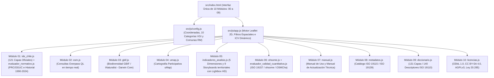

# Manual de Actualización, Arquitectura, Integridad y Contribución Técnica — Atlas VGI UAH

**Proyecto Fondecyt Regular N° 1261256 · Departamento de Geografía · Universidad Alberto Hurtado (2026)**  
**Documento Maestro Unificado:** Manual de Actualización Técnica · Arquitectura del Sistema · Protocolo de Integridad y Despliegue · Guía de Contribución Abierta.  
**Versión Consolidada del Sistema:** 131 Capas Operativas (121 Oficiales + 10 VGI) · 140 Descriptores en Diccionario · 10 Módulos Funcionales (`00` al `09`) · 7 Storyboards Territoriales · 5 Dimensiones Analíticas.

---

## 🧭 Índice de Contenidos

1. [Alcance y Objetivos del Proyecto](#1-alcance-y-objetivos-del-proyecto)
   - [Propósito del documento](#propósito-del-documento)
   - [Ámbitos y escalas territoriales de estudio](#ámbitos-y-escalas-territoriales-de-estudio)
   - [Estado de consolidación de la estructura](#estado-de-consolidación-de-la-estructura)
2. [Vías de Participación y Contribución Territorial](#2-vías-de-participación-y-contribución-territorial)
   - [Vía 1: Mapeo colaborativo en OpenStreetMap](#vía-1-mapeo-colaborativo-en-openstreetmap)
   - [Vía 2: Reporte o propuesta de datos vía GitHub Issues](#vía-2-reporte-o-propuesta-de-datos-vía-github-issues)
   - [Vía 3: Carga local de archivos en el visor](#vía-3-carga-local-de-archivos-en-el-visor)
   - [Vía 4: Contribución técnica de código y capas mediante Git](#vía-4-contribución-técnica-de-código-y-capas-mediante-git)
3. [Arquitectura y Tecnologías del Sistema](#3-arquitectura-y-tecnologías-del-sistema)
   - [Principios de diseño del software](#principios-de-diseño-del-software)
   - [Lenguajes y herramientas utilizadas](#lenguajes-y-herramientas-utilizadas)
   - [Diagrama de flujo modular de la arquitectura](#diagrama-de-flujo-modular-de-la-arquitectura)
   - [Sincronización simétrica entre directorios de trabajo y publicación](#sincronización-simétrica-entre-directorios-de-trabajo-y-publicación)
   - [Almacenamiento cartográfico dual](#almacenamiento-cartográfico-dual)
4. [Estructura del Repositorio y Anatomía de Archivos](#4-estructura-del-repositorio-y-anatomía-de-archivos)
   - [Árbol general del repositorio](#árbol-general-del-repositorio)
   - [Módulos del frontend y lógica de aplicación](#módulos-del-frontend-y-lógica-de-aplicación)
   - [Scripts de automatización y geoprocesamiento](#scripts-de-automatización-y-geoprocesamiento)
5. [Diseño Visual, Interfaz y Accesibilidad](#5-diseño-visual-interfaz-y-accesibilidad)
   - [Distribución de la pantalla principal](#distribución-de-la-pantalla-principal)
   - [Paleta de colores y componentes visuales](#paleta-de-colores-y-componentes-visuales)
   - [Insignias de geometría](#insignias-de-geometría)
   - [Criterios de accesibilidad web](#criterios-de-accesibilidad-web)
6. [Motor Cartográfico y Cálculos Geodésicos](#6-motor-cartográfico-y-cálculos-geodésicos)
   - [Visualización cartográfica en Leaflet](#visualización-cartográfica-en-leaflet)
   - [Biblioteca geodésica propia y proyecciones conformes](#biblioteca-geodésica-propia-y-proyecciones-conformes)
   - [Cálculo métrico de áreas y distancias](#cálculo-métrico-de-áreas-y-distancias)
7. [Inventario y Catálogo de Capas Territoriales](#7-inventario-y-catálogo-de-capas-territoriales)
   - [Cuadratura general de capas](#cuadratura-general-de-capas)
   - [Clasificación en cinco dimensiones analíticas](#clasificación-en-cinco-dimensiones-analíticas)
   - [Matriz multivariada y diagnóstico espacial del Barrio Brasil](#matriz-multivariada-y-diagnóstico-espacial-del-barrio-brasil)
   - [Diccionario técnico de datos](#diccionario-técnico-de-datos)
8. [Módulos Funcionales del Atlas (00 al 09)](#8-módulos-funcionales-del-atlas-00-al-09)
9. [Láminas de Análisis Territorial y Storyboards](#9-láminas-de-análisis-territorial-y-storyboards)
   - [Temáticas de las siete láminas de análisis](#temáticas-de-las-siete-láminas-de-análisis)
   - [Estructura obligatoria de los storyboards](#estructura-obligatoria-de-los-storyboards)
10. [Procedimientos de Mantención y Actualización](#10-procedimientos-de-mantención-y-actualización)
    - [Procedimiento 1: Ingesta de una nueva capa oficial del Estado](#procedimiento-1-ingesta-de-una-nueva-capa-oficial-del-estado)
    - [Procedimiento 2: Actualización de datos sin cambio de nombre](#procedimiento-2-actualización-de-datos-sin-cambio-de-nombre)
    - [Procedimiento 3: Incorporación o edición de un storyboard](#procedimiento-3-incorporación-o-edición-de-un-storyboard)
    - [Procedimiento 4: Actualización de la normativa urbana y el plan regulador](#procedimiento-4-actualización-de-la-normativa-urbana-y-el-plan-regulador)
    - [Procedimiento 5: Extracción de esquemas desde bases GeoPackage](#procedimiento-5-extracción-de-esquemas-desde-bases-geopackage)
    - [Procedimiento 6: Control de versiones en archivos estáticos](#procedimiento-6-control-de-versiones-en-archivos-estáticos)
11. [Protocolo de Integridad, Pruebas y Despliegue en Producción](#11-protocolo-de-integridad-pruebas-y-despliegue-en-producción)
    - [Reglas de integridad estructural del repositorio](#reglas-de-integridad-estructural-del-repositorio)
    - [Pruebas en servidor local](#pruebas-en-servidor-local)
    - [Ejecución de scripts automáticos de comprobación](#ejecución-de-scripts-automáticos-de-comprobación)
    - [Publicación de cambios en GitHub y Netlify](#publicación-de-cambios-en-github-y-netlify)
12. [Diagnóstico y Solución de Problemas Frecuentes](#12-diagnóstico-y-solución-de-problemas-frecuentes)
13. [Marco Legal, Licencias y Protección de Datos](#13-marco-legal-licencias-y-protección-de-datos)
    - [Régimen de licenciamiento abierto](#régimen-de-licenciamiento-abierto)
    - [Transparencia pública y privacidad de las personas](#transparencia-pública-y-privacidad-de-las-personas)
14. [Referencias Bibliográficas y Normativas](#14-referencias-bibliográficas-y-normativas)

---

## 1. Alcance y Objetivos del Proyecto

### Propósito del documento
El presente documento constituye la guía integral de mantención técnica, gobernanza de datos y contribución colaborativa para el **Atlas de Información Geográfica Voluntaria (`atlas_vgi_uah`)**. Su redacción adopta un tono técnico-profesional y académico en tercera persona, organizado para que cualquier investigadora, analista espacial o desarrollador web pueda intervenir el código, incorporar coberturas cartográficas, ajustar normativas urbanísticas o realizar despliegues a producción con total autonomía y sin requerir inducción previa.

### Ámbitos y escalas territoriales de estudio
El Atlas articula tres escalas geográficas complementarias:
1. **Escala Barrial Núcleo (Barrio Brasil)**: Polígono patrimonial consolidado de $74,85\text{ ha}$ delimitado por Av. Brasil, Alameda, Ricardo Cumming y San Pablo. Se caracteriza por un tejido morfológico tradicional de baja altura (135 inmuebles de 1 a 2 pisos), 9 cités catastrados y 4 torres residenciales en altura.
2. **Escala Universitaria (Campus UAH)**: Manzana institucional de $136,10\text{ ha}$ sobre el eje de la Alameda y estaciones de Metro Los Héroes, Moneda, Santa Ana y República.
3. **Escala Metropolitana (Santiago Poniente y Gran Santiago)**: Área de influencia extendida de $223,75\text{ ha}$ y coberturas regionales de la Región Metropolitana de Santiago en proyecciones `EPSG:4326` y `EPSG:32719`.

### Estado de consolidación de la estructura
La arquitectura actual representa la versión consolidada definitiva de la plataforma. Las actividades de cierre del proyecto —correspondientes a la validación participativa con vecinos y afinamientos analíticos menores— se implementan directamente sobre los módulos, catálogos e indicadores ya en funcionamiento, sin alterar el diseño de software aquí establecido.

---

## 2. Vías de Participación y Contribución Territorial

El proyecto cuenta con cuatro modalidades de colaboración según las capacidades e intereses de cada persona o colectivo:

### Vía 1: Mapeo colaborativo en OpenStreetMap
OpenStreetMap (OSM) constituye la base de datos comunitaria del Atlas. Cualquier dato incorporado o corregido en OSM se refleja en el visor mediante consultas en tiempo real:
1. Acceder a [OpenStreetMap.org](https://www.openstreetmap.org/) con una cuenta de usuario.
2. Abrir el editor web visual **iD** sobre el sector del Barrio Brasil y Campus UAH.
3. Relevar o actualizar elementos cotidianos:
   - **Comercio y servicios barriales**: Almacenes, panaderías, farmacias, librerías (`shop=*`, `amenity=*`).
   - **Accesibilidad y caminabilidad**: Rebajes de vereda (`kerb=lowered`), rampas peatonales, cruces con semáforo (`highway=crossing` con `crossing=traffic_signals`) y estacionamientos de bicicletas (`amenity=bicycle_parking`).
   - **Espacio público y naturaleza urbana**: Arbolado urbano (`natural=tree`), bancas públicas (`amenity=bench`), iluminación peatonal (`highway=street_lamp`) y puntos limpios (`amenity=recycling`).
4. Al guardar la edición, incluir en el comentario del conjunto de cambios (*changeset comment*) la etiqueta:
   ```text
   #AtlasVGI_UAH #BarrioBrasil
   ```
   Esta etiqueta permite que el módulo de auditoría histórica del Atlas (Módulo 06) certifique la trazabilidad del aporte comunitario.

---

### Vía 2: Reporte o propuesta de datos vía GitHub Issues
Cuando se identifique un desfase cartográfico, una capa desactualizada o se cuente con un levantamiento barrial propio:
1. Ingresar a [GitHub Issues](https://github.com/GEOJOTA/atlas_vgi_uah/issues).
2. Crear un nuevo reporte con la siguiente estructura:
   - **Tipo de contribución**: Corrección de dato existente, propuesta de nueva capa o reporte de inconsistencia.
   - **Fenómeno territorial**: Nombre del equipamiento, espacio o problemática (por ejemplo, *Puntos limpios comunitarios en calle Maturana*).
   - **Categoría sugerida**: Dimensión temática o institución pública de referencia.
   - **Ubicación o tramo**: Calles de referencia o coordenadas aproximadas.
   - **Fuente de verificación**: Enlace a geoportal institucional, documento público o fecha del levantamiento en terreno.
   - **Organización o colaborador**: Junta de vecinos, colectivo barrial o institución educativa.
   - **Fundamentación**: Breve explicación de la relevancia del dato para la gestión comunitaria del barrio.

El equipo del Departamento de Geografía de la Universidad Alberto Hurtado evaluará la geometría y la incorporará al catálogo formal.

---

### Vía 3: Carga local de archivos en el visor
Para contrastar datos propios de forma inmediata en asambleas vecinales o talleres técnicos sin necesidad de instalar software SIG de escritorio:
1. Abrir la plataforma en el navegador: [atlasvgiuah.netlify.app](https://atlasvgiuah.netlify.app/).
2. En el **Módulo 01 (Visor para la gestión territorial)**, pulsar el botón **"📂 Cargar Archivo Local"**.
3. Arrastrar un archivo en formato `.geojson`, `.kml`, `.kmz`, `.gpx` o `.csv` (con columnas de latitud y longitud).
4. El visor proyectará las entidades directamente sobre las 131 capas del sistema. Esta operación se procesa localmente en la memoria del navegador, garantizando la privacidad de los datos.

---

### Vía 4: Contribución técnica de código y capas mediante Git
Para desarrolladoras, investigadoras y analistas espaciales:
1. Realizar un *fork* del repositorio oficial a una cuenta personal de GitHub.
2. Clonar el repositorio localmente:
   ```bash
   git clone https://github.com/TU_USUARIO/atlas_vgi_uah.git
   cd atlas_vgi_uah
   ```
3. Crear una rama de trabajo temática:
   ```bash
   git checkout -b feat/nueva-capa-residuos
   ```
4. Realizar las modificaciones respetando los procedimientos técnicos documentados en la [Sección 10](#10-procedimientos-de-mantención-y-actualización).
5. Ejecutar la batería de pruebas automatizadas:
   ```bash
   python scripts/verificar_conteo_capas.py
   python scripts/verificar_integridad_despliegue.py
   python scripts/analisis_metacalidad.py
   ```
6. Enviar una solicitud de incorporación de cambios (*Pull Request*) hacia la rama `main` del repositorio oficial.

---

## 3. Arquitectura y Tecnologías del Sistema

### Principios de diseño del software
La plataforma implementa una arquitectura estática autónoma del lado del cliente. A diferencia de los sistemas de información geográfica tradicionales basados en servidores de mapas propietarios y costosos (ArcGIS Server, GeoServer y motores PostgreSQL/PostGIS dedicados), el Atlas VGI UAH se ejecuta directamente en el navegador web mediante tecnologías abiertas y peticiones asíncronas optimizadas (`Fetch API`).

Esta formulación ofrece tres ventajas operativas esenciales:
1. **Sostenibilidad y costo cero**: La plataforma no requiere servidores de pago, asegurando su funcionamiento continuo en servicios de alojamiento estático como **Netlify** y **GitHub Pages**.
2. **Independencia de herramientas de compilación**: No se emplean empaquetadores complejos (Webpack, Vite) ni dependencias que sufran obsolescencia rápida. Cualquier cambio en HTML, CSS o JavaScript se refleja de inmediato sin pasos intermedios de compilación.
3. **Portabilidad y preservación digital**: El repositorio completo puede ejecutarse de manera local sin conexión a internet y preservarse a largo plazo como archivo digital abierto.

### Lenguajes y herramientas utilizadas
- **HTML5 semántico**: Estructuración accesible con roles ARIA para facilitar la navegación y lectura de pantalla.
- **CSS3 estructurado**: Hoja de estilos centralizada en [`src/css/estilos.css`](file:///d:/17082025/2026/Practica%20profesional/atlas_vgi_uah/src/css/estilos.css) con variables nativas (`:root`), maquetación por Grid y Flexbox, y diseño adaptativo a múltiples tamaños de pantalla.
- **Vanilla JavaScript ES6+ modular**: Código organizado bajo el patrón de módulo revelador mediante funciones inmediatas (IIFE). Cada módulo encapsula sus variables internas y expone una interfaz pública en el objeto global `window`.
- **Python 3.10+**: Conjunto de scripts de geoprocesamiento, análisis espacial multivariado, cálculo del índice de metacalidad (ISO 19115/19157) y validación previa al despliegue.
- **Estándar GeoJSON (RFC 7946; Butler et al., 2016)**: Formato de intercambio para las 131 coberturas cartográficas, almacenadas en coordenadas geográficas WGS84 (`EPSG:4326`) y codificación UTF-8.
- **Estándar OGC GeoPackage v1.2**: Formato relacional SQLite utilizado para preservar esquemas y comentarios técnicos nativos de columnas en fuentes estatales complejas (SUBDERE RSD 2024).

### Diagrama de flujo modular de la arquitectura



### Sincronización simétrica entre directorios de trabajo y publicación
El archivo [`netlify.toml`](file:///d:/17082025/2026/Practica%20profesional/atlas_vgi_uah/netlify.toml) establece que la raíz de publicación web en producción es el directorio `src/`:

```toml
[build]
  publish = "src"

[[headers]]
  for = "/*"
  [headers.values]
    Access-Control-Allow-Origin = "*"
```

Dado que los scripts de auditoría y análisis en Python se ejecutan desde la raíz del repositorio, se debe mantener una **regla de sincronización simétrica**:
- Todo archivo de datos `.geojson` o `.gpkg` guardado en `data/` debe tener una réplica idéntica en `src/data/`.
- Todo documento `.md`, `.json` o `.xlsx` de `docs/` debe replicarse simétricamente en `src/docs/`.

### Almacenamiento cartográfico dual
- **Archivos para visualización web (`.geojson`)**: Las 131 coberturas se sirven al navegador en formato GeoJSON bajo coordenadas geográficas `EPSG:4326`.
- **Archivos para preservación de esquemas (`.gpkg`)**: En bases de datos oficiales que incluyen diccionarios incrustados como comentarios en la definición SQL de las tablas (específicamente las 13 capas del Catastro Nacional de Residuos Sólidos Domiciliarios SUBDERE 2024, `bbdd_86` a `bbdd_98`), se resguardan los archivos `.gpkg` originales tanto en `data/` como en `src/data/`.

---

## 4. Estructura del Repositorio y Anatomía de Archivos

### Árbol general del repositorio

```text
atlas_vgi_uah/
├── netlify.toml                         # Configuración de publicación web en producción
├── README.md                            # Resumen institucional y presentación del proyecto
├── CONTRIBUTING.md                      # Esta guía unificada de mantención y contribución
├── MANUAL_ACTUALIZACION_ATLAS.md        # Documento espejo de la guía de mantención
├── MANUAL_USO.md                        # Manual de Uso del sistema para el usuario final
├── PROTOCOL_INTEGRIDAD_Y_DESPLIEGUE.md  # Protocolo técnico de verificación pre-despliegue
│
├── data/                                # REPOSITORIO MAESTRO DE DATOS (Espejo de src/data/)
│   ├── *.geojson                        # 131 coberturas cartográficas vectoriales en EPSG:4326
│   ├── *.gpkg                           # Geodatabases originales con diccionarios de columnas
│   ├── geodatabase_completa_atlas_vgi.zip # Paquete comprimido maestro para descarga (542 MB)
│   └── matriz_sintesis_barrio_brasil_manzanas.geojson # Matriz de 51 manzanas y 44 variables
│
├── docs/                                # DOCUMENTACIÓN Y CATÁLOGOS ABIERTOS (Espejo de src/docs/)
│   ├── ARQUITECTURA.md                  # Especificación de arquitectura y flujo de datos
│   ├── BIBLIOGRAFIA_SEMINARIO_Y_ATLAS.md# 125 referencias bibliográficas completas en APA 7ª ed.
│   ├── TRAZABILIDAD_ACADEMICA.md        # Memoria técnica del proyecto Fondecyt F1261256
│   ├── ANALISIS_METACALIDAD.md          # Reporte de calidad cuantitativa y cualitativa ISO 19157
│   ├── matriz_metacalidad.json          # Matriz de métricas calculada por scripts
│   ├── categorias_tematicas_osm.xlsx    # Catálogo OpenXML de categorías VGI
│   ├── catalogo_fuentes_vgi.xlsx        # Catálogo OpenXML de fuentes oficiales
│   └── perfil_metadatos_vgi.xlsx        # Catálogo OpenXML del perfil de metadatos IDE Chile
│
├── scripts/                             # BATERÍA DE AUTOMATIZACIÓN Y AUDITORÍA EN PYTHON
│   ├── verificar_conteo_capas.py        # Audita cuadratura: 131 capas, 140 descriptores y dimensiones
│   ├── verificar_integridad_despliegue.py # Verifica sintaxis JSON, ausencia de LFS y paridad de archivos
│   ├── analisis_metacalidad.py          # Calcula el Índice Global de MetaCalidad (ISO 19115 / 19157)
│   └── procesar_bbdd_vgi.py             # Utilidad de reproyección e ingesta batch
│
└── src/                                 # DIRECTORIO DE PUBLICACIÓN WEB EN PRODUCCIÓN
    ├── index.html                       # Interfaz única: 10 pestañas (00-09), visor Leaflet y subpaneles
    ├── data/                            # Espejo idéntico de data/ consumido por el navegador
    ├── docs/                            # Espejo idéntico de docs/ para descargas directas del usuario
    ├── css/
    │   └── estilos.css                  # Sistema de diseño, paleta cromática y estilos responsivos
    └── js/
        ├── config.js                    # Bbox barrial, coordenadas de inicio y 10 categorías VGI
        ├── app.js                       # Controlador maestro, eventos de mapa, filtros e ICV dinámico
        └── modulos/
            ├── geodesia.js              # Biblioteca geodésica propia: proyecciones UTM 19S y áreas
            ├── mapa.js                  # Inicialización de Leaflet, capas base y controladores
            ├── ide_chile.js             # Catálogo de las 121 capas oficiales del Estado
            ├── evaluador_normativo.js   # Inspector Normativo PRC/OGUC e hitos históricos 1990-2024
            ├── osm.js                   # Módulo 02: Consultas en tiempo real vía Overpass API
            ├── gbif.js                  # Módulo 03: Registros de biodiversidad GBIF / iNaturalist
            ├── umap.js                  # Módulo 04: Integración de mapas participativos uMap
            ├── indicadores_analisis.js  # Módulo 05: 5 Dimensiones Analíticas y 9 Storyboards territoriales
            ├── ohsome.js                # Módulo 06: Series temporales ohsome API y auditoría OSMCha
            ├── evaluador_calidad_cuantitativa.js # Módulo 06: Matriz multicriterio ISO 19157
            ├── manual.js                # Módulo 07: Renderizador interactivo de manuales de uso y actualización
            ├── metadatos.js             # Módulo 08: Generador de fichas XML/JSON (ISO 19115 / 19139)
            ├── diccionario.js           # Módulo 09: Diccionario de Datos (140 descriptores, ISO 19110)
            └── licencias.js             # Módulo 10: Régimen de licencias y descarga de matrices Excel
            ├── taginfo.js               # Utilidad de validación de etiquetas con Taginfo API
            ├── calidad_analyst.js       # Asistente analítico de consistencia espacial
            ├── db_client.js             # Conector de persistencia cliente (Supabase)
            └── importador_capas.js      # Procesador cliente de subida de archivos espaciales locales
```

### Módulos del frontend y lógica de aplicación
Cada módulo en `src/js/modulos/` opera como un componente autocontenido:
- [`geodesia.js`](file:///d:/17082025/2026/Practica%20profesional/atlas_vgi_uah/src/js/modulos/geodesia.js): Contiene las fórmulas trigonométricas de transformación conforme entre coordenadas geográficas (`EPSG:4326`) y la proyección UTM 19 Sur (`EPSG:32719`), así como el algoritmo del área de Gauss.
- [`ide_chile.js`](file:///d:/17082025/2026/Practica%20profesional/atlas_vgi_uah/src/js/modulos/ide_chile.js): Declara el catálogo `CAPAS_OFICIALES` con las 121 coberturas del Estado.
- [`evaluador_normativo.js`](file:///d:/17082025/2026/Practica%20profesional/atlas_vgi_uah/src/js/modulos/evaluador_normativo.js): Implementa la lógica de intersección de usos de suelo (Art. 2.1.24 OGUC), emisión del certificado CIN-VGI e incorpora los 10 hitos históricos del PRC de Santiago.
- [`indicadores_analisis.js`](file:///d:/17082025/2026/Practica%20profesional/atlas_vgi_uah/src/js/modulos/indicadores_analisis.js): Gestiona la matriz de 5 dimensiones analíticas y renderiza las 7 láminas monográficas de análisis territorial.
- [`manual.js`](file:///d:/17082025/2026/Practica%20profesional/atlas_vgi_uah/src/js/modulos/manual.js): Construye la vista interactiva de documentación dentro del Módulo 07, con filtrado en vivo e inventario de capas.

### Scripts de automatización y geoprocesamiento
- [`verificar_conteo_capas.py`](file:///d:/17082025/2026/Practica%20profesional/atlas_vgi_uah/scripts/verificar_conteo_capas.py): Comprueba la paridad numérica exacta entre las capas declaradas en `ide_chile.js`, `config.js`, `indicadores_analisis.js` y `diccionario.js`.
- [`verificar_integridad_despliegue.py`](file:///d:/17082025/2026/Practica%20profesional/atlas_vgi_uah/scripts/verificar_integridad_despliegue.py): Audita los 216 archivos GeoJSON, certifica la ausencia de punteros Git LFS y valida la simetría entre `data/` y `src/data/`.
- [`analisis_metacalidad.py`](file:///d:/17082025/2026/Practica%20profesional/atlas_vgi_uah/scripts/analisis_metacalidad.py): Evalúa los diez criterios de las normas ISO 19115-1:2014 e ISO 19157:2013, generando los reportes JSON, Markdown y hojas de cálculo Excel.

---

## 5. Diseño Visual, Interfaz y Accesibilidad

### Distribución de la pantalla principal
La interfaz se organiza en torno a tres áreas principales:
1. **Encabezado institucional**: Contiene el logotipo de la Universidad Alberto Hurtado, la identificación del proyecto Fondecyt F1261256 y la barra horizontal de navegación con las 10 pestañas de módulos (`00` al `09`).
2. **Lienzo cartográfico central (`#mapa`)**: Gestionado mediante Leaflet, permite el desplazamiento, cambio de escala, consulta de atributos e interacción con los elementos vectoriales.
3. **Barra de herramientas flotantes**: Permite alternar entre los encuadres territoriales predefinidos, activar la herramienta de dibujo de recuadros con cálculo métrico en hectáreas y descargar la geodatabase completa en `.zip`.
4. **Paneles laterales colapsables**: Agrupan el catálogo de capas oficiales por ministerio e institución, el panel de métricas dinámicas de calidad VGI y el formulario del inspector normativo.
5. **Ventanas modales**: Paneles de lectura expandida para la revisión de storyboards territoriales y la emisión de certificados normativos descargables.

### Paleta de colores y componentes visuales
El diseño adopta una estética oscura funcional, optimizada para destacar la cartografía temática y reducir el cansancio visual durante jornadas prolongadas de trabajo:
- Fondo general de la aplicación: `#0b1329` (azul pizarra oscuro).
- Superficie de tarjetas y paneles: `rgba(15, 23, 42, 0.75)` (tono translúcido).
- Color de acento para capas oficiales: `#38bdf8` (cyan).
- Color de acento para capas comunitarias VGI: `#10b981` (verde esmeralda).
- Color de alerta y storyboards normativos: `#f59e0b` (ámbar).
- Color para patrimonio y conservación histórica: `#a855f7` (púrpura).
- Color de advertencia normativa o riesgo: `#ef4444` (rojo).

### Insignias de geometría
Para facilitar la rápida identificación del tipo de dato en los listados del visor:
- `● PUN` (Puntos, verde esmeralda): Equipamientos puntuales, árboles, semáforos o monumentos.
- `― LÍN` (Líneas, cyan): Redes viales, ciclovías, líneas de metro o rutas de transporte.
- `■ POL` (Polígonos, púrpura): Manzanas censales, zonas del plan regulador, predios o parques.

### Criterios de accesibilidad web
- **Contraste de colores**: Se mantiene una relación de contraste mínima de 4.5:1 entre el texto y el fondo para garantizar su legibilidad según las pautas WCAG 2.1 nivel AA.
- **Navegación accesible**: Todos los elementos interactivos cuentan con estados de enfoque claramente visibles para personas que utilizan el teclado.
- **Etiquetado semántico**: Se utilizan atributos `aria-label`, `aria-hidden` y `aria-expanded` para una correcta interpretación por lectores de pantalla.

---

## 6. Motor Cartográfico y Cálculos Geodésicos

### Visualización cartográfica en Leaflet
En [`src/js/modulos/mapa.js`](file:///d:/17082025/2026/Practica%20profesional/atlas_vgi_uah/src/js/modulos/mapa.js), el visor se inicializa con los siguientes parámetros:
- **Centro cartográfico**: Latitud `-33.4410`, Longitud `-70.6660` (Plaza Brasil).
- **Escala de inicio**: Nivel de zoom `15` (escala barrial).
- **Límites de visualización**: Área restringida a la Región Metropolitana (`[[-33.9, -71.2], [-33.0, -70.1]]`).
- **Capas base**: CartoDB DarkMatter (predeterminada), OpenStreetMap Standard y Satélite ESRI.

### Biblioteca geodésica propia y proyecciones conformes
Para evitar los errores comunes de deformación de distancias y superficies que produce la proyección Web Mercator (`EPSG:3857`) en la latitud de Santiago ($-33,4^\circ$), el Atlas cuenta con una biblioteca geodésica propia en [`src/js/modulos/geodesia.js`](file:///d:/17082025/2026/Practica%20profesional/atlas_vgi_uah/src/js/modulos/geodesia.js).

La formulación implementa las ecuaciones rigurosas de la proyección Transversa de Mercator (Snyder, 1987) para el elipsoide WGS84 en la **Zona UTM 19 Sur (`EPSG:32719`)**:
- Semieje mayor del elipsoide: $a = 6.378.137,0\text{ m}$.
- Factor de achatamiento: $f = 1 / 298,257223563$.
- Meridiano central: $\lambda_0 = -69,0^\circ\text{ W}$.
- Falso Este: $X_0 = 500.000,0\text{ m}$.
- Falso Norte: $Y_0 = 10.000.000,0\text{ m}$.
- Factor de escala en el meridiano central: $k_0 = 0,9996$.

### Cálculo métrico de áreas y distancias
1. **Transformación de coordenadas**: `ModuloGeodesia.geograficasAUTM(lat, lon)` convierte pares geográficos decimales en coordenadas métricas planas Este ($X$) y Norte ($Y$).
2. **Cálculo de superficie**: `ModuloGeodesia.calcularAreaPoligono(coordsGeograficas)` proyecta los vértices y aplica la fórmula del área de Gauss (Shoelace), entregando el resultado en metros cuadrados ($\text{m}^2$) y hectáreas ($\text{ha}$) con reducción de escala geodésica.
3. **Cálculo de distancias**: `ModuloGeodesia.calcularDistanciaMetros(p1, p2)` calcula la distancia geodésica mediante la fórmula de Haversine sobre el elipsoide.

---

## 7. Inventario y Catálogo de Capas Territoriales

### Cuadratura general de capas
El sistema mantiene una consistencia cuantitativa estricta entre todos sus módulos:

```text
  121 Capas Oficiales del Estado (ide_chile.js)
+  10 Macro-categorías VGI Comunitarias (config.js)
--------------------------------------------------------
= 131 Capas Cartográficas Operativas en el Visor
```

```text
  131 Capas Cartográficas Operativas
+   9 Tablas de Referencia y Esquemas Normalizados
--------------------------------------------------------
= 140 Descriptores Técnicos en el Diccionario (diccionario.js)
```

### Clasificación en cinco dimensiones analíticas
En [`src/js/modulos/indicadores_analisis.js`](file:///d:/17082025/2026/Practica%20profesional/atlas_vgi_uah/src/js/modulos/indicadores_analisis.js), las 131 coberturas se distribuyen en cinco dimensiones temáticas:

| Dimensión Temática | Código Interno | Número de Capas | Contenido Resumido |
| :--- | :--- | :---: | :--- |
| **Dimensión 01 · Sociodemográfica** | `dim-sociodemografica` | **19 capas** | Censo 2024 (población, tramos etarios, migración, pueblos originarios), RSH y densidad. |
| **Dimensión 02 · Socioeconómica** | `dim-socioeconomica` | **18 capas** | Vulnerabilidad socioeconómica (CSE), inversión pública BIP, comercio y avalúos fiscales SII. |
| **Dimensión 03 · Socioambiental** | `dim-socioambiental` | **36 capas** | Arbolado, áreas verdes, ruido ambiental MMA, GBIF y las 13 capas de residuos SUBDERE 2024. |
| **Dimensión 04 · Sociosanitaria** | `dim-sociosanitaria` | **3 capas** | Red asistencial de salud (CESFAM N° 1), farmacias comunitarias y dependencia funcional RSH. |
| **Dimensión 05 · Sociourbana o Habitabilidad** | `dim-sociourbana` | **55 capas** | Zonificación PRC Santiago, PRMS, alturas de edificación, 9 cités, patrimonio ZCH/ICH y movilidad. |
| **TOTAL CONSOLIDADO** | **5 Dimensiones** | **131 capas** | **Totalidad de coberturas cartográficas cuadradas.** |

### Matriz multivariada y diagnóstico espacial del Barrio Brasil
El archivo [`src/data/matriz_sintesis_barrio_brasil_manzanas.geojson`](file:///d:/17082025/2026/Practica%20profesional/atlas_vgi_uah/src/data/matriz_sintesis_barrio_brasil_manzanas.geojson) sintetiza el análisis territorial sobre las **51 manzanas censales consolidadas del Barrio Brasil**:
- **44 Variables Cuantitativas**: Densidad poblacional, porcentaje de arriendo, avalúo fiscal promedio, presencia de cités, nivel de ruido ponderado (MMA), áreas verdes per cápita a 300 y 500 metros, y distancia a estaciones de Metro.
- **Descomposición por Análisis de Componentes Principales (PCA)**: Cuatro dimensiones ortogonales que explican el $60,85\%$ de la variabilidad espacial.
- **Tipologías Urbanas mediante Clustering Ward**: Agrupamiento de las 51 manzanas en 4 tipologías socioespaciales diferenciadas.
- **Autocorrelación Espacial Local (LISA de Anselin)**: Detección de conglomerados significativos (*High-High*, *Low-Low*, *High-Low*, *Low-High*) con matriz Queen y 999 permutaciones de Monte Carlo.

### Diccionario técnico de datos
En [`src/js/modulos/diccionario.js`](file:///d:/17082025/2026/Practica%20profesional/atlas_vgi_uah/src/js/modulos/diccionario.js), los **140 descriptores técnicos** cumplen con el estándar **ISO 19110:2016**, detallando para cada capa su institución custodia, geometría, norma legal de origen y la definición semántica de cada una de sus columnas.

---

## 8. Módulos Funcionales del Atlas (00 al 09)

| Módulo | Nombre en Interfaz | Archivo Principal | Funcionalidad Principal |
| :---: | :--- | :--- | :--- |
| **`00`** | **Visor para la gestión territorial** | `src/js/app.js`<br>`src/js/modulos/mapa.js`<br>`src/js/modulos/evaluador_normativo.js` | Visualización de las 131 capas cartográficas; cálculo en tiempo real del Índice de Calidad VGI (ICV); delimitación de Bbox geodésico; **Inspector Normativo PRC/OGUC** que analiza la zonificación comunal e intercomunal, evalúa usos permitidos y prohibidos (Art. 2.1.24 OGUC), emite el **Certificado CIN-VGI** e incluye el historial de las **10 modificaciones al PRC de Santiago (1990–2024)** vinculadas a los expedientes oficiales de Asesoría Urbana; e importación local de archivos espaciales. |
| **`01`** | **Consultas Overpass (OSM)** | `src/js/modulos/osm.js` | Constructor visual de consultas y ejecución de sentencias en lenguaje Overpass QL para la extracción en tiempo real de geometrías y etiquetas desde OpenStreetMap. |
| **`02`** | **Calidad & ICV (ISO 19157)** | `src/js/modulos/ohsome.js`<br>`src/js/modulos/evaluador_calidad_cuantitativa.js` | Evaluación multicriterio de calidad según ISO 19157:2013 mediante combinación lineal ponderada (WLC / AHP); análisis de series temporales históricas con la API ohsome de HeiGIT; y auditoría de conjuntos de cambios con OSMCha. |
| **`03`** | **Biodiversidad GBIF** | `src/js/modulos/gbif.js` | Conexión directa a las bases de datos abiertas de GBIF e iNaturalist para la consulta y visualización de registros biológicos urbanos bajo el estándar Darwin Core. |
| **`04`** | **Cartografía uMap** | `src/js/modulos/umap.js` | Galería interactiva e integración de proyectos territoriales elaborados en la plataforma colaborativa uMap para actividades comunitarias y talleres participativos. |
| **`05`** | **Metadatos ISO 19115** | `src/js/modulos/metadatos.js` | Generación y exportación de fichas técnicas de metadatos en formatos JSON y XML (ISO 19139:2007) homologadas con el Perfil Nacional de Metadatos de Chile (IDE Chile / SNIT). |
| **`06`** | **Diccionario de Datos** | `src/js/modulos/diccionario.js` | Consulta interactiva de los 140 descriptores técnicos de capas y atributos bajo el estándar ISO 19110:2016, incluyendo los diccionarios de columnas de las 13 capas SUBDERE RSD 2024. |
| **`07`** | **Licencias & Catálogos** | `src/js/modulos/licencias.js` | Documentación del marco legal abierto (ODbL 1.0, CC BY-SA 4.0, AGPLv3, Ley N° 20.285 y Ley N° 19.628) y descarga directa de catálogos en formato Excel (.xlsx). |
| **`08`** | **Manual de Uso y Actualización** | `src/js/modulos/manual.js` | Visualizador interactivo de la documentación técnica del sistema, con buscador por palabras clave, inventario dinámico de capas y descarga de manuales en Markdown. |
| **`09`** | **Indicadores & Storyboards** | `src/js/modulos/indicadores_analisis.js` | Consulta de indicadores territoriales organizados en 5 dimensiones analíticas y lectura de las 7 láminas monográficas de análisis territorial. |

---

## 9. Láminas de Análisis Territorial y Storyboards

### Temáticas de las siete láminas de análisis
Cada storyboard aborda un fenómeno socioterritorial específico mediante el cruce de datos espaciales:

1. **Lámina 1 · Habitar, Altura y Presión sobre el Tejido Patrimonial**:
   - Analiza la convivencia entre los 135 inmuebles de 1 a 2 pisos protegidos como Zona de Conservación Histórica (ZCH B1) frente al avance de torres habitacionales en los bordes de la Alameda.
   - *Capas utilizadas*: `minvu_patrimonio`, `minvu_ipt_prc_santiago`, `catastro_predial_sii`, `bbdd_19`, `cat09_edificaciones`.
2. **Lámina 2 · Movilidad Sustentable y Caminabilidad Peatonal**:
   - Evalúa los tiempos de caminata hacia el Metro (Líneas 1, 2 y 5), la continuidad de las ciclovías y la seguridad peatonal en cruces regulados por la UOCT.
   - *Capas utilizadas*: `cat05_transporte`, `lineas_metro`, `estaciones_metro`, `ciclovias_subdere`, `semaforos_rm_uoct_2026`.
3. **Lámina 3 · El Oasis Verde del Barrio Brasil: Cobertura Arbórea y Biodiversidad**:
   - Cuantifica la disparidad en la dotación de áreas verdes ($2,1\text{ m}^2/\text{hab}$ en manzanas interiores frente a $46\text{ m}^2/\text{hab}$ en torno a la Plaza Brasil) y el rol del arbolado en la mitigación del ruido urbano.
   - *Capas utilizadas*: `cat08_espaciopublico`, `bbdd_40`, `bbdd_42`, `mma_ruido_gran_santiago_2010`, `catastro_vegetacional`.
4. **Lámina 4 · Campus UAH y Vitalidad Económica Cotidiana**:
   - Examina el rol de la universidad como motor de la vida de barrio y su vinculación con los 381 locales comerciales y gastronómicos del sector.
   - *Capas utilizadas*: `cat01_educacion`, `cat03_comercio`, `bbdd_12`, `bbdd_14`, `red_vial_caminera`.
5. **Lámina 5 · Cuidados, Género y Salud Comunitaria**:
   - Visibiliza el envejecimiento de la población barrial (índice de 118 adultos mayores por cada 100 menores de 15 años), la feminización de las tareas de cuidado no remunerado ($84,6\%$) y las barreras arquitectónicas en casonas y cités.
   - *Capas utilizadas*: `establecimientos_salud`, `bbdd_67`, `bbdd_70`, `bbdd_66`, `bbdd_73`.
6. **Lámina 6 · Metabolismo Urbano y Residuos Sólidos Domiciliarios (SUBDERE RSD 2024)**:
   - Reconstruye la ruta de las 189.510 toneladas anuales de residuos generadas en Santiago Centro ($500,78\text{ kg/hab/año}$), desde las calles del barrio hasta la Estación de Transferencia Quilicura (12,1 km en camión) y su transporte en tren de carga durante 49 km hasta el Relleno Sanitario Loma Los Colorados en Tiltil ($61,1\text{ km}$ totales), con un costo municipal anual de $\$14.845$ millones CLP según el SINIM.
   - *Capas utilizadas*: `bbdd_86`, `bbdd_87`, `bbdd_89`, `bbdd_91`, `bbdd_94`, `cat03_comercio`.
7. **Lámina 7 · Treinta Años de Disputa Normativa: Las Modificaciones al PRC en Barrio Brasil (1990–2024)**:
   - Sistematiza cómo 10 modificaciones al Plan Regulador Comunal de Santiago (Seccional Brasil, Modificaciones N° 16, 21, 26 y 31, Enmienda N° 2 de Cités, Enmiendas de Altura N° 1, 3 y 6) frenaron la demolición indiscriminada, protegieron los **9 cités catastrados** y consolidaron la protección del $80,4\%$ del barrio bajo conservación histórica frente a la brecha de renta inmobiliaria (*Rent Gap*).
   - *Capas utilizadas*: `minvu_prc`, `minvu_patrimonio`, `cmn_monumentos`, `cat02_vivienda`.

### Estructura obligatoria de los storyboards
Para que la ventana modal `abrirLaminaStoryboard` en [`src/js/modulos/indicadores_analisis.js`](file:///d:/17082025/2026/Practica%20profesional/atlas_vgi_uah/src/js/modulos/indicadores_analisis.js) funcione correctamente, cada objeto del arreglo `STORYBOARDS` debe contener obligatoriamente las siguientes diez propiedades en su sección `contenido`:
1. `introduccion`: Párrafo de apertura o síntesis general (cadena de texto).
2. `datosClave`: Arreglo de tarjetas con indicadores destacados (`{ valor, label, sub }`).
3. `porcentajesClave`: Arreglo de barras de porcentaje (`{ label, valor, porcentaje, contexto }`).
4. `graficoComparativo`: Objeto con `titulo` y arreglo `filas` compuesto por `{ label, valor, porcentaje }`.
5. `diagramaSVG`: Función que retorna el código vectorial SVG: `() => '<svg ...>...</svg>'`.
6. `tablaIndicadores`: Arreglo de filas con `{ variable, valor, referencial, fuente }`.
7. `cuerpo`: Arreglo de cadenas de texto con los párrafos de análisis detallado.
8. `conclusion`: Párrafo de cierre con implicancias para la gestión territorial.
9. `analisisPorActor`: Arreglo de cuatro perfiles de usuario con `{ id, icono, nombre, subtitulo, utilidad }`, utilizando los identificadores `institucion`, `comunidad`, `voluntario` y `ong`.
10. `apartadoBibliografico`: Objeto con los arreglos `fuentesDatos` y `referenciasAcademicas` en formato APA 7ª edición.

---

## 10. Procedimientos de Mantención y Actualización

### Procedimiento 1: Ingesta de una nueva capa oficial del Estado

#### Paso 1. Preparación del archivo
- Asegurar que la capa se encuentre en coordenadas geográficas WGS84 (`EPSG:4326`) con latitud y longitud en grados decimales.
- Exportar en formato GeoJSON con codificación UTF-8 sin BOM (ejemplo: `bbdd_99.geojson`).

#### Paso 2. Copia en los directorios correspondientes
El archivo debe depositarse simétricamente en ambas rutas del repositorio:
```bash
cp origen/bbdd_99.geojson data/bbdd_99.geojson
cp origen/bbdd_99.geojson src/data/bbdd_99.geojson
```

#### Paso 3. Registro en el catálogo oficial
Abrir [`src/js/modulos/ide_chile.js`](file:///d:/17082025/2026/Practica%20profesional/atlas_vgi_uah/src/js/modulos/ide_chile.js) e incorporar la definición en `CAPAS_OFICIALES`:
```javascript
  bbdd_99: {
    id: 'bbdd_99',
    nombre: 'Puntos Limpios y Reciclaje Barrial (BBDD-99)',
    institucion: 'Ilustre Municipalidad de Santiago / MMA',
    urlServicio: 'https://ide.minvu.cl/',
    archivoLocal: 'data/bbdd_99.geojson',
    color: '#10b981',
    peso: 2,
    opacidadRelleno: 0.35,
    geometria: 'Punto', // 'Punto' | 'Línea' | 'Polígono'
    num_bbdd: 99,
    licencia: 'Datos Abiertos / Ley 20.285',
    descripcion: 'Catastro georreferenciado de infraestructura de reciclaje en Barrio Brasil.'
  },
```

#### Paso 4. Incorporación del botón en la interfaz
En [`src/index.html`](file:///d:/17082025/2026/Practica%20profesional/atlas_vgi_uah/src/index.html), añadir el botón dentro del acordeón correspondiente en `#subpanel-ide`:
```html
<button type="button" class="chip-oficial" id="btn-oficial-bbdd_99" data-capa="bbdd_99" title="Ilustre Municipalidad de Santiago / MMA">
  <span class="dot-color" style="background:#10b981;"></span>
  <span class="nombre-chip">99. Puntos Limpios y Reciclaje Barrial</span>
  <span class="badge-institucion-chip">MUNISTGO</span>
  <span class="badge-geom-chip">● PUN</span>
</button>
```

#### Paso 5. Asociación a dimensión analítica y diccionario
1. En [`src/js/modulos/indicadores_analisis.js`](file:///d:/17082025/2026/Practica%20profesional/atlas_vgi_uah/src/js/modulos/indicadores_analisis.js):
   - Registrar el nombre en `NOMBRES_OFICIALES_FALLBACK`.
   - Añadir `'bbdd_99'` al arreglo `capasIds` de la dimensión analítica correspondiente en `DIMENSIONES`.
2. En [`src/js/modulos/diccionario.js`](file:///d:/17082025/2026/Practica%20profesional/atlas_vgi_uah/src/js/modulos/diccionario.js):
   - Registrar la capa y el detalle de sus atributos en `CATALOGO_DICCIONARIO`.

#### Paso 6. Ajuste de los umbrales de comprobación
Actualizar el número esperado de capas en [`scripts/verificar_conteo_capas.py`](file:///d:/17082025/2026/Practica%20profesional/atlas_vgi_uah/scripts/verificar_conteo_capas.py) y ejecutar las pruebas automáticas.

---

### Procedimiento 2: Actualización de datos sin cambio de nombre
Cuando se dispone de una nueva versión de una capa existente (por ejemplo, una actualización del catastro predial o del censo) conservando el mismo nombre de archivo:
1. Verificar que el archivo resultante mantenga el CRS `EPSG:4326` y los mismos nombres de atributos.
2. Sobrescribir el archivo de manera idéntica en `data/` y en `src/data/`.
3. El visor Leaflet y los cálculos de calidad leerán las nuevas geometrías automáticamente en la siguiente recarga sin requerir cambios en el código JavaScript.

---

### Procedimiento 3: Incorporación o edición de un storyboard
1. Abrir [`src/js/modulos/indicadores_analisis.js`](file:///d:/17082025/2026/Practica%20profesional/atlas_vgi_uah/src/js/modulos/indicadores_analisis.js).
2. Localizar el arreglo `STORYBOARDS`.
3. Agregar o editar el objeto asegurando la presencia de las diez propiedades obligatorias de `contenido` detalladas en la [Sección 9](#estructura-obligatoria-de-los-storyboards).
4. Si se añade una nueva lámina, crear la tarjeta de presentación correspondiente en [`src/index.html`](file:///d:/17082025/2026/Practica%20profesional/atlas_vgi_uah/src/index.html) dentro del contenedor `#panel-indicadores`.

---

### Procedimiento 4: Actualización de la normativa urbana y el plan regulador
En [`src/js/modulos/evaluador_normativo.js`](file:///d:/17082025/2026/Practica%20profesional/atlas_vgi_uah/src/js/modulos/evaluador_normativo.js):
- Modificar las zonas y usos de suelo en `FUENTES_ORDENANZAS_IPT`.
- Si se aprueba una nueva enmienda o modificación al Plan Regulador Comunal de Santiago, incorporar un nuevo registro al arreglo `HITOS_HISTORICOS_PRC_BRASIL`:
  ```javascript
  {
    anio: '2026',
    hito: 'Modificación N° 35 (Nombre de la modificación)',
    detalle: 'Resumen claro del impacto en alturas máximas, densidades y usos de suelo.'
  }
  ```
  La modificación se actualizará de forma automática en el visor y en el certificado CIN-VGI descargable.

---

### Procedimiento 5: Extracción de esquemas desde bases GeoPackage
Para consultar las definiciones y comentarios de columnas incrustados en archivos GeoPackage mediante Python:

```python
import sqlite3

def inspeccionar_columnas_gpkg(ruta_archivo):
    conexion = sqlite3.connect(ruta_archivo)
    cursor = conexion.cursor()
    cursor.execute("SELECT table_name FROM gpkg_contents WHERE data_type='features'")
    tablas = [fila[0] for fila in cursor.fetchall()]
    
    for tabla in tablas:
        print(f"\n--- Cobertura: {tabla} ---")
        cursor.execute(f"PRAGMA table_info('{tabla}')")
        for col in cursor.fetchall():
            print(f"Columna: {col[1]:25} | Tipo: {col[2]}")

inspeccionar_columnas_gpkg("data/CATASTRO_RSD_SUBDERE_2024.gpkg")
```

---

### Procedimiento 6: Control de versiones en archivos estáticos
Para evitar que los navegadores web retengan versiones antiguas de los archivos en su memoria caché tras realizar modificaciones en JavaScript o CSS, se debe actualizar el parámetro de versión en [`src/index.html`](file:///d:/17082025/2026/Practica%20profesional/atlas_vgi_uah/src/index.html):

```html
<!-- En el encabezado <head> -->
<link rel="stylesheet" href="css/estilos.css?v=20261015_v8">

<!-- Al final del cuerpo <body> -->
<script src="js/config.js?v=20261015_v8"></script>
<script src="js/app.js?v=20261015_v8"></script>
<!-- (actualizar en todos los scripts) -->
```

---

## 11. Protocolo de Integridad, Pruebas y Despliegue en Producción

### Reglas de integridad estructural del repositorio
Para garantizar la estabilidad y reproducibilidad del sistema, todo cambio previo a su despliegue debe satisfacer tres condiciones de consistencia estricta:
1. **Cuadratura universal de coberturas y descriptores**:
   - Exactamente **121 capas oficiales del Estado** registradas en `src/js/modulos/ide_chile.js` (`CAPAS_OFICIALES`), en el acordeón temático de `src/index.html` y en las 5 dimensiones de `src/js/modulos/indicadores_analisis.js`.
   - Exactamente **10 macro-categorías colaborativas VGI** registradas en `src/js/config.js` (`NODO_CONFIG.categorias_osm`).
   - Exactamente **131 capas cartográficas operativas** en total (`EPSG:4326`).
   - Exactamente **140 descriptores técnicos normalizados** en el Diccionario de Datos (`131 capas` + `9 tablas de referencia`).
2. **Paridad espejo simétrica entre directorios de trabajo y publicación**:
   - Todo archivo de datos `.geojson` o `.gpkg` alojado en `data/` debe replicarse de manera idéntica en `src/data/`.
   - Todo documento técnico de `docs/` (`MANUAL_USO.md`, `MANUAL_ACTUALIZACION_ATLAS.md`, `BIBLIOGRAFIA_SEMINARIO_Y_ATLAS.md`, `TRAZABILIDAD_ACADEMICA.md`, `DICCIONARIO_CATASTRO_RSD_SUBDERE_2024.md`) debe mantenerse sincronizado en `src/docs/`.
3. **Normalización geodésica estricta (`EPSG:4326`)**:
   - Todos los archivos `.geojson` servidos al visor deben estar expresados en coordenadas geográficas en grados decimales (elipsoide WGS84 / SIRGAS-Chile, `EPSG:4326`), reservando las coordenadas planas métricas `EPSG:32719` para los cálculos de superficie en el motor geodésico.

### Pruebas en servidor local
Antes de enviar cambios al repositorio remoto, se debe comprobar el funcionamiento en un navegador web local:
```bash
# Cambiar al directorio de publicación
cd src

# Iniciar servidor web básico en el puerto 8080
python -m http.server 8080
```
Abrir en el navegador la dirección `http://localhost:8080` y comprobar la carga de capas, la apertura de las láminas de análisis y la respuesta del inspector normativo.

### Ejecución de scripts automáticos de comprobación
Desde la raíz del proyecto (`atlas_vgi_uah`), ejecutar de forma obligatoria los tres scripts de control:

```bash
# 1. Comprueba la cuadratura de 131 capas y 140 descriptores
python scripts/verificar_conteo_capas.py

# 2. Comprueba la integridad de los GeoJSONs y la paridad entre carpetas
python scripts/verificar_integridad_despliegue.py

# 3. Recalcula el Índice Global de MetaCalidad bajo normas ISO
python scripts/analisis_metacalidad.py
```
Los tres scripts deben finalizar con mensaje de éxito (`[OK]`).

### Publicación de cambios en GitHub y Netlify
Una vez superadas las comprobaciones automáticas:
```bash
# Revisar el estado de los archivos modificados
git status

# Añadir todos los cambios
git add -A

# Confirmar los cambios con un mensaje claro y descriptivo
git commit -m "Actualización técnica y documental del Atlas VGI"

# Enviar los cambios a la rama principal
git push origin main
```
Netlify detectará de forma automática el envío a la rama `main` y actualizará el sitio en producción en menos de un minuto.

---

## 12. Diagnóstico y Solución de Problemas Frecuentes

| N° | Síntoma Observado | Causa Técnica | Solución Paso a Paso |
| :---: | :--- | :--- | :--- |
| **1** | La capa aparece en la lista pero no se visualiza en el mapa. | El archivo `.geojson` fue guardado en coordenadas planas UTM (`EPSG:32719`) en lugar de geográficas (`EPSG:4326`). | Reproyectar a `EPSG:4326` (grados decimales) en QGIS o mediante Python y sobrescribir el archivo en `data/` y `src/data/`. |
| **2** | Error 404 al intentar activar una capa en el visor. | La ruta especificada en `archivoLocal` dentro de `ide_chile.js` no coincide exactamente con el nombre físico del archivo en `src/data/`. | Comprobar que el nombre del archivo esté escrito en minúsculas y sin espacios tanto en el código como en la carpeta. |
| **3** | Al pulsar *Leer Lámina ↗*, el modal no se despliega. | Falta alguna de las propiedades requeridas dentro de `contenido` en el archivo `indicadores_analisis.js`. | Abrir la consola del navegador (`F12`), revisar el mensaje de error y verificar que el storyboard incluya `datosClave`, `porcentajesClave`, `filas` y `diagramaSVG()`. |
| **4** | Los cambios en archivos `.js` o `.css` no se ven reflejados. | El navegador está utilizando una versión guardada en su memoria caché local. | Incrementar el número de versión `?v=...` en `src/index.html` y forzar la recarga en el navegador con `Ctrl + F5` (o `Cmd + Shift + R`). |
| **5** | Alerta en el script de despliegue por punteros Git LFS. | Un archivo GeoJSON de gran tamaño fue registrado como puntero de texto en lugar de almacenar los datos reales. | Ejecutar `git lfs pull` o restaurar el archivo GeoJSON original en `data/` y `src/data/` antes de realizar el commit. |
| **6** | Descuadre en el script de conteo de capas. | Se agregó una capa en `ide_chile.js` pero no se asoció a una dimensión en `indicadores_analisis.js` o en `diccionario.js`. | Leer el mensaje del script `verificar_conteo_capas.py`, el cual indicará con precisión qué identificador falta por incorporar. |
| **7** | El Inspector Normativo no entrega resultados al hacer clic. | El punto consultado cae fuera de los polígonos de zonificación comunal o la capa `minvu_prc.geojson` no se encuentra encendida. | Verificar que las capas del PRC y patrimonio existan en `src/data/` y contengan geometrías válidas sobre el sector consultado. |
| **8** | Caracteres dañados o signos de interrogación en textos. | El archivo fue guardado con una codificación distinta de UTF-8 (como ANSI o Latin-1). | Abrir el archivo en el editor de código y guardarlo explícitamente con codificación `UTF-8 sin BOM`. |
| **9** | El cálculo de área en la herramienta de dibujo difiere del software SIG. | Se calculó el área en grados decimales sin proyección geodésica. | Asegurarse de utilizar la función `ModuloGeodesia.calcularAreaPoligono()`, la cual transforma los puntos a UTM 19S previo al cálculo métrico. |
| **10** | Error de conexión al consultar datos de Overpass o GBIF. | Bloqueo temporal por alta demanda en los servidores públicos de Overpass. | En `src/js/modulos/osm.js`, conmutar temporalmente al servidor de respaldo (`https://overpass.kumi.systems/api/interpreter`). |

---

## 13. Marco Legal, Licencias y Protección de Datos

### Régimen de licenciamiento abierto
El Atlas se publica bajo un esquema de licenciamiento abierto que promueve la reutilización social y académica de la información:
1. **Datos de OpenStreetMap (Categorías VGI `cat01` a `cat10`)**:
   - Amparados por la licencia **Open Database License (ODbL 1.0)** de la Fundación OpenStreetMap. Permite el uso, adaptación y redistribución de los datos exigiendo dar crédito a *© Colaboradores de OpenStreetMap* y publicar las bases derivadas bajo los mismos términos.
2. **Capas cartográficas y productos elaborados por la Universidad**:
   - Distribuidos bajo la licencia **Creative Commons Atribución-CompartirIgual 4.0 Internacional (CC BY-SA 4.0)**. Se permite su empleo citando la fuente institucional: *Atlas de Información Geográfica Voluntaria — Universidad Alberto Hurtado, Fondecyt Regular F1261256 (2026)*.
3. **Código fuente de la plataforma web**:
   - Publicado bajo la licencia **GNU Affero General Public License v3.0 (AGPLv3)**, lo que asegura que cualquier modificación o servicio web derivado mantenga su código abierto para la comunidad.

### Transparencia pública y privacidad de las personas
- **Ley N° 20.285 sobre Acceso a la Información Pública**: Respalda el libre acceso y reutilización de la información geográfica producida por ministerios y servicios del Estado de Chile.
- **Ley N° 19.628 sobre Protección de la Vida Privada**: Las capas provenientes del Censo, del Registro Social de Hogares y del Servicio de Impuestos Internos se presentan agregadas a nivel de manzana o unidad vecinal, sin contener datos personales ni identificadores individuales.

---

## 14. Referencias Bibliográficas y Normativas

El catálogo completo de 125 referencias bibliográficas del proyecto se encuentra disponible en [`docs/BIBLIOGRAFIA_SEMINARIO_Y_ATLAS.md`](docs/BIBLIOGRAFIA_SEMINARIO_Y_ATLAS.md):

- Anselin, L. (1995). Local indicators of spatial association—LISA. *Geographical Analysis*, 27(2), 93–115. https://doi.org/10.1111/j.1538-4632.1995.tb00338.x
- Butler, H., Daly, M., Doyle, A., Gillies, S., Hagen, S., & Schaub, T. (2016). *The GeoJSON Format* (RFC No. 7946). Internet Engineering Task Force (IETF). https://doi.org/10.17487/RFC7946
- Goodchild, M. F. (2007). Citizens as sensors: The world of volunteered geography. *GeoJournal*, 69(4), 211–221. https://doi.org/10.1007/s10708-007-9111-y
- Haklay, M. (2010). How good is volunteered geographical information? A case study of OpenStreetMap for the UK. *Environment and Planning B: Planning and Design*, 37(4), 682–703. https://doi.org/10.1068/b35097
- Harvey, D. (2012). *Ciudades rebeldes: del derecho a la ciudad a la revolución urbana*. Ediciones Akal.
- Heynen, N., Kaika, M., & Swyngedouw, E. (Eds.). (2006). *In the nature of cities: Urban political ecology and the politics of urban metabolism*. Routledge. https://doi.org/10.4324/9780203027523
- Ilustre Municipalidad de Santiago — Asesoría Urbana. (1990–2024). *Repositorio Oficial de Modificaciones Históricas al Plan Regulador Comunal de Santiago* [Expedientes digitales: Mod. N° 16, N° 21, N° 26, N° 31, Enmiendas N° 1, 2, 3 y 6]. https://drive.google.com/drive/folders/1MMxFwr8G3fYCjX2NzO_0yeUIzPN-CSjz
- Infraestructura de Datos Espaciales de Chile [IDE Chile]. (2017). *Marco Técnico y Metodológico para la Evaluación de la Calidad de la Información Geográfica en Chile (Norma ISO 19157)*. Secretaría Ejecutiva SNIT, Ministerio de Bienes Nacionales. https://www.ide.cl/
- Infraestructura de Datos Espaciales de Chile [IDE Chile]. (2018). *Perfil Nacional de Metadatos de Chile v2.0 (Basado en ISO 19115:2003 / ISO 19139:2007)*. Secretaría Ejecutiva SNIT, Ministerio de Bienes Nacionales. https://www.ide.cl/
- International Organization for Standardization [ISO]. (2013). *Geographic information — Data quality* (ISO Standard No. 19157:2013). ISO. https://www.iso.org/standard/32575.html
- International Organization for Standardization [ISO]. (2014). *Geographic information — Metadata — Part 1: Fundamentals* (ISO Standard No. 19115-1:2014). ISO. https://www.iso.org/standard/53798.html
- International Organization for Standardization [ISO]. (2016). *Geographic information — Methodology for feature cataloguing* (ISO Standard No. 19110:2016). ISO. https://www.iso.org/standard/57303.html
- Lefebvre, H. (1974). *La production de l'espace*. Éditions Anthropos.
- López-Morales, E. (2015). Gentrification by ground rent dispossession: The shadows cast by large-scale urban renewal in Santiago de Chile. *International Journal of Urban and Regional Research*, 39(4), 756–772. https://doi.org/10.1111/1468-2427.12261
- Raifer, M., Troilo, R., Kowatsch, F., Marx, S., & Zipf, A. (2019). OSHDB: A framework for spatio-temporal analysis of OpenStreetMap history data. *Open Geospatial Data, Software and Standards*, 4(1), Article 3. https://doi.org/10.1186/s40965-019-0061-3
- Smith, N. (1987). Gentrification and the rent gap. *Annals of the Association of American Geographers*, 77(3), 462–465. https://doi.org/10.1111/j.1467-8306.1987.tb00171.x
- Snyder, J. P. (1987). *Map projections: A working manual* (U.S. Geological Survey Professional Paper No. 1395). U.S. Government Printing Office. https://doi.org/10.3133/pp1395
- Subsecretaría de Desarrollo Regional y Administrativo [SUBDERE]. (2024). *Catastro Nacional de Instalaciones de Recepción y Disposición Final de Residuos Sólidos Domiciliarios (RSD) y Diccionario Técnico Geodatabase*. Gobierno de Chile.
