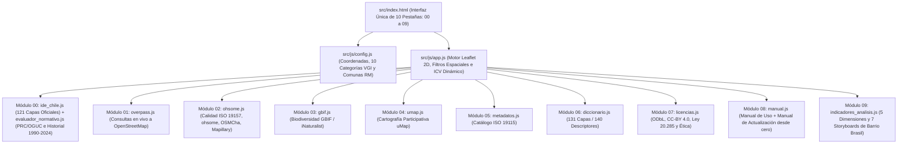

# 🏗️ Arquitectura Técnica del Atlas de Información Geográfica Voluntaria (Atlas VGI — UAH)

**Proyecto Fondecyt Regular N° 1261256 · Departamento de Geografía · Universidad Alberto Hurtado (2026)**

---

## 1. Filosofía de Diseño: Simple de mantener, rápido de usar

El Atlas está diseñado bajo una premisa muy práctica: **evitar la dependencia de servidores complejos o bases de datos pagadas que dejan de funcionar cuando termina un proyecto académico**. Toda la plataforma corre directamente en el navegador del usuario sobre una arquitectura estática moderna (**HTML5 + CSS3 + Vanilla JavaScript ES6+**), alojada gratuitamente en **Netlify** y **GitHub**.

---

## 2. Estructura de Datos: 131 Capas Operativas y Base Dual (`.geojson` + `.gpkg`)

El repositorio integra un inventario auditado de **131 capas geográficas** en el sistema de referencia oficial **`EPSG:4326` (WGS84 / SIRGAS-Chile)**:

1. **121 Capas Oficiales del Estado de Chile (`src/js/modulos/ide_chile.js`)**:
   - **23 capas base institucionales**: Censo 2024 (INE), Planes Reguladores Comunales (PRC MINVU), Plan Regulador Metropolitano (PRMS), Zonas e Inmuebles de Conservación Histórica, Monumentos Nacionales (CMN), Red Vial MOP, Red Metro, Paraderos DTPM, Ciclovías, Semáforos UOCT, Ferias Libres, Establecimientos de Salud (DEIS/MINSAL), Educación (MINEDUC), Riesgos y Fallas Geológicas (SERNAGEOMIN), Humedales Urbanos (MMA), entre otros.
   - **98 capas de la Geodatabase Territorial (`bbdd_01` a `bbdd_98`)**: Incluye indicadores sociodemográficos, socioeconómicos (RSH / BiDat MDSF), unidades vecinales, cités, avalúos SII, islas de calor, arbolado urbano y las **13 capas del Catastro Nacional de Residuos Sólidos Domiciliarios (SUBDERE 2024, `bbdd_86` a `bbdd_98`)**.
2. **10 Categorías Colaborativas VGI (`src/js/config.js`)**:
   - Datos levantados por la comunidad de **OpenStreetMap (OSM)** y **GBIF / iNaturalist**: `cat01_movilidad`, `cat02_vivienda`, `cat03_comercio`, `cat04_areas_verdes`, `cat05_seguridad`, `cat06_educacion`, `cat07_patrimonio`, `cat08_biodiversidad`, `cat09_cuidados` y `cat10_percepcion`.
3. **140 Descriptores Técnicos en el Diccionario de Datos (`src/js/modulos/diccionario.js`)**:
   - Documenta las 131 capas geográficas más 9 tablas de referencia complementarias.
   - Conserva en `data/` y `src/data/` tanto los archivos `.geojson` (para renderizado web instantáneo) como las geodatabases originales `.gpkg` de SUBDERE RSD 2024 que almacenan los comentarios técnicos nativos de cada columna.

---

## 3. Flujo de Módulos (`00` al `09`)

---

## 4. Sincronización de Directorios (`data/` $\leftrightarrow$ `src/data/`)

Dado que `netlify.toml` define `publish = "src"`, todo archivo incorporado en `data/` o `docs/` se mantiene espejado en `src/data/` y `src/docs/`. Los scripts en `scripts/` validan automáticamente esta paridad antes de cada despliegue. Para instrucciones detalladas de modificación paso a paso, consulta **`MANUAL_ACTUALIZACION_ATLAS.md`**.
