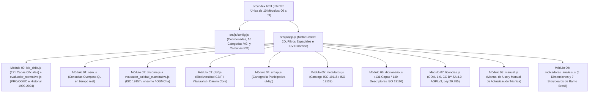

# Arquitectura Técnica del Atlas de Información Geográfica Voluntaria (Atlas VGI · UAH)

**Proyecto Fondecyt Regular N° 1261256 · Departamento de Geografía · Universidad Alberto Hurtado (2026)**

---

## 🧭 Índice de Contenidos

1. [Principios de Diseño e Ingeniería](#1-principios-de-diseño-e-ingeniería)
2. [Estructura de Datos: 131 Coberturas Operativas y Base Dual (.geojson + .gpkg)](#2-estructura-de-datos-131-coberturas-operativas-y-base-dual-geojson--gpkg)
3. [Diagrama de Flujo Modular (00 al 09)](#3-diagrama-de-flujo-modular-00-al-09)
4. [Sincronización de Directorios (data/ y src/data/)](#4-sincronización-de-directorios-data--srcdata)

---

## 1. Principios de Diseño e Ingeniería

El **Atlas de Información Geográfica Voluntaria (Atlas VGI)** se fundamenta en una arquitectura estática autónoma (**HTML5 + CSS3 + Vanilla JavaScript ES6+**) diseñada para garantizar la sostenibilidad operativa de costo cero y la transferencia institucional sin dependencia de servidores propietarios ni motores de bases de datos de pago. El procesamiento espacial, la reproyección geodésica (`EPSG:32719`, Snyder, 1987) y el consumo de servicios abiertos (**Overpass API**, **ohsome API**, **GBIF API**) se ejecutan en el navegador del cliente sobre infraestructura estática distribuida (**Netlify** y **GitHub Pages**).

---

## 2. Estructura de Datos: 131 Coberturas Operativas y Base Dual (`.geojson` + `.gpkg`)

El repositorio integra un inventario auditado de **131 capas geográficas** normalizadas bajo el sistema de referencia **`EPSG:4326` (WGS84 / SIRGAS-Chile)**:

1. **121 Capas Oficiales del Estado de Chile (`src/js/modulos/ide_chile.js`)**:
   - **23 coberturas institucionales base**: Censo 2024 (INE), Planes Reguladores Comunales (PRC MINVU), Plan Regulador Metropolitano de Santiago (PRMS), Zonas e Inmuebles de Conservación Histórica, Monumentos Nacionales (CMN), Red Vial MOP, Red Metro, Paraderos DTPM, Ciclovías, Cruces Semaforizados UOCT, Ferias Libres, Establecimientos de Salud (DEIS/MINSAL), Educación (MINEDUC), Peligros Geológicos (SERNAGEOMIN) y Humedales Urbanos (MMA).
   - **98 coberturas de la Geodatabase Territorial (`bbdd_01` a `bbdd_98`)**: Indicadores sociodemográficos, socioeconómicos (RSH / BiDat MDSF), unidades vecinales, cités patrimoniales, avalúos fiscales SII, islas de calor, arbolado urbano y las **13 capas del Catastro Nacional de Residuos Sólidos Domiciliarios (SUBDERE 2024, `bbdd_86` a `bbdd_98`)**.
2. **10 Categorías Colaborativas VGI (`src/js/config.js`)**:
   - Registros comunitarios de **OpenStreetMap (OSM)** y **GBIF / iNaturalist**: `cat01_movilidad`, `cat02_vivienda`, `cat03_comercio`, `cat04_areas_verdes`, `cat05_seguridad`, `cat06_educacion`, `cat07_patrimonio`, `cat08_biodiversidad`, `cat09_cuidados` y `cat10_percepcion`.
3. **140 Descriptores Técnicos en el Diccionario de Datos (`src/js/modulos/diccionario.js`)**:
   - Documenta las 131 capas geográficas más 9 tablas de referencia conforme al estándar **ISO 19110:2016**.
   - Conserva simétricamente en `data/` y `src/data/` tanto los archivos `.geojson` (para renderizado web) como las geodatabases originales `.gpkg` del catastro SUBDERE RSD 2024 que almacenan los descriptores técnicos nativos por columna.

---

## 3. Diagrama de Flujo Modular (00 al 09)

---

## 4. Sincronización de Directorios (`data/` $\leftrightarrow$ `src/data/`)

Dado que `netlify.toml` define `publish = "src"`, todo archivo incorporado en `data/` o `docs/` se replica de forma idéntica en `src/data/` y `src/docs/`. Los scripts alojados en `scripts/` auditan automáticamente esta paridad antes de cada despliegue en producción, según se detalla en [`MANUAL_ACTUALIZACION_ATLAS.md`](MANUAL_ACTUALIZACION_ATLAS.md).
